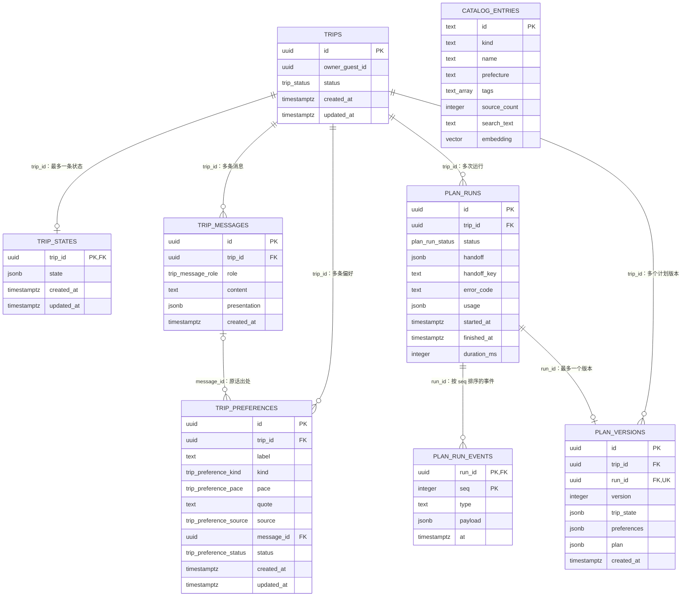

# Meri 数据库结构与关系目录

> 核对日期：2026-10-01；计划运行三张表 2026-11-15；目录表 catalog_entries 2026-11-25（本机 Postgres 18 已执行 0014 并导入）。根据当前 Drizzle schema、repository 和迁移文件整理，供 AI 定位代码及向用户讲解。本文记录仓库定义，不代表已检查某个在线数据库的实际表或迁移执行状态；本次没有连接数据库或执行迁移。

阅读顺序：数据库代码目录 → 表关系 → 字段字典 → JSONB 内容 → 操作与代码映射 → 迁移历史。总体分层见 [ARCHITECTURE.md](ARCHITECTURE.md)，完整业务与失败边界见 [USER_FLOW_CURRENT.md](USER_FLOW_CURRENT.md)。

## 1. 数据库相关代码目录

所有路径相对仓库根目录。

| 目录/文件 | 职责 | 与其他部分的关系 |
| --- | --- | --- |
| [drizzle.config.ts](../drizzle.config.ts) | Drizzle Kit 配置：schema 来源、SQL 输出目录及连接配置 | 读取 `DATABASE_URL`；管理生成/执行迁移 |
| [database/db.ts](../src/platform/persistence/database/db.ts) | 按 host 创建 Drizzle 客户端：localhost 用 node-postgres，其余用 Neon HTTP | 将当前 schema 装配到 `db`，供生产 repository 使用 |
| [database/schema/index.ts](../src/platform/persistence/database/schema/index.ts) | 导出当前全部表 | 供数据库客户端和 schema 工具加载 |
| [database/schema/trips.ts](../src/platform/persistence/database/schema/trips.ts) | Trip 根表及 status enum | 状态和消息通过外键指向它 |
| [database/schema/trip-states.ts](../src/platform/persistence/database/schema/trip-states.ts) | 权威状态 JSONB 表 | 一个 Trip 最多一条状态记录 |
| [database/schema/trip-messages.ts](../src/platform/persistence/database/schema/trip-messages.ts) | 消息及 presentation 表、role enum | 一个 Trip 可以有多条消息 |
| [database/schema/trip-preferences.ts](../src/platform/persistence/database/schema/trip-preferences.ts) | 旅程偏好表、kind/source/status 三个 enum、(trip_id, status) 索引 | 一个 Trip 可以有多条偏好 |
| [database/schema/catalog-entries.ts](../src/platform/persistence/database/schema/catalog-entries.ts) | Meri 目录表 catalog_entries（RAG 第 1 步） | 独立表，和旅程表没有外键；由 `scripts/import-catalog.ts` 写入；`CATALOG_ENABLED=true` 时 Generate plan 的调研和吃什么按（省，州/市）只读它（RAG 第 2 步，[catalog-source](../src/platform/catalog/catalog-source.ts)） |
| [database/schema/plan-runs.ts](../src/platform/persistence/database/schema/plan-runs.ts) | 计划运行、运行事件、计划版本三张表及 plan_run_status enum（1.2010） | 一个 Trip 可以有多次运行和多个版本；一次运行最多一个版本 |
| `src/platform/persistence/*.ts` | repository 接口和 JourneySummary 读模型 | 应用服务依赖的存储能力契约，不是 SQL 本身 |
| `src/platform/persistence/postgres/` | 生产查询、写入、数据映射、CAS 和错误包装 | 通过 Drizzle 操作七张表 |
| `src/platform/persistence/in-memory/` | 测试用内存实现 | 替代数据库做规则/状态测试，不是生产存储 |
| `drizzle/*.sql` | 历史迁移序列 | 将数据库逐步演进到当前 schema |
| [drizzle/meta/_journal.json](../drizzle/meta/_journal.json) 与 `*_snapshot.json` | 迁移顺序与历史结构快照 | 工具元数据，不是当前用户数据 |

## 2. 表之间的关系



| 关系 | 约束 | 业务含义 |
| --- | --- | --- |
| `trip_states.trip_id → trips.id` | 主键同时为外键；`ON DELETE CASCADE` | 每条状态必须属于已有 Trip，且同一个 Trip 最多一条状态 |
| `trip_messages.trip_id → trips.id` | 非空外键；`ON DELETE CASCADE` | 每条消息属于一个 Trip，同一个 Trip 可有多条消息 |
| `trip_preferences.trip_id → trips.id` | 非空外键；`ON DELETE CASCADE` | 每条偏好属于一个 Trip，删除 Journey 时一起删除 |
| `trip_preferences.message_id → trip_messages.id` | 可空外键；`ON DELETE SET NULL` | 来自对话的偏好指向原话所在的用户消息；计划页添加的为空 |
| `plan_runs.trip_id → trips.id` | 非空外键；`ON DELETE CASCADE` | 每次 Generate plan 运行属于一个 Trip |
| `plan_run_events.run_id → plan_runs.id` | 主键 (run_id, seq) 的一部分；`ON DELETE CASCADE` | 一次运行的进度事件，seq 从 1 递增 |
| `plan_versions.trip_id → trips.id` | 非空外键；`ON DELETE CASCADE`；`unique(trip_id, version)` | 旅程的计划按版本号递增 |
| `plan_versions.run_id → plan_runs.id` | 非空、唯一外键；`ON DELETE CASCADE` | 一次成功的运行保存一个版本；失败或中断的运行没有版本 |
| `trips.owner_guest_id → 访客 cookie` | 普通非空 UUID 列，没有 guest/user 表外键 | 所有权由应用按 cookie 中的 guest ID 检查；当前没有账户关系表 |

图中 Trip 到状态是“1 对 0..1”：业务要求完整 Journey 有状态，但外键不能强制父表必须有子记录，创建中间步骤或异常可能留下缺状态 Trip。Workspace 单独处理状态缺失，列表查询使用 inner join，只列有状态的 Trip。

删除整个 Journey 时删除 Trip，数据库级联清理它的状态、消息、偏好、计划运行（连同事件）和计划版本。删除省/市/spot 则只更新 `trip_states.state` 的 JSON，属于领域规则，不是删除数据库子表。

## 3. 表与字段字典

以下为当前 schema 约束。`timestamptz` 表示带时区时间戳，Drizzle 使用 `mode: "string"` 返回时间字符串。schema 没有为这些 ID 和时间字段声明数据库默认值，当前写入由应用提供。

### 3.1 `trips`：身份与生命周期

| 数据库列 | TypeScript 属性 | 类型 | 约束 | 用途 |
| --- | --- | --- | --- | --- |
| `id` | `id` | uuid | 主键、非空 | Journey 稳定身份，状态/消息的引用目标 |
| `owner_guest_id` | `ownerGuestId` | uuid | 非空 | 当前访客归属，用于 owner-scoped 查询和删除 |
| `status` | `status` | `trip_status` enum | 非空 | 允许 `idea`、`planning`；新建默认为应用设置的 idea |
| `created_at` | `createdAt` | timestamptz | 非空 | 根身份创建时间 |
| `updated_at` | `updatedAt` | timestamptz | 非空 | 根记录更新时间；不是每次状态修改的唯一时间来源 |

Trip 不再保存 name、origin、destination 或日期列，避免与 TripState 出现两份可变事实。

### 3.2 `trip_states`：权威旅程状态

| 数据库列 | TypeScript 属性 | 类型 | 约束 | 用途 |
| --- | --- | --- | --- | --- |
| `trip_id` | `tripId` | uuid | 主键、非空、外键→trips.id | 一条状态对应一个 Trip |
| `state` | `state` | jsonb | 非空 | 完整 TripState，包含当前字段与目的地层级 |
| `created_at` | `createdAt` | timestamptz | 非空 | 状态记录创建时间 |
| `updated_at` | `updatedAt` | timestamptz | 非空 | 状态更新时由 repository 写入 |

`$type<TripState>()` 提供 TypeScript 类型，不是数据库内的 JSON Schema 约束；实际合法性由领域校验器验证。每次保存是整份状态 JSONB 替换，应用先对最新状态应用 patch，生产写入使用 CAS 防止丢失并发修改。

### 3.3 `trip_messages`：真实会话与卡片

| 数据库列 | TypeScript 属性 | 类型 | 约束 | 用途 |
| --- | --- | --- | --- | --- |
| `id` | `id` | uuid | 主键、非空 | 消息身份；部分助手确认使用稳定 UUID 支持重试 |
| `trip_id` | `tripId` | uuid | 非空、外键→trips.id | 所属 Journey |
| `role` | `role` | `trip_message_role` enum | 非空 | `user` 或 `assistant` |
| `content` | `content` | text | 非空 | 保存的真实正文；空正文由应用校验拒绝 |
| `presentation` | `presentation` | jsonb | 可为空 | 助手附带的受限卡片数据；无卡写 SQL NULL |
| `created_at` | `createdAt` | timestamptz | 非空 | 消息排序及 UI 时间显示 |

当前 presentation 包括 `destination_choices`、`destination_recommendations`、`destination_recommendations_pending`（`{type, scope: "within" | "elsewhere"}`，表示这条回复的推荐卡片随后作为下一条消息生成），并兼容历史 `location_candidates`。应用只允许助手携带 presentation；数据库列本身没有按 role 限制 JSON 的 CHECK。待选卡保存后可恢复，但不代表其地点已经进入 TripState。

### 3.4 `trip_preferences`：旅程偏好（1.2007）

| 数据库列 | TypeScript 属性 | 类型 | 约束 | 用途 |
| --- | --- | --- | --- | --- |
| `id` | `id` | uuid | 主键、非空 | 偏好身份 |
| `trip_id` | `tripId` | uuid | 非空、外键→trips.id，级联删除 | 所属 Journey |
| `label` | `label` | text | 非空 | 给用户看的短标签（例如「喜欢自然景观」），模型生成，应用限 24 字 |
| `kind` | `kind` | `trip_preference_kind` enum | 非空 | `pace`/`walking`/`companions`/`budget`/`diet`/`interests`/`avoid`/`other`；不显示，代码据此定规则（体力、同行人 → 每天最多 3 个景点） |
| `pace` | `pace` | `trip_preference_pace` enum | 可空；CHECK：只有 `kind = 'pace'` 时可以有值 | 1.2017：节奏偏好的方向，不显示。`packed`（想多看、能接受紧凑）或 `relaxed`（想轻松、少安排）；方向不明（「早上别太早」）和其他类型为空。提取偏好、计划页手写和回答提问时由模型判断一次；代码据此定规则（packed 且每城都排得下 → 不问是否放弃城市；relaxed → 每天最多 3 个景点）。之前的行都为空 |
| `quote` | `quote` | text | 非空 | 用户原话，交给规划模型的是这一句；来自对话的由应用逐字核对，应用限 160 字 |
| `source` | `source` | `trip_preference_source` enum | 非空 | `conversation`（交接时从对话提取）、`plan_page`（计划页添加）、`question`（生成中提问的回答，预留） |
| `message_id` | `messageId` | uuid | 可空、外键→trip_messages.id，删除时置空 | 原话出处 |
| `status` | `status` | `trip_preference_status` enum | 非空、默认 `active` | `active` 或 `removed`；用户删除只改状态，防止下次交接时被重新提取 |
| `created_at` | `createdAt` | timestamptz | 非空 | 来自对话的为原消息时间，计划页添加的为添加时间；排序用 |
| `updated_at` | `updatedAt` | timestamptz | 非空 | 最后修改时间（删除时更新） |

索引 `trip_preferences_trip_status_idx (trip_id, status)`：计划页按旅程读取有效偏好。约束 `trip_preferences_pace_kind_check`：`pace IS NULL OR kind = 'pace'`。每个旅程最多 30 条有效偏好，由应用限制。

### 3.5 计划运行三张表（1.2010）

`plan_runs`：每次 Generate plan 一行。

| 数据库列 | TypeScript 属性 | 类型 | 约束 | 用途 |
| --- | --- | --- | --- | --- |
| `id` | `id` | uuid | 主键 | 运行身份，同时是 Mastra 工作流的 runId |
| `trip_id` | `tripId` | uuid | 非空、外键→trips.id，级联删除 | 所属 Journey |
| `status` | `status` | `plan_run_status` enum | 非空 | `running`、`suspended`（1.2011：等用户回答，Mastra 快照在 `mastra` schema）、`succeeded`、`failed`、`interrupted`（服务器重启时还在运行，被第一个来看的页面标记） |
| `handoff` | `handoff` | jsonb | 非空 | 本次运行收到的交接快照（TripState、偏好、参考日期、语言）；读取时按 PlanHandoff 校验 |
| `handoff_key` | `handoffKey` | text | 非空 | 交接快照按键排序后的 SHA-256；同一份交接复用已有运行或已保存的计划 |
| `error_code` | `errorCode` | text | 可空 | `planner_unavailable`、`time_limit`、`internal_error`、`interrupted`，第 2 步起还有 `daily_quota`（Kimi 当天的钱用完）和 `paid_calls_paused`（总开关关闭）；不存提供方的错误原文 |
| `usage` | `usage` | jsonb | 可空 | `{inputTokens, outputTokens, searches, mapLookups}`；模型 token 含调研、路线、选点和验证（1.2014 起计入调研；之前的行只算后三者）；`mapLookups` 1.2102 起也含驾车路线查询 |
| `started_at` / `finished_at` | `startedAt` / `finishedAt` | timestamptz | 开始非空，结束可空 | 起止时间 |
| `duration_ms` | `durationMs` | integer | 可空 | 用时 |

索引 `plan_runs_trip_started_idx (trip_id, started_at)`：找旅程最近一次运行。

`plan_run_events`：一次运行的进度事件，主键 `(run_id, seq)`；`type` 是事件类型，`payload` 是完整事件（读取时按 [plan-progress](../src/domain/plan/plan-progress.ts) 校验），`at` 是服务器时间。运行中的事件先推给页面，再按顺序写入这里；页面断线重连或运行结束后再来，从这里补读。

`plan_versions.plan` 的 JSON 自 1.2013 起：景点卡可带 `availability`（营业时间、每周闭馆日、关闭日期范围、预约、模糊通知，每条带出处），草稿可带 `checks`（每站的核实结果、预约、从哪天换来），冲突多一种 `closed_on_day`。旧版本没有这些字段，照样能读。1.2117 起景点卡还可带 `outdoor`（调研模型判断是否户外，可为 null）和 `weather`（`forecast`：查询点来源 spot/city、海拔、每天的天气代码、最高最低气温、降水、降水概率、降雪、阵风，以及超出预报范围的日期；或 `beyond_range`；或 `unavailable`），没有日期的行程不带；旧版本没有，照样能读。草稿还可带 `outfits`（1.2117 穿衣：每天的日期、最冷和最暖及地点、基础款及结构化理由、Kimi 补充的物品（名字、部位、理由）、一句提示、是否温差大），没有预报的天不带。草稿还可带 `stays`（1.2117 住宿：每座城的城市、入住日期、晚数、在哪附近查；找到时三档酒店（名字、地址、坐标、星级、距离、每晚参考价、图片、标签设施）和详情，以及可选的 Meri 推荐和理由；或「附近没有」「查不到」），不存预订链接。草稿还可带 `food`（1.2117 吃什么：每座城的特色菜（名字、介绍、出处）、地图上核实的餐厅（招牌、两个以上出处、地址、坐标、距离）和只在文章里的餐厅（出处，没有地址），或「没有」「查不到」）。

RAG 第 2 步（2026-11-25）起景点卡可带 `catalog`（`{ id, summary, highlights }`：目录 id、Meri 的介绍、亮点），这种卡没有网页引文（`location` 为 null），不算「位置待核实」；`draft.food` 的特色菜 `evidence` 可为 null，表示来自目录。旧版本没有这些，照样能读。

`plan_versions`：生成好的计划。`version` 按旅程从 1 递增（`unique(trip_id, version)`），`run_id` 唯一；`trip_state` 和 `preferences` 是生成时依据的 TripState 和偏好，`plan` 是页面显示的完整计划（草稿、用到的景点卡、各城调研状态、待定省份、每天照片、天地图核实状态）。三个 JSONB 列读取时都会校验。计划不写回 TripState；是否过期在读取时把 `trip_state` 和当前 TripState 按键排序后比较。1.2107 起计划页补填出发地时，`trip_state` 和 `plan` 会就地更新（版本号不变），对应运行的 `handoff`/`handoff_key` 也换成新的交接；`plan` 可带 `travelChoice`（drive/train/flight/auto）；1.2108 起 `draft.transfers` 的每段可带 `trains`（查询日期、是否参考车次、查询时间、最多 3 趟车）和 `recommendation`（火车或开车、车次、理由、由 Agent 还是代码决定）；1.2110 起车次可带 `change`（中转城市、等车分钟、是否同站、两趟直达车），中转行程的车次写成「G201/Y767」；1.2111 起每段可带 `flights`（查询日期、查询时间、最多 3 个航班：航班号、机场、时刻、历时、舱位、票价、剩余座位、机建燃油、经停、代码共享）和 `flightsMissing`，`recommendation.mode` 可为 `flight` 并带 `flightNo`。1.2113 起航班可带 `change`（中转城市、等待分钟、是否同机场、两段航班），转机航班号写成「MU9181/MU5780」，票价是两段相加。1.2114 起每段可带 `airRail`（飞机转火车：中转城市、航班、火车、等待、总时长、两段票价之和），`recommendation.mode` 可为 `air_rail` 并带 `airRailCode`；1.2115 起 `recommendation.by` 可为 `traveller`。

### 3.6 `mastra` schema：Mastra 的工作流快照（1.2011，不归 Drizzle 管）

`mastra.mastra_workflow_snapshot` 由 `@mastra/pg`（1.29.0）的 `WorkflowsPG` 在第一次连库时自己创建并维护，不在 Drizzle schema 和迁移里，所以 `npm run db:migrate` 不会建它，新库上应用一启动就会自动建好。它只装 Mastra 的工作流状态，Meri 的业务数据都不在这里。

| 列 | 类型 | 用途 |
| --- | --- | --- |
| `workflow_name` | text | 工作流 ID（`plan-generation`） |
| `run_id` | text | 运行 ID，等于 `plan_runs.id`（没有外键，删除 Journey 不会级联删除快照） |
| `resourceId` | text，可空 | Meri 不用 |
| `snapshot` | jsonb | 运行状态、每个已完成步骤的输出、workflow state、暂停的步骤和给用户的问题 |
| `createdAt` / `updatedAt`（及带时区的 `createdAtZ` / `updatedAtZ`） | timestamp | 创建与最后更新时间 |

唯一约束 `(workflow_name, run_id)`；写入是 `INSERT … ON CONFLICT (workflow_name, run_id) DO UPDATE`，每个运行一行、状态变化时覆盖。实测一个暂停在路线前的三城运行约 23 KB。恢复时 Mastra 按 run_id 读回这一行。没有设清理策略，快照会随运行累积，以后需要时再按 `updatedAtZ` 清理。

### 3.7 `catalog_entries`：Meri 的目录（RAG 第 1 步，2026-11-25）

目录来自私有仓库 meri-catalog-cn（127 个城市 NDJSON 文件，从攻略 PDF 提取的事实，不含原文）。数据和原文都不进本仓库，只有表结构和导入脚本在这里。表和旅程表没有外键；一行就是目录的一条记录，主键用目录自己的 id。`historical`（旧价格、开放时间、交通）和 `source_refs`（攻略文档与页码）只存不展示。

| 列 | 类型 | 约束 | 用途 |
| --- | --- | --- | --- |
| `id` | text | 主键 | 目录 id，如 `spot_dali_erhai` |
| `kind` | text | 非空，CHECK ∈ spot/dish/restaurant/stay/transport/tip | 种类 |
| `name` | text | 非空，pg_trgm GIN 索引 | 名称 |
| `aliases` | text[] | 非空 | 别名 |
| `aliases_text` | text | 非空，pg_trgm GIN 索引 | 别名用空格连起来（代码拼）；pg_trgm 不能给数组建索引 |
| `province` / `prefecture` | text | 非空；(prefecture, kind) 索引 | 省、州/市（全称，如「大理白族自治州」） |
| `county` | text | 可空 | 区县 |
| `summary` | text | 非空 | Meri 自己写的一两句介绍 |
| `tags` | text[] | 非空 | 固定标签（[归并表](../src/domain/catalog/catalog-tags.ts)：景点 23 个；其他种类就是种类本身） |
| `tags_raw` | text[] | 非空 | 目录原来的自由标签，改归并表时可以重算 |
| `details` | jsonb | 非空 | 按种类：景点 highlights/suggested_hours/best_season/visit_note/walking；菜 ingredients/flavor/preparations；餐馆 cuisine/signature_dishes/branch/address；住宿 stay_type/area/features/branch/address；交通 from/to/modes；提示 applies_in/advice |
| `related` | jsonb | 非空 | `[{ id, relation }]`，指向别的条目（nearby、applies_to 等） |
| `historical` | jsonb | 可空 | 旧的 price_note/hours_note/access_note/duration_note，**永不展示** |
| `source_refs` | jsonb | 非空 | `[{ document_id, pdf_pages, guide_year }]`，**永不展示** |
| `confidence` | text | 非空，CHECK ∈ high/medium/low | 提取时的把握 |
| `source_count` | integer | 非空 | `source_refs` 的份数（几本攻略提到） |
| `search_text` | text | 非空 | 名称、别名、种类、固定标签、摘要、景点亮点，由代码拼；第 3 步拿它做向量 |
| `embedding` | vector(1024) | 可空；HNSW 索引（`vector_cosine_ops`） | `search_text` 的向量（百炼 qwen3.7-text-embedding，1024 维，RAG 第 3 步），由 [embed-catalog](../scripts/embed-catalog.ts) 补空的；导入时 search_text 变了就清空 |
| `catalog_version` | text | 非空 | 导入时私有仓库的 git 提交号，`data/` 有未提交改动时加 `-dirty` |
| `imported_at` | timestamptz | 非空 | 本次导入时间 |

导入（[scripts/import-catalog.ts](../scripts/import-catalog.ts)）先校验全部行：zod 严格 schema、文件名的省市与记录一致、标签都在归并表里、id 不重复，有一处问题就一行不写；然后在一个事务里按 id `INSERT … ON CONFLICT DO UPDATE`，再删除目录里已经没有的 id，所以可以重复执行。不读 `identity_check` 和 `schema_version`（后者校验时固定为 1）。填向量（[scripts/embed-catalog.ts](../scripts/embed-catalog.ts)）：只给 `embedding` 为空的行算，每次请求 20 条，写回时再核对 `search_text` 没变；可重复执行，`--dry-run` 只报行数、字数和请求数。2026-11-26 首次填满 2284 条（115 次请求，58 秒）。调研排候选时（`CATALOG_ENABLED=true`、有偏好）同时查两路：同城景点按余弦距离取前 50，名字或别名用 `word_similarity(name, 偏好原话) ≥ 0.5` 取前 20。

2026-11-25 首次导入：提交 4ac288c，2284 条（spot 1349、dish 316、restaurant 157、stay 254、transport 118、tip 90），127 个州/市。

### 3.8 索引与约束范围

各表主键提供唯一性及对应索引；除 trip_preferences 的 (trip_id, status)、plan_runs 的 (trip_id, started_at) 和 catalog_entries 的四个索引外，当前 schema 未声明额外的 owner、消息时间或 JSONB 查询索引。外键保证归属对象存在，不代替 owner 授权，也不会自动为外键列建立额外索引。这里只记录现状，不提前增加索引或新表。

## 4. JSONB 内部结构

### 4.1 `trip_states.state`

| JSON 字段 | 内容 | 与其他数据的关系 |
| --- | --- | --- |
| `name` | 当前名称及 certainty/source | 列表/Workspace 标题从这里派生 |
| `origin` | 出发地，known 时可带已选输入建议身份/坐标 | 不等于目的地层级 |
| `destination` | missing 或 known；known 保存 areas，可带 legacyText | 当前已选省/市/spot 的权威来源 |
| `startDate`、`endDate` | 精确日期 `YYYY-MM-DD`，或近似/歧义原话 | 日期保存在 JSON 字段，不是 Trip 的 SQL date 列 |
| `duration` | 已知/近似时长；精确值写作 `N天` | 与日期分别保存；数据库不推算，应用在 applyTripStatePatch 中按“任意两项定第三项”补算（见 USER_FLOW_CURRENT 5.1） |
| `transportPreference` | 火车/飞机/自驾/灵活（2026-11-22 起；旧值 public_transport、no_self_drive 读取时换成 train、flexible，不改写数据库），或不确定表达 | known 值由领域交通枚举约束 |

普通字段非 missing 时含 state/value/source，missing 只有 `{ "state": "missing" }`。目的地没有独立 value 文本副本。以下为完整的结构示例，不是在线记录：

```json
{
  "name": { "state": "known", "value": "云南徒步", "source": "user" },
  "origin": { "state": "missing" },
  "destination": {
    "state": "known",
    "source": "user",
    "areas": [
      {
        "province": "云南省",
        "places": [
          { "name": "迪庆藏族自治州", "spots": ["梅里雪山"] }
        ]
      }
    ]
  },
  "startDate": { "state": "missing" },
  "endDate": { "state": "missing" },
  "duration": { "state": "missing" },
  "transportPreference": { "state": "missing" }
}
```

省、市和 spot 是 JSON 内的嵌套值，没有独立表、数据库外键或保存的精确 POI 坐标。spot 是用户想去的名称；同名具体位置需要以后规划再核验。删除市同时去掉其 spots，保留省；这由 [destination-areas.ts](../src/domain/trip-state/destination-areas.ts) 执行。

### 4.2 `trip_messages.presentation`

当前 choices 保存 mode、choice IDs、省/市/spot、理由/细节；replace 还保存出卡时目的地的 `baseDestination` 字符串，用于检查提交期间目的地是否变化。它不是另一张表的外键或状态版本列。

地点候选卡（`location_candidates`）和起点选择（TripState `origin.selection`）里的坐标带 `coordinateSystem`：高德为 `GCJ-02`，天地图为 `CGCS2000`；起点选择的 `provider` 为 `amap` 或 `tianditu`，坐标系必须和提供方一致。1.0500 之前的数据都是高德和 `GCJ-02`，照常读取。

推荐卡与地点候选卡的每个地点可带可选的 `image: {url, caption, credit?}`（`credit` 是照片要求的署名，≤120 字，Pixabay 照片为 `Photo: <作者> / Pixabay`，Wikimedia Commons 照片为 `Photo: <作者> / Wikimedia Commons, <许可证>`，完整署名见 /photo-credits）：只存链接和说明文字，不存图片本身，也不进 TripState。链接是 https 外部地址、本地图集的 `/photos/...`，或运行时下载的 `/media/place-photos/pixabay-<ID>.<jpg|png|webp>`、`/media/place-photos/wikimedia-<ID>.<jpg|png|webp>`（文件在 `MERI_MEDIA_DIR`，不在数据库）。推荐卡的地点还带 `landmark`（配图用的代表地标，≤30 字）和可选的 `landmarkEn`（它的英文名，只含拉丁字母、数字、空格和 `'’.-`，≤60 字，Pixabay 搜图用；1.0624 之前的卡没有）、`landmarkAliases`（同一地标的其他叫法，≤3 个，每个 ≤40 字）、`backupLandmarks`（同地其他常被拍的景点，≤2 个，`{name ≤30 字, en 同 landmarkEn 规则}`）、`photoRules`（回答照片时的照片规则版本，正整数，没有＝1；存成 null 且版本旧、带地标的卡会按新规则再查一次），其 `image` 有三种状态：不存在＝还没查过（Pixabay 这次查不了的卡也保持不存在），对象＝照片，`null`＝查过没有照片；读取时不合法的 image 按 `null` 处理而不是让消息失效。地点候选卡读取时不合法的 image 被去掉，没有 image 的历史卡照常读取。

**消息唯一的更新：**消息插入后内容、角色和时间不再改变；唯一例外是推荐卡的照片——卡片先保存（image 未设置），照片查完后由 `updateAssistantPresentation` 按 `id + trip_id + role = assistant` 整体替换这条消息的 `presentation`（[saveRecommendationPhotos](../src/capabilities/conversation/trip-message-service.ts)先校验它原本就是推荐卡）。两个页面同时补同一条消息时后写覆盖先写，两者内容等价，所以不加条件更新。已选地点的照片不落库，由 `GET /api/trips/[id]/destination-photos` 按当前目的地现查。

pending 标记只保存推荐范围，不保存要推荐什么：卡片请求从同一 Trip 的消息顺序中取 pending 之前的那条用户原话和更早的历史。卡片消息的 `id` 由 tripId 与 pending 消息 ID 派生，`createAssistantIfAbsent` 保证同一 pending 只有一条卡片消息。不需要迁移：`presentation` 本就是 JSONB，新类型只在领域读取边界校验。

选卡请求先取得属于当前 Trip 的持久化消息，检查 choice IDs 和时效，再复核地点；成功后更新状态并保存确认助手消息。消息主键帮助稳定身份的确认去重，但普通聊天/推荐 POST 尚没有全局幂等保证。详细提交及半成功边界见 USER_FLOW_CURRENT 第 4 节。

## 5. 操作与代码关系

| 操作 | 涉及表 | 主要代码 | 一致性/读取方式 |
| --- | --- | --- | --- |
| 创建 Journey | trips → trip_states → 可选 trip_messages | [JourneyService](../src/capabilities/journey/journey-service.ts) | 多步骤保存，后续失败补偿删除根记录，不是一笔跨全过程事务 |
| 读取 Workspace | trips、trip_states、trip_messages | [页面入口](../src/app/trips/%5Bid%5D/page.tsx)、JourneyService、[TripMessageService](../src/capabilities/conversation/trip-message-service.ts) | 先检查根身份归属，再读状态和历史 |
| 更新字段/目的地 | trip_states | [状态 repository](../src/platform/persistence/postgres/postgres-trip-state-repository.ts)、JourneyService | 比较规范化预期与当前状态，再以原始 JSONB 作 UPDATE 条件；最多重试 3 次 |
| 保存完整聊天轮次 | trip_messages | [消息 repository](../src/platform/persistence/postgres/postgres-trip-message-repository.ts) | user/assistant 两行一次 INSERT；与前面的状态更新仍是独立步骤 |
| 保存稳定助手确认 | trip_messages | 同上、[selection message ID](../src/capabilities/conversation/destination-selection-message-id.ts) | `ON CONFLICT(id) DO NOTHING`，读取已保存助手记录并检查所属 Trip/角色 |
| 列表摘要 | trips INNER JOIN trip_states | [摘要 repository](../src/platform/persistence/postgres/postgres-journey-summary-repository.ts) | owner 过滤，按两张表最新更新时间等排序；JourneySummary 不是独立表 |
| 交接时保存偏好 | trip_preferences | [交接 handler](../src/capabilities/planning/planning-handoff-handler.ts)、[偏好 repository](../src/platform/persistence/postgres/postgres-trip-preference-repository.ts) | 删除该旅程有效的对话偏好，再插入新提取的；用户删除过的同一句原话不再插入；两步没有事务（Neon HTTP 驱动不支持），中途失败下次交接重建 |
| 计划页增删偏好 | trip_preferences | [偏好 handler](../src/capabilities/planning/trip-preferences-handler.ts) | 先按 cookie 检查 Trip 归属；新增前查重；删除只把 status 改为 removed |
| 开始 Generate plan | plan_runs、plan_versions | [plan-run-service](../src/capabilities/planning/plan-run-service.ts)、[运行 repository](../src/platform/persistence/postgres/postgres-plan-run-repository.ts) | 先按 handoff_key 找最近运行：有版本直接返回，运行中复用；否则插入 running 行 |
| 运行进度与结束 | plan_run_events、plan_runs | 同上 | 事件按 seq 逐条插入；结束时只更新仍是 running 的行（`WHERE status = 'running'`），防止中断标记和正常结束互相覆盖 |
| 回答问题并恢复运行（1.2011） | plan_runs、trip_preferences、mastra.mastra_workflow_snapshot | plan-run-service 的 `answer` | `UPDATE … SET status = 'running' WHERE status = 'suspended'` 认领，只有一个回答成功；答案存成 `source = question` 的偏好；Mastra 从快照恢复。运行暂停时用同样的条件 UPDATE 改回 `suspended` |
| 计划页补填出发地（1.2107） | trip_states、plan_versions、plan_runs | [getting-there](../src/capabilities/planning/getting-there.ts)、运行 repository 的 `fillPlanFacts` | 先 CAS 写 TripState 的出发地（和没填的交通方式）；再更新最新版本的 `trip_state` 和 `plan`（只重算启程和回程）；最后把这次运行的 `handoff` 和 `handoff_key` 换成与新 TripState 一致的交接，页面刷新仍找到同一份计划。不是一个事务：中途失败时同样的请求再发一次会补完，不会重复写 TripState |
| 保存计划版本 | plan_versions | [plan-generation](../src/agents/workflows/plan-generation.ts) 的 save-plan 步骤 | 先查该旅程最大版本号再插入下一个；唯一约束拒绝并发重复 |
| 导入目录 | catalog_entries | [import-catalog](../scripts/import-catalog.ts)、[校验与拼行](../scripts/import-catalog-read.ts) | 人工执行；全部校验通过后一个事务写入并删除目录已没有的条目；不碰旅程表 |
| 删除 Journey | trips，级联其余六表 | [Trip repository](../src/platform/persistence/postgres/postgres-trip-repository.ts) | DELETE 同时带 Trip ID/owner 条件，依赖外键级联 |

状态和消息 repository 按 tripId 读写，owner 授权主要由上层 Trip/Journey/Message 服务负责。不要因为子表没有 owner 列就跳过根记录授权，也不要把外键当成访客权限检查。

## 6. 迁移历史目录

| 文件 | 结构变化 |
| --- | --- |
| [0000_initial_trips.sql](../drizzle/0000_initial_trips.sql) | 创建原始 trips 与 status enum；当时旅程字段仍在根表 |
| [0001_support_incomplete_trip_ideas.sql](../drizzle/0001_support_incomplete_trip_ideas.sql) | 放宽目的地/日期约束，增加 origin |
| [0002_fearless_mach_iv.sql](../drizzle/0002_fearless_mach_iv.sql) | 创建 JSONB trip_states 与级联外键 |
| [0003_misty_maginty.sql](../drizzle/0003_misty_maginty.sql) | 增加 owner_guest_id，回填旧行 UUID 并设非空 |
| [0004_persist_trip_messages.sql](../drizzle/0004_persist_trip_messages.sql) | 创建消息表、role enum 与级联外键 |
| [0005_remove_legacy_trip_state.sql](../drizzle/0005_remove_legacy_trip_state.sql) | 删除根表重复的旅程字段和旧日期约束 |
| [0006_backfill_default_journey_names.sql](../drizzle/0006_backfill_default_journey_names.sql) | 为满足旧格式条件且缺名的状态回填系统旅程名 |
| [0007_trip_user_actions.sql](../drizzle/0007_trip_user_actions.sql) | 历史上创建独立显式推荐 action 表 |
| [0008_trip_message_presentation.sql](../drizzle/0008_trip_message_presentation.sql) | 消息表增加 presentation JSONB |
| [0009_drop_trip_user_actions.sql](../drizzle/0009_drop_trip_user_actions.sql) | 定义删除旧 action 表，当前 schema 不再包含它 |
| [0010_trip_preferences.sql](../drizzle/0010_trip_preferences.sql) | 创建 trip_preferences 表、三个 enum、两个外键和 (trip_id, status) 索引。0007–0009 是手写迁移、没有快照，drizzle-kit 生成时多出一句已存在的 `trip_messages.presentation`，已手动删掉；0010 快照是当前完整 schema |

| [0011_plan_runs.sql](../drizzle/0011_plan_runs.sql) | 创建 plan_runs、plan_run_events、plan_versions 和 plan_run_status enum，四个级联外键、唯一约束和 (trip_id, started_at) 索引（drizzle-kit 生成，没有多余语句） |
| [0013_trip_preference_pace.sql](../drizzle/0013_trip_preference_pace.sql) | 1.2017：新 enum `trip_preference_pace`（packed、relaxed），`trip_preferences` 加可空列 `pace` 和 CHECK 约束 `trip_preferences_pace_kind_check`；已有行为空，不需补数据 |
| [0012_plan_run_suspended.sql](../drizzle/0012_plan_run_suspended.sql) | `plan_run_status` 加 `suspended`（在 `succeeded` 之前） |
| [0015_catalog_embedding_1024.sql](../drizzle/0015_catalog_embedding_1024.sql) | RAG 第 3 步：`catalog_entries.embedding` 改成 `vector(1024)`（当时全为空，不丢数据），加 HNSW 索引 `catalog_entries_embedding_hnsw_idx`（`vector_cosine_ops`） |
| [0014_catalog_entries.sql](../drizzle/0014_catalog_entries.sql) | RAG 第 1 步：`CREATE EXTENSION IF NOT EXISTS pg_trgm` 和 `vector`（手动加在 drizzle-kit 生成的语句前面，新库也能直接迁移；需要能建扩展的用户），创建 catalog_entries、两个 CHECK、(prefecture, kind) 索引和 name / aliases_text 的 GIN 三元组索引 |

`_journal.json` 记录仓库迁移顺序；历史 snapshots 只覆盖已有快照，不应拿最后一份历史 snapshot 当完整当前 schema。执行状态需针对实际环境另行确认，本文件不授权清库或执行 DROP。

## 7. 后续更新格式

新增或修改表时，同步：**代码目录 → ER 关系图 → 列名/类型/约束/用途 → JSON 形状 → 读写与权限边界 → 迁移目录**。明确关系是数据库约束还是应用规则，列明是否可空、是否有默认值/索引、删除如何级联。

`schema` 是目标结构，SQL 是演进历史，repository 是实际读写行为，领域校验是业务合法性；四者需要对应。同步 [CODEBASE_GUIDE.md](CODEBASE_GUIDE.md) 的文件目录和受影响的详细业务流程，不提前创建未来计划/研究/证据表。
