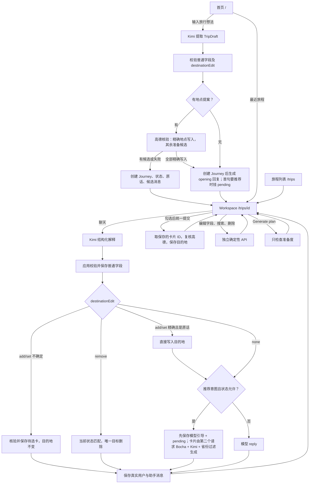
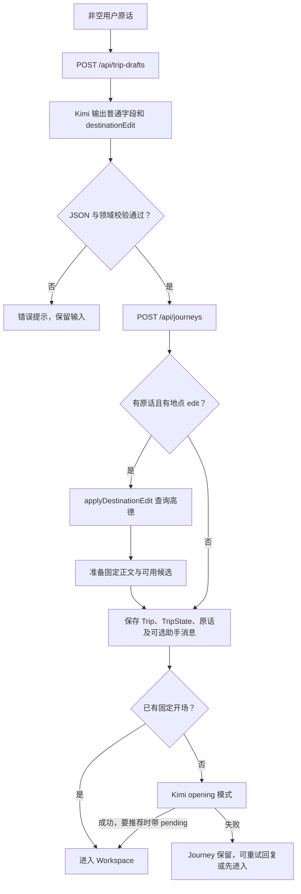
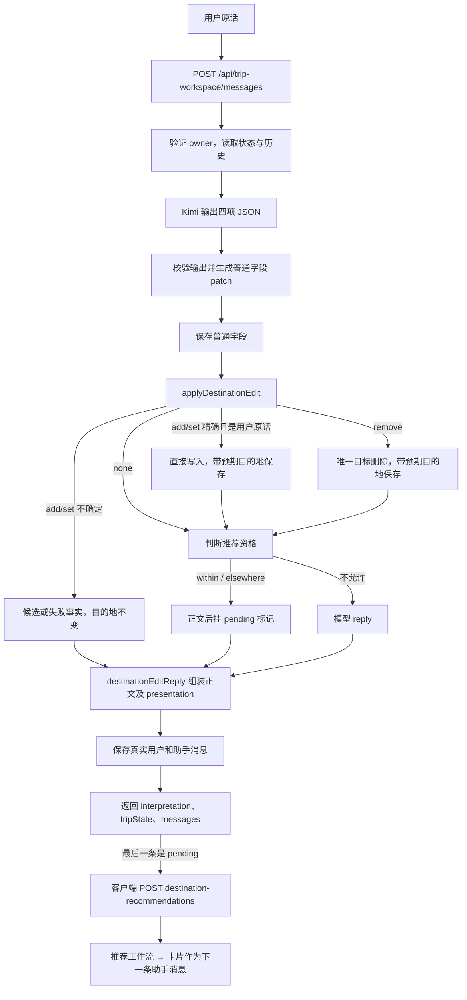

# Meri 当前用户操作流程与回复来源

> 按 2026-10-01 工作区源码核对，包含已落地的 destination 重构和 UI 调整。沿用原有章节、流程图、操作表及代码索引，用于业务追踪与向用户讲解。本文描述实际调用路径；输入示例是按规则推导，未来能力明确标为计划。Home 指 `/`，Workspace 指 `/trips/[id]`，Journey 是持久化旅程。完整目录、分层与逐文件说明见 [CODEBASE_GUIDE.md](CODEBASE_GUIDE.md)。

## 先看全局



**数据权威：**TripState 是当前决定，模型输出是提案，助手卡片是待选项，聊天记录是历史。核验成功不代表用户已经选择；显式提交后的地点才进入正式 destination。删除后不能因为历史里提过就自动恢复。

**谁决定执行什么：**LLM 理解语言并输出受限 JSON；应用校验 JSON、判断可执行分支、调用高德和保存；React 根据受支持的 presentation 渲染。workflow 是我们写的确定性应用流程。Vercel AI SDK 用于模型调用及聊天适配；当前没有 Vercel Workflow 执行器或开放式 Agent 循环。

代码：[TripState](../src/domain/trip-state/trip-state.ts)、[消息模型](../src/domain/trip-message/trip-message.ts)、[聊天 API](../src/app/api/trip-workspace/messages/route.ts)、[AI SDK 客户端](../src/platform/llm/ai-sdk-kimi-client.ts)。

## 1. 用户能从哪里进入

| 入口与操作 | 页面/组件 | 到达结果 |
| --- | --- | --- |
| 首页输入一句旅行想法 | [`/`](../src/app/page.tsx) → [NewTripComposer](../src/components/meri-shell/new-trip-composer.tsx) | 提取草稿，创建 Journey，开场成功后跳转 Workspace |
| 首页点最近旅程 | [RecentJourneys](../src/components/meri-shell/recent-journeys.tsx) | 打开既有 Journey，不重新提取草稿 |
| `/trips` 点旅程卡 | [旅程列表](../src/app/trips/page.tsx) | 打开已有 Workspace |
| Workspace 左侧新旅程 | [TripWorkspace](../src/components/trip-workspace/trip-workspace.tsx) | 返回首页输入入口 |
| `/trips/new` | [重定向](../src/app/trips/new/page.tsx) | 返回首页 |

首页输入框由 [NewTripComposer](../src/components/meri-shell/new-trip-composer.tsx) 管理创建流程，使用独立的 [ChatComposer](../src/components/ui/chat-composer.tsx) 展示输入区和底部工具栏（参考 Astryx ChatComposer 的布局，使用项目现有 CSS Modules、Motion 与 Lucide，并未安装 Astryx）。多行文字输入自动增高，最高 15rem 后内部滚动；Enter 提交，Shift+Enter 换行，中文输入法组合输入期间 Enter 不提交。空白且未聚焦时每 4 秒向上轮换一个旅行示例；聚焦、已有文字、输入被禁用或系统要求减少动态效果时停止轮换，隐藏页不轮换。示例只作提示，不写入输入或旅程状态。附件和麦克风图标按钮当前禁用，名称及悬停提示标明“上传文档 / 语音输入 · 即将支持”；不打开文件选择器、不请求麦克风权限，也没有上传、识别或模拟进度。发送仍走原有草稿提取与旅程创建流程，加载、失败保留输入和开场重试行为不变，新增文案由中英字典提供。

### 1.1 访客身份、列表与刷新

1. 访客 cookie 提供 ownerGuestId；当前是访客所属 Journey，没有账号协作体系。
2. Workspace 加载先验证 Trip 属于访客，再加载 TripState 和保存的消息。
3. 不存在或不属于访客的 Journey 按 404 处理；Trip 存在但状态缺失属于不完整旅程错误。
4. 刷新读取保存的正文和 presentation，不因刷新重跑 Kimi 或重新生成卡片。
5. JourneySummary 是列表读模型，不作为修改或未来规划的事实基底。

代码：[页面加载](../src/app/trips/[id]/page.tsx)、[访客身份](../src/platform/identity/guest-identity.ts)、[JourneyService](../src/capabilities/journey/journey-service.ts)、[消息服务](../src/capabilities/conversation/trip-message-service.ts)、[列表查询](../src/capabilities/journey/my-journeys.ts)。

首页最近旅程最多显示按最近更新排序的 5 个 Journey；没有时隐藏，只有一个时静态显示。多个时使用适配 [Aceternity Carousel](https://ui.aceternity.com/components/carousel) 的居中轨道、两侧透视缩放和鼠标悬停视差，每张卡的背景是这个旅程的封面照片：和 Workspace 标题缩略图同一张，即第一个有照片的已选地点（从卡片选的地点沿用卡片的照片），所以不管地点是点卡片加的、用户说出名字自动加的，还是在右侧栏手动搜索加的，都有照片（[journeyCovers](../src/capabilities/journey/journey-covers.ts)，照片查询见 [place-images](../src/capabilities/destination/place-images.ts)）。照片不存进 TripState 或数据库，每次按当前目的地查；首页最多等 1.5 秒，查过的地点从进程内缓存立即返回，没赶上、没有地点或高德没有照片的卡继续用本地户外插画，下次打开就会有。下方箭头首尾循环，圆点定位；可左右滑动或用左右方向键切换。点击侧卡先居中，点击当前卡（含「打开旅程」）进入 Workspace，拖动不会打开。只有当前卡显示删除菜单；删除确认框在视口中央显示，窄屏留出边距、内容过高时内部滚动，取消或 Esc 关闭（删除请求进行中禁止取消）；删除成功后保留仍存在的当前 Journey，当前 Journey 被删则选第一项，删至一个转为静态卡、删空隐藏；请求失败保留卡片并可重试。系统减少动态效果设置关闭轨道/卡片过渡及悬停视差。

### 1.2 界面语言（中 / EN）

首页右上角、Profile 右边有「中 | EN」切换（[LanguageToggle](../src/components/ui/language-toggle.tsx)）。

1. 点击后浏览器写入 cookie `meri_locale`（`zh` 或 `en`，一年，全站，非 httpOnly——只存语言，不含私密信息），再 `router.refresh()`：服务端用新语言重画当前页面，网址不变（没有 `/en/...` 路由）。
2. 服务端每次渲染读 [requestLocale](../src/platform/locale/request-locale.ts)：有合法 cookie 用它；没有时按浏览器 `Accept-Language`，中文排在英文前面就用中文，其他情况（包括法语、德语、没有该请求头）用英文，因为 Meri 的用户来自各国。
3. 根布局据此设置 `<html lang>`（`zh-CN` / `en`）、页面标题与描述，并用 [LocaleProvider](../src/components/i18n/locale-context.tsx) 把语言交给客户端组件；界面文字都取自 [messages](../src/components/i18n/messages.ts) 的同一份中英字典，英文定结构、中文必须一一对应（缺一句类型检查就失败）。
4. 旅程名、地名、目的地等数据不翻译，按保存时的样子显示。

**当前范围：**按钮只在首页，但所有界面文字都跟随同一个 cookie：首页（1.0029）、旅程页面和「我的旅程」列表（1.0032）——页头、导航、对话框里的提示/状态/错误、旅程概览各字段与编辑器、目的地搜索、地点卡、日历（react-day-picker 的中/英 locale）、Generate plan 说明、小熊的话、聊天时间（昨天/Yesterday）、错误页和页面标题。纯函数（小熊、准备度、日期概括、时间）由调用方传入字典，不自己判断语言。精确天数按语言显示（7天 / 7 days），其余写法（7天6晚、大概一周）原样保留。品牌标语（Explore Further With Meri、Small steps. A wider world.）两种语言都保持英文。旧的 `destination-recommendation-picker.tsx` 不在主链路上，未翻译。**Meri 在代码里写的句子（1.0033）也跟按钮走**：「已加入…」「找到…相关的地点了」「暂时没找到…」、搜索提示、准备度句子、选卡确认（「好，已加入…」）、推荐卡上方的固定句和没推荐出来时的说明，都由 [meri-replies](../src/capabilities/conversation/meri-replies.ts) 按 cookie 取中文或英文，句子之间的连接（中文直接相连、英文加空格）、列表分隔（、/ , ）和引号（「」/ “”）也在那里。代码**不判断**用户写的是什么语言。**模型写的文字（1.0034）也以按钮为准**：聊天回复和开场回复（[workspace-conversation-prompt](../src/capabilities/conversation/prompts/workspace-conversation-prompt.ts)）、推荐卡理由（[destination-recommendation-prompt](../src/capabilities/recommendation/prompts/destination-recommendation-prompt.ts)，中文 ≤30 字、英文 ≤15 词）、首页第一句话提取出的旅程名（[trip-draft-prompt](../src/capabilities/journey/prompts/trip-draft-prompt.ts)）和聊天里改的旅程名，都由路由用 `requestLocale()` 读 cookie 后传进提示词（[reply-language-guidance](../src/capabilities/conversation/prompts/reply-language-guidance.ts) 一处写定措辞）。只有聊天/开场回复跟随用户：提示词让模型只看用户这条消息——是英文句子就用英文回，是中文句子就用中文回；分不清时（只有地名、数字、表情，或中英各半）才用按钮选的语言；句子里夹一个地名或外来词不算换语言，判断全由模型做。推荐理由和旅程名始终用按钮选的语言，因为它们显示在界面里。实测（kimi-k2.6）：旧写法「默认按钮语言，明显另一种语言时才跟随」6 次一次都没跟随，按钮语言把模型锚住了；1.0101 改成先看消息、分不清再用按钮语言后，跨语言用例 4 次跟随 3 次，所以英文固定句后接中文模型回复（或反过来）是可能出现的。英文界面下，大概的日期和时长保持用户的英文原话（a week、early November），精确天数仍存成「7天」并显示为 7 days。**中英提示词分开（1.0100）：**规则只写一份，两种语言共用（一次只问一个问题、不说能否生成计划、天气不给数字、不重复已有字段等）；按语言各写一份的只有示例、地名怎么交给高德和回复语言（[workspace-conversation-locale-rules](../src/capabilities/conversation/prompts/workspace-conversation-locale-rules.ts)，首页草稿的地名规则在 trip-draft-prompt 里）。中文提示词就是调好的原文，[chinese-prompts-lock.test](../src/capabilities/conversation/prompts/chinese-prompts-lock.test.ts) 把中文的聊天、开场、草稿提示词和两份 JSON schema 与快照逐字比较，变一个字测试就失败；返回格式两种语言共用，没有新增字段。地名：中文界面下 `destinationEdit` 里仍是用户打的原样（错别字也不改）。英文界面下模型把英文/拼音地名换成标准中文名再交给高德（Lijiang → 丽江、Jade Dragon Snow Mountain → 玉龙雪山、Yunnan → 云南），因为高德查不到拉丁地名（2026-10-04 实测：Yunnan、Sichuan、Hainan、Lijiang、Sanya、Shangri-La、Dali、Chengdu、Guilin、Jade Dragon Snow Mountain 都是 unresolved，Hong Kong 返回 ambiguous）；用户原样打的中文仍原样保留。翻译出的中文名不在用户原话里，按「原话里出现才自动加入」的既有规则，它总是出卡让用户确认（「I found places for “丽江” — …」），模型翻错时用户不点即可，不会悄悄写进旅程。英文句子里模型可能写 Hainan、Sanya 这类通用英文名；推荐卡的省、市和配图地标仍是中文（schema 和高德要求）。**不翻译的：**已保存的消息、已保存的旅程名和地名是数据，切换语言后按保存时的样子显示。**已知未覆盖：**目的地变化时代码自动重命名的旅程名（[trip-state](../src/domain/trip-state/trip-state.ts) 的「…之旅」）仍只有中文，英文界面下选卡后 "Lijiang Trip" 会变成「丽江市之旅」（要把语言传进 6 个保存旅程状态的接口，而地名仍是中文，最好也只能得到「丽江市 Trip」，决定不做）。

中文标题「你想去哪里？」不走像素标题组件，而是普通 `<h1>`，字体按系统依次取苹方 → 思源黑体 → 微软雅黑（`--font-cjk-sans`，字重 500）：像素字体（Geist Pixel）没有中文字形，它自带的后备字体又以 monospace 结尾，Windows 上可能落到等宽中文字体。英文标题仍是像素字体。

## 2. Home 新建 Journey：输入一句话之后



### 2.1 提取阶段：只理解，不保存旅程

[客户端模型](../src/components/meri-shell/new-trip-composer-model.ts)把 trim 后的非空原话作为 `{message}` 提交 [trip-drafts API](../src/app/api/trip-drafts/route.ts)。[TripDraftExtractor](../src/capabilities/journey/trip-draft-extractor.ts)调用结构化模型；[prompt](../src/capabilities/journey/prompts/trip-draft-prompt.ts)规定提取规则；[领域校验](../src/domain/trip-draft/trip-draft.ts)保证合法形状。

草稿包括 name、origin、startDate、endDate、duration、transportPreference 六个普通字段，另有 destinationEdit。目的地不再由模型拼一个包含所有旧地点的 destination.value。

普通字段支持 known、approximate、ambiguous、missing。日期解释使用参考日期和时区；交通 known 值只支持 self_drive、no_self_drive、public_transport、flexible。这一步没有 Journey ID、数据库副作用或助手正文。

模型输出由 [salvageTripDraft](../src/domain/trip-draft/trip-draft.ts)逐项读取：某个字段不合格就按 missing，destinationEdit 不合格（包括自造 providerId）就按 none，结束早于开始时丢弃结束日期，schema 外的键忽略；丢弃项记录 `trip_draft.parts_dropped` 警告。只有输出根本不是对象时才失败。以前一个坏字段就让用户无法创建旅程。浏览器提交到 journeys API 的草稿仍由 validateTripDraftDomain 严格校验。

### 2.2 创建阶段：地点提案与正式状态分开

客户端提交 `{draft, initialUserMessage}` 到 [journeys API](../src/app/api/journeys/route.ts)。[createJourneyWithOpening](../src/capabilities/journey/create-journey-with-opening.ts)再次校验草稿；有原话且 destinationEdit 不为 none 时，以 missing 目的地为基底执行地点操作。

- add/set 查询地点。**精确匹配**直接作为初始目的地：提供方只返回一个地点（或多条记录都落在同一省/市/spot 偏好），名称等于用户原话或只多出行政/景区后缀（大连→大连市、迪庆→迪庆藏族自治州、玉龙雪山→玉龙雪山风景区），或前面只多出它自己所在的市/区县（西湖→杭州西湖风景名胜区、稻城亚丁→甘孜稻城亚丁景区），**且这个表达确实出现在用户原话里**。名称匹配的完整规则见 3.2「名称匹配」。其余（错别字、多个可能、宽泛区域、模型改写过的名称）生成待选卡。
- 有候选或找不到的表达时，保存应用模板开场（[destinationEditReply](../src/capabilities/conversation/turn-reply.ts)）和 presentation，告知点击添加后才会记入旅程。
- 没结果或提供方失败时保存事实说明，不写无法验证的地点。
- 没有上述固定开场时（包括地点已精确写入），创建后执行 opening 模式；opening 看到已保存的目的地，不宣称是否可以生成计划，最多问一个问题。
- 首句明确要推荐（“有推荐吗”“推荐一下”）或描述想要的地方（雪山、安静）时，opening 可以给出推荐意图；目的地仍开放（missing 或只有没选城市的省）时，开场消息挂 `destination_recommendations_pending`，正文去掉问句，进入 Workspace 后卡片作为下一条消息出现（见 4.1）。首句很模糊、旅程还没有任何目的地时（“想出去玩”“下个月有空想出去走走”）也出卡，但只出 3–4 个各在不同省份、类型明显不同的地方（山、海、古城、大城市），给用户一个可以回应的起点；明确说“推荐一下”或说了偏好的仍是完整一组（最多 12 个）。数量由推荐生成的 prompt 约束，代码上限仍是 12，不做硬性截断。2026-10-24 实测（真实 Kimi）：“想出去玩”与“下个月有空，想出去走走”首句都给出推荐意图；生成时“想出去玩”得到 4 个地方/4 个省，“你推荐一下呗”得到 9 个。1.0628 之前 opening 一律拒绝推荐意图，首句写了“有推荐吗”也只会被追问交通、日期。
- 没有 initialUserMessage 的接口调用返回 not_requested；首页正常路径提供原话。

[initializeTripState](../src/domain/trip-state/trip-state.ts)建立初始状态，目的地初始 missing；精确匹配的地点由 [JourneyService.createJourney](../src/capabilities/journey/journey-service.ts) 的 initialDestination 参数写入初始状态。草稿中的普通字段可保留；其余目的地由后续用户选择提交产生。

### 2.3 保存、回滚与开场重试

[JourneyService.createJourney](../src/capabilities/journey/journey-service.ts)顺序保存 Trip、TripState、用户原话及可选固定助手消息。状态/消息保存失败时尝试删除 Trip；清理失败保留创建与清理的两份错误。这是补偿回滚，并非整个调用链的一笔数据库事务。

[OpeningConversationService](../src/capabilities/conversation/opening-conversation-service.ts)调用 Kimi opening 模式：只允许 reply 和推荐意图，拒绝 changes 和目的地 edit。因此开场不会再次修改已经创建的状态；推荐意图只决定开场是否挂 pending 标记，由应用按已保存的目的地检查资格。

模型开场失败后 Journey 仍存在。首页进入 opening_failed，提供“重试 Meri 回复”和“先进入旅程”。重试调用 [conversation/initialize](../src/app/api/trips/[id]/conversation/initialize/route.ts)，服务检查现有消息及开场资格，使用确定的助手消息身份减少重复写入；不会重新创建 Journey。

**回复来源：**普通开场是 Kimi（推荐开场去掉问句，后接卡片）；地点候选/失败开场是应用模板。无保存消息时 [ConversationPanel](../src/components/trip-workspace/conversation-panel.tsx)还可能显示本地占位，它不代表数据库已有助手消息。

## 3. Workspace 聊天：每条输入如何分流



### 3.1 模型实际决定什么

[interpretWorkspaceConversation](../src/capabilities/conversation/workspace-conversation-interpreter.ts)调用一次 generateStructuredOutput，输入当前 TripState、用户原话、参考日期/时区和最近对话。

[历史选择器](../src/capabilities/conversation/workspace-conversation-context.ts)最多取最近 5 轮、6000 字符，先合并连续助手消息，避免选卡确认因没有新用户原话而被遗漏。[conversation-history-content](../src/capabilities/conversation/conversation-history-content.ts)将持久化卡片转成上下文内容。

| 字段 | 合法值/形状 | 用途 |
| --- | --- | --- |
| presentationIntent | none / destination_recommendations / destination_recommendations_elsewhere | 推荐信号，应用再检查资格；elsewhere 表示扩大到尚未保存的省份 |
| changes | 六类普通字段的修改数组 | field、state、value；不能改 destination 或重复字段 |
| destinationEdit | none / add / set / remove | 本次用户提及的地点操作，不重写整个旧目的地 |
| reply | 非空文字 | 暂定自然回复；有地点事实时排在应用句子之后，有卡或失败时被省略 |

受限 JSON 示例（按规则构造，不代表某次线上原始输出）：

```json
{
  "presentationIntent": "none",
  "changes": [],
  "destinationEdit": {
    "operation": "add",
    "places": ["梅里雪山"],
    "broadRegion": null
  },
  "reply": "我帮你确认一下梅里雪山的位置。"
}
```

[destinationEdit schema](../src/domain/trip-state/destination-edit.ts)在严格模型输出里要求 operation、places、broadRegion 都出现；校验后的领域 none 只保留 operation，remove 不保留 broadRegion。places 最多 6 个表达、每个最多 80 字符，trim 后去重。

- add 是追加提议，保留现有目的地。
- set 用于首次提及地点，和 add 一样只生成追加卡；已有目的地时也不能清空旧项。只有用户明确表示不去某个已保存地点，才用 remove 删除对应省/市/spot。
- remove 是删除当前保存目标。
- broadRegion 表示潮汕等宽泛区域，places 为模型提出的具体表达，仍需高德验证，且总是出卡。
- 几个整省的合称（江浙沪、京津冀、川渝、巴蜀、东三省、两广 等）不交给地图提供方，展开为它代表的省份（江浙沪 → 江苏省、浙江省、上海市），broadRegion 形式下模型猜的城市被丢弃。**谁来判断（1.0630 起，模型优先）：**① 对话模型按提示词把合称放进 broadRegion、把省份全称放进 places，应用只核对这些是真实的省；② 否则由地点解读（[region-hint](../src/capabilities/destination/region-hint.ts) 的 `readPlace`，和冷启动地区提示是同一次模型调用、同一份缓存）判断这几个字是不是"几个整省"；③ 模型答不上来（没有 key、超时、回复读不了）时，才用 [china-region-nicknames](../src/domain/location/china-region-nicknames.ts) 里那张只收无争议说法的小表兜底。模型给了答案时以模型为准，即使和表不同。实测（2026-10-24，真实 Kimi）：江浙沪、巴蜀（表里没有）读成整省组合；珠三角 读成只有广东一个省，不算组合，照常查询。
- places 应保留用户原话，包括错别字（大莲仍是大莲）。模型改写过的名称即使精确匹配也只出卡：应用检查表达是否出现在用户原话里，因为模型曾把“大莲”改写成“大理”并直接写入。

[Workspace prompt](../src/capabilities/conversation/prompts/workspace-conversation-prompt.ts)要求区分明确修改与提问、保留用户决定及具体景点表达、缺目的地时推荐或追问。不允许编造未研究的实时事实或直接写行程。其余规则：

- 回复不说地点“已记录/已添加/已加入”，目的地发生了什么由应用的句子说明。
- 不说旅程能否生成计划；用户问时不回答这一点，只问一个缺失信息（先问出发地）。
- 天气只可说季节特征（旱季/雨季、冷热、是否可能下雪），并说明是一般情况，不报温度、降雨等数字，建议临近出发查预报；价格、开放时间、人流、路况一律说暂时查不到。
- 每次回复最多一个问题。
- 明确要求推荐（“推荐一下”“有什么好地方”）本身就够出卡，不先追问日期或偏好；推荐回合的正文只说要推荐，不点名任何地点、不列举、不承诺数量、不提问。

当前没有 intent、destinationDisambiguation 和旧 resolve_location 前置工具。模型不能生成 providerId、宣称数据库操作成功或生成任意 React/CSS。LLM 判断语义，应用负责执行权限和事实边界。

### 3.2 应用实际决定什么

**名称匹配：**[resolveDestinationCandidates](../src/domain/location/destination-resolution-policy.ts)决定高德结果里哪些算用户说的地方，[namesSamePlace](../src/capabilities/destination/resolve-destination-place.ts)决定其中哪些"精确"到可以直接加入。按顺序：

| 规则 | 例子（2026-10-04 实测高德名称） | 结果 |
| --- | --- | --- |
| 与用户原话完全相同 | 大昭寺 → 大昭寺 | 精确，直接加入 |
| 原话＋行政/景区后缀 | 玉龙雪山 → 玉龙雪山风景区；大连 → 大连市 | 精确，直接加入 |
| 前面只多出它**自己所在**的市/区县（前缀取名称与该记录市/区县名开头相同的部分，至少 2 字，所以自治州的简称"甘孜"不需要民族名单） | 西湖 → 杭州西湖风景名胜区（杭州市）；稻城亚丁 → 甘孜稻城亚丁景区（甘孜藏族自治州） | 精确，直接加入；景点名用用户原话（杭州市 · 西湖） |
| 用户自己在前面加了地名，且该地名出现在记录的地区/地址里 | 杭州西湖 | 匹配 |
| 同一个市里同时有景点和同名区/县/县级市时，区县让位给景点；只有行政名称时不让（朝阳市/朝阳县仍是选择），市本身也不让（黄山市 与 黄山风景区 仍是选择） | 西湖 不再落到 西湖区；泰山、峨眉山、九寨沟、武夷山 不再和 泰山区、峨眉山市、九寨沟县、武夷山市 一起出卡 | 直接加入景点 |
| **兜底**：以上都没匹配上，且原话至少 3 个字，名称以原话结尾（可再带景区后缀），前面是别的字 | 松赞林寺 → 噶丹松赞林寺 | **不算精确，出卡确认**；景点名用高德全名 |
| **最后兜底「是这几个吗」**：仍没有匹配时，取高德归为**景点**的结果（风景名胜 11xxxx，城市广场 110105 除外；博物馆 1401xx），名称里含用户原话，且不是某景点的一部分（名称带 -、·、括号，如 故宫博物院-午门、…(建设中)），最多 3 个 | 故宫 → 故宫博物院；兵马俑 → 秦始皇兵马俑博物馆；洪崖洞 → 洪崖洞民俗风貌区；长城 → 八达岭/居庸关/慕田峪长城 | **出卡确认**，从不直接加入 |

至少 3 个字，是因为两个字的名字会被太多别的名字包含（西湖 是 瘦西湖 的结尾）。兜底只在没有更严格的匹配时才用，所以今天能匹配的地点结果不变。2026-10-04 用 45 个常见景点在真实高德上对比改动前后：9 个变化都是上述预期（西湖、松赞林寺、稻城亚丁、九寨沟、泰山、峨眉山、武夷山 变好；黄山 卡片少了 黄山区；张家界 多一条同为 张家界市 的记录，来自高德返回结果的波动，卡片上合并显示）。1.0031 加了最后兜底：故宫、兵马俑、洪崖洞、长城、东方明珠 从「没找到」变成出卡；其余 45 个地点结果不变。售票处、停车场、公交站、酒店、餐厅按高德的类别排除，不用关键词表（高德类别由 [AmapLocationProvider](../src/platform/location-provider/amap-location-provider.ts) 归一成地点的 `kind: sight | other`，取不到时不算景点）。「潮汕」曾因 潮汕站南广场（城市广场）被当成景点，所以城市广场不算景点。

**跨省昵称为什么不查地图（1.0628 发现，1.0630 修）：**用户说“我想去江浙沪玩一玩 有推荐吗”，后来回答“都可”时，模型把“江浙沪”作为地点交了出来；地图提供方返回一条名叫 江浙沪、位于 河北省 石家庄市 的记录，名称与原话完全相同，按上表第一条规则被当成这个地点，出了“石家庄市 · 江浙沪”的卡，用户点了之后写入旅程。名称规则本身没有错（原话与名称相同），错在一个代表几个省的说法被当成了一个点。所以合称在任何查询之前展开，由 [applyDestinationEdit](../src/capabilities/destination/apply-destination-edit.ts) 当作“用户说了这几个省”处理（判断顺序见上：对话模型、地点解读、兜底小表）；当时真实的天地图返回没有留下日志，测试用的是合成的同名记录。

另外加了一条与具体说法无关的通用规则（[destination-resolution-policy](../src/domain/location/destination-resolution-policy.ts) 的 `couldBeADestination`）：提供方标为"其他"（不是景点）、名字又不是行政区自己的名字、也没有 市/区/县/省/景区/风景名胜区 等地点后缀的候选，**不能因为名字和用户原话相同就当成这个地点**。石家庄那家叫 江浙沪 的店就属于这种；换成别的说法、别的同名店铺，也一样挡住。没有类别的候选、景点、行政区、带地点后缀的名字不受影响。

**模型给地图写搜索词（1.0630）：**地点解读还会给出地图上的正式名称（`officialName`，苍山 → 点苍山）。用户原话在地图上什么都没找到时，[LocationService](../src/capabilities/destination/location-service.ts) 用这个名称**再查一次**，只查一次、只在没找到之后。用正式名称找到的结果不是用户原话，所以按原规则一律出卡让用户确认，不会直接写入。

**出卡和没找到时都提示可以自己搜：**出卡时回复末尾加「都不是的话，可以在「目的地」的「添加」里自己搜索。」；没找到时加「也可以在「目的地」的「添加」里自己搜索。」（[turn-reply.ts](../src/capabilities/conversation/turn-reply.ts)）。右侧的目的地搜索本来就有，不需要新入口。

**行政地名补查：**[LocationService.resolveExpression](../src/capabilities/destination/location-service.ts)先按原词查询。如果返回了 POI，但没有合理匹配，且原词为 2–12 个汉字、不以省/市/区/县/州/镇/乡/村结尾，最多再查询一次“原词＋市”。补查只接受名称精确匹配且 city 或 district 同名的行政地点；酒店、道路等不能替代城市。空结果、已有明确/歧义结果不补查，提供方失败仍报查询故障。例如“香格里拉”的酒店结果可通过“香格里拉市”补查恢复；仍需中国范围检查和显式确认。县级市在当前结构中归到所属地级市/自治州，偏好名称保留提供方行政全名，确认时用全名重新查询，避免再次落到同名酒店。

**结构校验：**解释器拒绝空输出、截断输出、非法 JSON，以及没有可用 reply 的回答。其余部分由 [salvageWorkspaceConversationInterpretation](../src/domain/trip-state/workspace-conversation.ts)逐项检查：字段名、状态和值及交通枚举不合法的 change、重复的字段（保留第一个）、不合法的 presentationIntent（按 none）、不合法的 destinationEdit（按 none，包括模型自造 providerId 的情况）、schema 外的键，都**丢弃这一部分**，其余照常执行，并记录 `workspace.conversation.parts_dropped` 警告。以前任何一部分不合格都会让整轮 502、用户原话丢失；本版本之前已出现过两次（列表多一项、清空交通）。missing 的 value 必须为 null，其他普通状态必须有非空 value。交通可以清空为 missing；有值时必须是 known 且为支持的四个值之一。严格版 validateWorkspaceConversationInterpretation 仍保留，遇到任何丢弃即报错。

**普通字段：**createTripStatePatchFromInterpretation 以当前 TripState 为参照，先丢弃不会改变字段的 change（重复当前值，或对已经 missing 的字段再写 missing），再转成 source=user 的 patch；剩余为空返回 null。模型习惯重复已有字段，若照写会让旧值覆盖新值。destination 不在普通 changes 中。

**地点执行：**[applyDestinationEdit](../src/capabilities/destination/apply-destination-edit.ts)接收用户原话，返回 destination、changed、added（已直接写入的地点）、choices，以及 unresolved、lookupFailed、notInDestination、ambiguousRemovals 等事实，供 route 决定保存和回复。精确判断由 [resolveDestinationPlace](../src/capabilities/destination/resolve-destination-place.ts) 的 `exact` 与 `namesSamePlace` 给出：提供方名称必须以用户表达开头，余下部分只能是行政后缀（省/市/县/区/自治州/自治区/特别行政区/地区/盟，可带民族名）或景区后缀（风景区/景区/风景名胜区/旅游区/国家公园/自然保护区）。

| 操作/查询结果 | 正式目的地行为 | 用户看到什么 |
| --- | --- | --- |
| none | 不变 | 有资格可推荐，否则模型 reply |
| add/set + resolved 精确且是用户原话 | 直接写入（已存在则不变） | “已加入…”，首次可规划时附一次准备度句子，再接模型 reply |
| add/set + resolved 不精确或模型改写 | 不变 | 待选卡（如错别字被提供方纠正） |
| add/set + area | 精确时直接写入为只有省的目的地；否则不变 | 精确：“已加入云南省”，可直接规划；否则省级候选卡 |
| add/set + 跨省昵称（江浙沪） | 昵称在用户原话里：直接写入这几个只有省的目的地（上海市也是只有省、没有市）；否则不变 | 原话：“已加入江苏省、浙江省、上海市”，仍可在省内推荐；模型代说（如用户只回了“都可”）：省级候选卡。从不查地图，因此不会落到同名店铺所在的 石家庄 |
| add/set + ambiguous 落在同一偏好 | 同 resolved | 三个梅里雪山记录同属迪庆/梅里雪山，按一个地点判断精确 |
| add/set + ambiguous 跨省市 | 不变 | 按省/市/景点偏好归并；不同省市分别供选择 |
| add/set + unresolved | 不因该表达改变 | 暂未找到可靠地点 |
| add/set + provider_error | 不因该表达改变 | 查询暂不可用，可重试 |
| 多表达部分成功 | 精确项写入，其余仍为候选 | “已加入…”＋候选卡，并说明失败表达 |
| remove 唯一匹配 | 删除对应项 | 无失败时可用模型 reply；级联由领域规则执行 |
| remove 多匹配 | 不删这个表达的项 | 要求说明更具体目标 |
| remove 无匹配 | 不删这个表达的项 | 告知当前旅程没有该地点 |
| 多 remove 部分唯一 | 唯一目标可以删除 | 说明已移除可确认项及未处理项 |

add/set 使用 Promise.all 查询表达。解析层保留不同 provider ID，不把不同 POI 认成同一具体位置；生成旅程选择卡时，按省/市/spot 偏好身份归并。三个梅里雪山记录若归属同一省市且表达同一偏好，就是一个地点：精确时直接写入迪庆藏族自治州并附 spot「梅里雪山」，否则只出一个城市选择。这是目的地偏好的合并，不是具体 POI 消歧成功。不同省市、同市不同 spot 仍分别保留。候选数受消息模型上限约束。set 和 add 均生成 mode=add，提交时合并最新状态。旧版本保存的 mode=replace 卡仍按原基底、过期与幂等规则处理；本版本聊天不再生成整体替换卡。

聊天 remove 先匹配当前 areas 的精确名称，无精确匹配才允许唯一前缀；多匹配不能取第一个。UI 删除提交完整省/市/spot 元组，不用模糊前缀。

**实际分支顺序：**[messages route](../src/app/api/trip-workspace/messages/route.ts)先保存普通字段，再运行地点 edit；精确地点带 expectedDestination 写入。地点 edit 出了卡或有找不到/查询失败的表达时，本轮不推荐；否则由 [recommendationScopeForTurn](../src/capabilities/recommendation/destination-recommendation-use-case.ts)按写入后的状态判断推荐范围，因此“我想去云南，想爬山”可以在同一轮写入云南省并推荐省内城市。正文由 [destinationEditReply](../src/capabilities/conversation/turn-reply.ts)组装：已加入 → 候选 → 删除歧义/无匹配 → 查询失败 → 无结果，旅程首次变为可规划时附一次准备度句子；有卡或失败时省略模型 reply，否则接在后面。推荐回合只在助手消息上挂 `destination_recommendations_pending`，卡片由第二个请求生成（见 4.1）。

[workspace-turn-branch](../src/capabilities/conversation/workspace-turn-branch.ts)存在且有单测，但当前 route 没有调用它。这里以实际 route 条件为准，不能把该 helper 描述为正在运行的中央决策器。

**失败边界：**普通字段、目的地删除、推荐查询、消息保存不是同一笔跨步骤事务。后一步失败时前面状态可能已变。客户端因此提示发送结果未确认，需刷新核对。

| 聊天错误 | HTTP | 定位含义 |
| --- | --- | --- |
| 请求/状态无效 | 400 | 未通过输入规则 |
| Journey/状态不存在 | 404 | owner 或持久化读取失败边界 |
| 状态并发冲突 | 409 | 重读后不能安全提交 |
| 模型配置缺失 | 503 | 未配置服务 |
| 模型超时 | 504 | 超过请求时间 |
| 模型请求或输出失败 | 502 | 外部调用失败、非 JSON、截断或没有可用 reply；单个字段不合格不会到这里 |
| 其他错误 | 500 | 未分类失败 |

响应带 requestId，可与结构化日志关联。[Transport](../src/components/trip-workspace/workspace-chat-transport.ts)处理完整响应与客户端状态同步。

### 3.3 输入示例与实际路径

下面是按代码推导的示例；实际提案取决于模型输出，应用不会只靠自然语言关键词绕过解释器。

| 输入及状态 | 预期结构与路径 | 结果 |
| --- | --- | --- |
| 缺目的地：“人少安静，彻底放空” | none + 推荐信号 | 先显示模型的简短引导，卡片随后作为下一条消息出现，目的地不变 |
| 缺目的地：“你推荐一下呗” | none + 推荐信号；明确要求即可 | 同上，不先追问日期 |
| 缺目的地：“想出去玩” | none，无推荐信号 | Kimi 追问，无状态变化 |
| “我想去云南” | add/set，查询省级 area，精确 | 直接写入云南省（全省），首次可规划 |
| 首句：“想出去玩”（没有任何目的地） | 草稿 none；opening 给推荐意图 | 开场后出 3–4 张不同类型、不同省份的卡 |
| 首句：“我想去江浙沪玩一玩 有推荐吗 玩7天 从大连出发” | 草稿 set 江浙沪（或 broadRegion 江浙沪）；opening 给推荐意图 | 直接写入江苏省、浙江省、上海市，出发地大连、7天；开场后卡片限这三个省市内 |
| “云南，想爬山” | set 云南 + 推荐信号 | 同一轮写入云南省，再挂 pending，卡片限云南省内 |
| “我还想去大莲”（错字） | add，places 保留“大莲” | 不直接写入；提供方给出的地点作为卡片供确认，或说明没找到 |
| 已有城市：“推荐下别的省份” | none + destination_recommendations_elsewhere | 卡片只来自尚未保存的省份，已保存的全部保留 |
| 已有浙江福建：“还想去潮汕” | add，broadRegion=潮汕，核验相关市 | 广东城市可多选追加，旧目的地保留 |
| 已有云南后说“我想去青岛” | add；模型误用 set 也只追加 | 精确时直接追加山东/青岛，保留云南 |
| “想去梅里雪山” | 保留表达并查真实行政归属 | 直接写入迪庆藏族自治州，spots=[梅里雪山]，名称不被自治州吞掉 |
| “朝阳”返回多个地点 | ambiguous，保留不同 provider 身份 | 用户区分候选，不自动取第一项 |
| “不去潮州了” | remove 当前保存名 | 唯一目标删除，最后一个城市删除后省仍在 |
| “不去梅里雪山了” | remove 当前 spot | 删除 spot，保留城市和省 |
| “时间改到十一月底左右” | startDate approximate | 普通字段变化，Kimi reply |
| “梅里雪山现在开放吗” | 应识别为问题 | 地点核验不能当成开放证据 |
| “可以生成计划了吗” | 普通 reply | 聊天无计划执行分支，按钮只检查准备度 |

## 4. 推荐卡、候选卡和点击后的动作

### 4.1 推荐如何触发

**中国目的地范围：**Meri 的用户可以来自任何国家，目的地限定在中国境内（含港澳台，仍需提供方核验）。草稿、开场、聊天和推荐提示词明确该范围；聊天只在用户提到中国以外的目的地时简短说明“目前只规划中国境内的旅行”，其余回复不提范围，不使用“国内/国外”的说法，也不询问去中国还是境外。纯境外请求不提出目的地增改或推荐卡。范围在提示词里是有条件的规则而不是固定话术：1.0021 曾让模型照念一句固定话术，结果无关回复（如“我想安静一点的地方”）也以它开头。提示词约束不等于普通正文经过地理核验。[china-destination-scope](../src/domain/location/china-destination-scope.ts)维护 34 个省级行政区的完整名称和常用简称；这是服务范围校验，不是地点归属映射，也不承诺提供方能核验每一个城市/景点。模型推荐 schema 的 province 使用完整名称枚举，运行时校验再次检查名单；含范围外省份的整批输出作为无效模型输出处理，不创建卡片，沿用推荐失败路径。城市名称仍在用户确认时核验，不能仅凭模型写了一个中国省名就保存。

**聊天自动触发：**presentationIntent 只是模型信号。[recommendationScopeForTurn](../src/capabilities/recommendation/destination-recommendation-use-case.ts)按本轮写入后的状态和 [isDestinationOpenToRecommendations](../src/domain/trip-state/trip-state.ts)决定范围：

- `destination_recommendations` → within：目的地 missing 或只有没选城市的省，卡片限已保存省份内。
- `destination_recommendations_elsewhere` → elsewhere：已有至少一个省份时扩大范围，卡片只来自尚未保存的省份，已保存的全部保留；什么都没保存时按 within 处理。
- 已定城市时的普通偏好（“想找个人少的地方”）仍是 none，不提供替代地点；legacyText 不作为已验证省范围。
- 本轮地点 edit 出了卡或有找不到的表达时不推荐。模型要推荐但被拒绝时记录 `recommendation.intent.declined`。

**首句触发：**Home 新建 Journey 时，opening 模式也可以给出 `destination_recommendations`（见 2.2）；[OpeningConversationService](../src/capabilities/conversation/opening-conversation-service.ts) 只在目的地仍开放时给开场挂 `{type:"destination_recommendations_pending", scope:"within"}`（首句模糊时推荐生成只给 3–4 个地方，见 2.2），后面与聊天推荐完全相同：pending 之前那条用户消息就是首句。有地点候选/失败的固定开场不调用 opening 模型，因此也不推荐，与聊天“本轮出了卡不推荐”一致。

**没有推荐按钮：**推荐只从对话（首句或聊天）触发。缺目的地时，聊天下方的 Generate plan 不可用，悬停或聚焦时提示用户：在对话里说出想去的地方、对 Meri 说“帮我推荐几个地方”，或点击提示里的链接打开右侧目的地搜索（见 5.4）。旧版“帮我推荐 / 我自己选”引导消息及其 API 已删除；旧旅程历史里保存的那条引导消息仍按普通助手消息显示，不再带按钮，[其稳定 ID](../src/capabilities/conversation/destination-missing-guidance.ts) 只用于开场判断时跳过它。

**先回复，后出卡：**推荐需要一次 Bocha 搜索和第二次 Kimi 调用。为了不让用户等待两次模型调用才看到任何字，聊天请求只保存模型的简短引导，并在助手消息上挂 `{type:"destination_recommendations_pending", scope}`。[ConversationPanel](../src/components/trip-workspace/conversation-panel.tsx)发现最后一条消息是 pending 时显示“正在挑选推荐的地方…”、小熊进入思考状态、输入框暂停，并调用 `POST /api/trips/[id]/destination-recommendations`（body 只有 `{messageId}`）。重新打开 Journey 时如果最后一条仍是 pending，会自动再请求一次。

推荐回合的引导语由 [recommendationLeadIn](../src/capabilities/conversation/turn-reply.ts)去掉问句：卡片本身就是这一轮的问题，提示词虽然禁止，模型仍会追问日期；全是问句时换成“好，我挑几个地方给你看看。”。

[该 route](../src/app/api/trips/%5Bid%5D/destination-recommendations/route.ts)从保存的对话中读出 pending 消息之前的那条用户原话和更早历史（[pendingRecommendationRequest](../src/capabilities/recommendation/destination-recommendation-use-case.ts)），浏览器不提供推荐内容。卡片消息 ID 由 pending 消息派生（[destinationRecommendationCardsMessageId](../src/capabilities/conversation/destination-selection-message-id.ts)），通过 createAssistantIfAbsent 保存，重复请求返回同一条。

| 情况 | HTTP | 结果 |
| --- | --- | --- |
| 卡片已存在 | 200 | 返回已保存的卡片消息，不再运行工作流 |
| pending 仍是最新消息且状态仍允许该范围 | 200 | 运行工作流，保存卡片或“没有筛出”说明 |
| 用户之后又发了消息 | 409 recommendations_stale | 不出卡，界面不再等待 |
| 期间目的地已定城市等 | 409 recommendations_stale | 同上 |
| 不是 pending 消息 / 请求体错误 / 无 owner | 404 / 400 / 404 | 不写入 |
| 工作流失败 | 502 | 不写入；界面显示“推荐暂时没有生成出来”和重试按钮 |

**实际推荐流水线：**

1. [构造上下文](../src/capabilities/recommendation/destination-recommendation-context.ts)：TripState、scope、最多 10 条/6000 字符对话；追加触发推荐的真实原话并使用 source=conversation（唯一入口），来源标记只存在于本次调用上下文。
2. [Discovery Search](../src/platform/search/discovery-search.ts)：Bocha 取最多 8 条启发信息，失败退化为空搜索上下文。
3. [推荐生成器](../src/capabilities/recommendation/destination-recommendation-generator.ts)：Kimi 输出省、市/州和理由。
4. [领域校验](../src/domain/location/destination-recommendations.ts)：形状校验、去重、最多 12 个地点。
5. 生成器每个地点还给出一个代表地标（`landmark`，如丽江市→玉龙雪山）和它的英文名（`landmarkEn`，Jade Dragon Snow Mountain），只用来配图，不当作计划或已核验事实。英文名只用于天地图模式下的 Pixabay 搜图，不合法时只丢掉这个字段。工作流**不再查图**：地标随卡片存进消息，卡片先到，照片随后由浏览器单独请求（见 5.6）。
6. [workflow](../src/capabilities/recommendation/destination-recommendation-workflow.ts)：within 用 withinSettledProvinces 按规范化省名限制已定省，并采用用户保存的省名拼写；elsewhere 用 outsideSavedProvinces 丢弃所有已保存省份，即使模型换了写法。给卡项赋 ID。
7. 卡片作为 pending 之后的下一条助手消息保存 destination_recommendations presentation（每张卡带 landmark、还没有 image），正文是工作流的固定句子，UI 适配为统一多选卡。卡项仍是建议，提交时才高德复核。地点名称只出现在这条卡片消息里，因此不会再出现正文列举的地点和卡片不一致。

该执行链没有访问检查或风险排序；照片只是装饰（见 5.6）。搜索上下文不能证明开放、安全或可达。搜索失败可降级，模型失败仍可能令请求失败。

### 4.2 用户点击卡片

[DestinationChoicesCard](../src/components/trip-workspace/destination-choices-card.tsx)按省分组，每个省一行、用 Embla 左右滑（拖动不会误勾选，行宽放不下时出现左右箭头）。每张卡上方是照片（4:3，底部写照片内容，见 5.6）；照片还在查、或图片文件还在下载时，照片位置显示呼吸闪烁的骨架块（[Skeleton](../src/components/ui/skeleton.tsx)），照片到了淡入，确实没有照片时显示定位图标。复选框和“已在行程”叠在照片上，下方是地名、想去的景点和推荐理由（最多三行）。逐项勾选后统一提交“添加所选”；历史 replace 卡提交“替换为所选目的地”，新聊天的 set/add 均生成追加卡。没有逐行添加按钮。勾选只改变本地 picked，不写服务器。

| 动作/状态 | UI 判定 | 结果 |
| --- | --- | --- |
| 多选 | 记录暂选 ID 并显示数量 | 一次提交整组 |
| 第二轮新城市 | 按候选身份判断，不按整个 destination.state 禁用 | 可以继续追加广东等地点 |
| 已有市的新 spot | 检查 province/city/spot 元组 | 市存在仍可加新景点 |
| 已经添加 | 以当前 TripState 判断：add 模式勾选并锁定，名称后显示“已在行程”；只读卡同样勾选当前仍在行程中的地点 | 不重复；replace 可选已有城市 |
| 同省市、同景点偏好的多个 POI | 按目标省/市/spot 分组 | 显示一个城市主项，附景点偏好，具体位置在规划阶段再确认 |
| 同名但不同省市 | 目标行政归属不同 | 保留独立选择，不仅按名称合并 |
| 旧卡无可靠身份 | legacyUnverified | 禁用，提示重新搜索 |
| 任一选择正在保存 | selectionInFlight + pending | 暂停全部聊天选择卡，避免重入 |
| 保存失败，且状态未确认写入 | 最新有效卡显示可重试错误 | 不伪称已添加 |
| 已确认/继续聊天/后续新卡 | 原卡变成只读 | 禁用复选框和提交，显示“历史选项，仅供查看” |
| 点击 Generate plan，或在其提示里打开目的地搜索 | 立即关闭当前卡的本地操作资格 | 新返回的候选卡按新消息判断资格 |
| replace 的目的地基底已变化 | 比较 baseDestination 和当前 destination | 原卡只读，不能覆盖新的决定 |

[UI adapter](../src/components/trip-workspace/trip-message-ui-adapter.ts)兼容新 destination_choices、旧 destination_recommendations 和旧 location_candidates。旧独立 location-candidate-selection API 已移除。

[destination-choice-identity](../src/domain/trip-message/destination-choice-identity.ts)定义偏好身份和历史卡分组。新卡的城市偏好 ID 由省/市/spot 构造，不依赖某条 POI。旧卡显示归并时保留组内全部原 ID，提交仍从保存的 offer 验证，不能伪造新 ID。暂选数量按显示行计数。

旧卡一组多个 ID 提交时，服务端先确认它们都属于原 offer，再把同一省/市/spot 合成一次偏好核验，避免对相同表达重复查询高德。不会合并不同省市或不同景点意图。

卡片资格由 [ConversationPanel](../src/components/trip-workspace/conversation-panel.tsx) 的 offerIsActive 判断：必须是消息列表最后一条，未在本地关闭，且 replace 基底未变化。正在聊天、推荐或保存时暂停选择；保存期间暂停发送聊天，避免本窗口同时提交两种决定。确认成功立即关闭原卡；follow_up_unavailable 也关闭，因为状态已经保存，并显示刷新核对提示。刷新后按持久化消息顺序恢复资格，后面已有确认或新对话的卡保持只读。本地按钮关闭记录只在当前页面有效，不将只读准备度查询当作新的持久化对话。

#### 请求与服务器验证

统一 [POST /api/trips/{id}/destination-recommendation-selection](../src/app/api/trips/[id]/destination-recommendation-selection/route.ts)只接受精确两键 body：

```json
{"messageId":"已保存助手消息 ID","destinationIds":["候选 ID 1","候选 ID 2"]}
```

服务端不信任客户端传入地名、行政区、spot 或 verified 标记。实际顺序：

1. 校验访客与 Journey 所有权，messageId 非空，destinationIds 非空且无重复。
2. 从本 Journey 保存的助手消息取 offer，每个 ID 必须属于它。
3. 检查消息顺序：非最后一条 offer 且没有同组合确认记录，返回 409、code=offer_expired。replace 首次检查 baseDestination；已变化则 409。
4. [verifyDestinationChoice](../src/capabilities/destination/verified-destination-choice.ts)重新高德查询所选项。新偏好 ID 校验查询结果中是否存在相同省/市/spot 的合理匹配，不能跨行政区保存，也不能把机场等相关 POI 当景点。旧 provider ID 仍核对身份；旧随机推荐 ID 需精确规范名匹配，多个记录若都代表同一个省市且不是景点，可确认该城市。已验证省级合成项有专门分支。
5. 任一选中项核验失败则整批 409，不部分保存。

   中国范围也在 verifyDestinationChoice 中检查，包括历史卡及省级合成 ID 的快捷分支；不支持省份返回 unresolved，再由接口按核验失败返回 409。新省/市/spot 必须通过范围与现有身份核验，不能借旧卡写入境外地点。
6. 查询结束重读最新 TripState；同组合已有确认且当前结果仍匹配时返回原确认、不写状态。否则再次读取消息，若有后续消息或该组合已消费，返回 offer_expired，防止查询期间继续聊天后旧卡落库。未过期时：add 合并最新 areas；replace 再检查基底，从空 areas 构造整体替换。
7. 按 offer 顺序处理，使请求 ID 顺序变化仍一致；省市合并、spot 同名去重。
8. 带 expectedDestination 保存，避免覆盖查询期间的目的地修改。
9. [destinationSelectionReply](../src/capabilities/destination/destination-selection-reply.ts)按保存前后状态生成固定确认，只说这次新增的部分（[destinationAdditions](../src/domain/trip-state/destination-areas.ts)）：“好，已加入浙江省 杭州市、舟山市。”；全部已在旅程里则说“这些地点已经在旅程里了。”。这次选择使旅程首次可规划时，再附准备度句子和可补充的信息。以前每次都念整个目的地，四个省时很长。保存助手消息。
10. 返回 `{tripState,assistantMessage}`，客户端同步聊天与右侧。

#### 重试、过期与保存一半

- [确认 ID](../src/capabilities/conversation/destination-selection-message-id.ts)由 Journey、原消息及所选组合确定，ID 顺序变化不会产生新确认身份。
- 已有确认且所选仍存在时 add 可返回原回复；replace 还要求当前整个目的地与这次替换结果一致。
- 确认存在不表示可以忽略后来删除/替换；旧 add 不能恢复后来删除的地点，旧 replace 不能覆盖新的决定。已消费卡不能换一组选项再次提交。客户端收到 offer_expired 后锁定卡片，提示刷新或重新搜索。
- 状态已保存但确认失败返回 500、code=follow_up_unavailable 和已保存 tripState。[客户端异常](../src/components/trip-workspace/workspace-conversation-model.ts)先同步真实状态，关闭卡片，再显示“目的地已保存，但确认回复未完成”的刷新提示。
- 非法 body 为 400；无权限/消息/选项不存在 404；核验、基底或并发冲突 409；其他保存失败 500。

## 5. 右侧 Journey overview 的直接操作

| 操作 | 实际行为 | LLM/聊天副作用 |
| --- | --- | --- |
| 修改名称 | 文本编辑后 [state PATCH](../src/app/api/trips/[id]/state/route.ts)，校验普通字段 | 无 LLM，无聊天正文 |
| 选择交通偏好 | 一次点选四个选项之一，再点已选项清除；state PATCH | 无 LLM，无聊天正文 |
| 选择“何时” | [TripDatesField](../src/components/trip-workspace/trip-dates-editor.tsx)范围日历 + 天数步进器；state PATCH 只发送用户选的值，服务器补算第三个 | 无 LLM，无聊天正文 |
| 修改出发地 | [LocationEditor](../src/components/trip-workspace/location-editor.tsx)、[suggestions API](../src/app/api/locations/suggestions/route.ts)、选中后 state PATCH | 仍是 origin 身份结构，不走 destinationEdit |
| 展开目的地搜索 | 目的地行右侧“＋ 添加”（展开后变“收起”） | 本地展开，无状态写入 |
| 搜索城市/景点 | 单字 GET /api/locations/suggestions?q=…；2 字及以上 GET /api/trips/{id}/destinations?q=… | 当前地图提供方，无 LLM，无消息 |
| 添加搜索结果或单字建议 | POST destinations：搜索结果 `{query,id}`；建议 `{query:完整名称,region}` | 重查身份后保存，无助手消息 |
| 删除省、市、spot | DELETE 同路径 `{province,place,spot}` | 确定性级联，同步状态 |
| 清除旧文本 | DELETE `{legacy:true}` | 删除 legacyText，保留已添加 areas |
| Generate plan（唯一，位于聊天下方） | [GeneratePlanAction](../src/components/trip-workspace/generate-plan-action.tsx) 调用 [planning-readiness API](../src/app/api/trips/[id]/planning-readiness/route.ts) | 只检查，不执行规划；右侧面板不再有 Generate plan |
| 返回、重开、刷新 | 读持久化状态与消息 | 不调用模型 |
| 删除 Journey | [DELETE /api/trips/{id}](../src/app/api/trips/[id]/route.ts)，校验 owner | 列表反馈，不调用模型 |

### 5.1 普通字段编辑体验

[ExpeditionBriefPanel](../src/components/trip-workspace/expedition-brief-panel.tsx)按“从哪出发 → 去哪 → 何时 → 怎么去”排列：出发地、目的地、何时、交通偏好，旅程名称放最后。不再显示“N / 7 已理解”计数、示意封面、重复的目的地/日期/交通摘要和“即将开放”快捷按钮。

每行状态由 [field-certainty](../src/components/trip-workspace/field-certainty.tsx)统一为 18px 圆形：known 实心绿圆带勾；missing 空心灰圈；approximate 琥珀色圈内一点，并在值后显示“大致”；ambiguous 红褐色圈内“!”，并显示“待确认”。完整状态文字仍以屏幕阅读器可读的隐藏文本提供。聊天选择卡的复选框保持圆角方形，表示“可勾选”，与状态圆区分。

- 旅程名称：文本编辑，Enter/失焦提交，Escape 取消。用户没改过名称时，名称随目的地派生为“…之旅”：只有一个城市用城市名，否则用省名；超过两个省时只列前两个并写总数，如“云南省、四川省等4省之旅”（[destinationAreasTitle](../src/domain/trip-state/destination-areas.ts)）。
- 出发地、何时和旅程名称共用浅绿圆角铅笔编辑入口：浅绿图形区域 30px、图标 15px；字段值与图标仍是同一个至少 44px 高的按钮，触屏可点整行。悬停显示具体编辑提示并轻微划动一次，按下轻微缩小，键盘聚焦及浮层打开时加深底色；减少动态效果偏好下关闭动画。保留各字段原有编辑与保存方式。
- 交通偏好：四个选项（自驾、不自驾、公共交通、灵活）一次点选，再点已选项清除为 missing；Meri 从对话记下的近似原话（如“可能自驾吧”）显示在选项下方，直到用户点选。
- 何时：一行概括开始、结束和时长，例如“10月1日 → 10月7日 · 7天”；近似原话原样显示并标“大致”。点开为范围日历（宽屏两个月、窄屏一个月，今天之前不可选）：第一次点为开始、第二次点为结束，结束早于开始时改为新的开始；选完两端才保存。只选了开始就填天数或关闭浮层，会连同开始一起保存。天数可用 −/+ 或直接输入（1–366）。“清除日期”把三项都设为 missing。
- 成功采用服务器状态，失败显示错误。[createDirectTripStatePatch](../src/components/trip-workspace/trip-state-persistence-model.ts)与 [createTripDatesPatch](../src/components/trip-workspace/trip-dates-model.ts)构造 source=user 修改；客户端及服务端均禁止通过通用 PATCH 改 destination。

收起详细字段时保留目的地和何时。页头日期行与“何时”使用同一 [tripDatesSummary](../src/components/trip-workspace/trip-dates-model.ts)；旅程标题等由 [workspace-presentation](../src/components/trip-workspace/workspace-presentation.ts)派生，不是另一份事实。

**日期补算规则：**开始、结束、时长描述同一段时间，任意两项确定第三项，天数按含首尾计算（1号到7号为 7天，即 7天6晚）。[deriveTripDates](../src/domain/trip-state/trip-dates.ts)在 [applyTripStatePatch](../src/domain/trip-state/trip-state.ts)中执行，因此右侧编辑和聊天修改都遵守同一规则：

| 本次修改 | 已有 | 补算 |
| --- | --- | --- |
| 开始 + 结束 | — | 时长 |
| 开始 + 时长 | — | 结束 |
| 结束 + 时长 | — | 开始 |
| 只改开始 | 时长 | 保持时长，移动结束 |
| 只改开始 | 结束（无时长） | 时长 |
| 只改结束 | 开始 | 时长 |
| 只改结束 | 时长（无开始） | 开始 |
| 只改时长 | 开始 | 保持开始，移动结束 |
| 只改时长 | 结束（无开始） | 开始 |

只有 state=known 且格式精确的值参与：日期为真实日历日 `YYYY-MM-DD`，时长为 `N天`（可带“M晚”）。“周末”“十月底”“大概一周”等近似或非精确写法不参与，也不会被改写；结束早于开始时不补算。补算出的值 source=system。已保存的旧旅程不回填，下次修改日期时才补算。对话模型的字段说明要求精确天数写成 `N天`（“玩七天”→“7天”）。

### 5.2 目的地搜索、核验、保存

目的地标题行右侧是“＋ 添加”按钮，采用与铅笔入口同色的浅绿圆角矩形（高 30px、宽 66px、圆角 8px）。展开后显示“− 收起”，宽度不变；悬停、键盘聚焦和展开时底色加深，按下轻缩至 0.97；减少动态效果偏好下关闭动画。其下横跨整行，每个省一块浅底区域：省名在左、删除省的 ✕ 统一在右；每个城市占一行：城市是带 ✕ 的标签，想去的景点以带定位图标的浅色标签排在同一行城市右侧，景点多时只在右侧区域内换行（例如“丽江市 · 玉龙雪山”一行、“迪庆藏族自治州 · 香格里拉市 · 梅里雪山”一行）。以前所有标签挤在一行里换行，第二行的景点看起来像属于上一行的城市。没有城市的省显示“全省”标签和“规划时按整省考虑”，表示整省范围的目的地，而不是未完成项。展开后搜索横跨字段行。手动搜索仍用单个结果添加，聊天则多选统一提交。

- 输入 1 字时查输入建议，2 字及以上查目的地；均为 250ms 防抖，新输入/收起取消旧请求，已取消响应不得覆盖新列表。单字建议直接显示“＋ 添加”，不再先“补全”再点添加；点选时仅对该项完整名称做服务端核验，不逐条预查列表。
- [picksFromSearch](../src/capabilities/destination/resolve-destination-place.ts)过滤省份缺失或不在中国省级名单内的结果；POST 重查后使用同一过滤，无法核验则返回 409，不写入目的地。聊天地点解析也执行相同范围检查。已有历史记录保持可读、可删除，不自动清理或搬到其他省份。
- [destinations API](../src/app/api/trips/[id]/destinations/route.ts)限制表达 2–80 字符，最多返回 12 项，GET 响应 no-store。
- 候选提供 id、name、province、city、spot、detail，前端 Zod 校验，spot 必须有 city。
- 详情可显示规范名称差异、区县及地址；无法区分的同名结果要求细化搜索。
- POST 搜索结果用 query 和 id 重新查当前地图提供方，身份消失返回 409，不信任缓存候选。单字建议没有可靠 POI ID，传完整名称和 region（允许 null），服务端只接受提供方同名、地区前缀一致且唯一的省/市/spot 偏好；同一偏好的重复 POI 可合并，不同偏好或地区不符返回 409，界面提示输入完整名称和地区，不静默添加第一项。
- 核验后重读最新状态再合并；busy/inFlight 防重入，成功使用返回 TripState，没有乐观假保存。
- 添加成功后清空本次搜索输入和结果，搜索框保持展开以便继续添加；添加失败保留输入和结果供重试。保存期间若已输入新查询，旧添加成功不会清掉新查询；删除操作也不清空搜索。
- 列表中的“添加”统一为深绿实心、加号图标、至少 44px 高的按钮，独立覆盖字段通用按钮重置；有键盘焦点轮廓、添加中状态和已添加反馈。搜索计数和来源署名使用各自样式，只有错误提示使用错误色。请求失败即显示错误，不继续保存。
- 已有城市但新 spot 未添加仍可保存；追加时保留待确认旧文本。

### 5.3 层级、级联与具体景点偏好

正式 destination 示例：

```json
{
  "state": "known",
  "source": "user",
  "areas": [
    {"province":"云南省","places":[{"name":"迪庆藏族自治州","spots":["梅里雪山"]}]},
    {"province":"广东省","places":[{"name":"潮州市","spots":[]}]},
    {"province":"福建省","places":[]}
  ]
}
```

[resolveDestinationPlace / picksFromSearch](../src/capabilities/destination/resolve-destination-place.ts)取得高德省市父级。匹配城市本身时不建 spot；具体 POI 进入所属市的 spots，适当保留用户表达，否则采用规范名。直辖市以省名作市级父项，UI 显示“市内”标签避免重复。

[destination-areas](../src/domain/trip-state/destination-areas.ts)纯函数负责：

| 删除元组 | 影响 |
| --- | --- |
| province + place=null + spot=null | 删除省及所有城市/景点 |
| province + place + spot=null | 删除市及其 spots，保留省 |
| province + place + spot | 只删景点，市与省保留 |
| 最后一个城市删除 | 保留省，表示整省范围的目的地，仍可规划 |
| 所有省删除且无 legacyText | destination 回到 missing |

最终 spots 是名称字符串，不含 provider ID/坐标。聊天卡选择城市及景点偏好，使用偏好身份，不展示某条 POI 地址来暗示已选精确位置；手动搜索和历史原始候选可保留 provider 身份与地址，确认后也不复制进 spots。未来规划须重新查询具体地点。spots 表示用户想去，不表示强制行程或已经验证开放/安全/可达。

城市删除连带删 spots；未来规划读取当前 TripState，不能从历史聊天恢复这些偏好。历史消息保留是对话记录，不是当前意图清单。

### 5.4 Generate plan 当前只检查准备度

[evaluateGeneratePlanReadiness](../src/domain/trip-state/planning-readiness.ts)是纯状态判断，没有高德调用：

| 当前目的地 | 返回 | 下一步 |
| --- | --- | --- |
| missing | destination_missing | 按钮不可用；悬停/聚焦提示三种添加途径 |
| 存在 legacyText | destination_unverified | 按钮不可用；提示重新搜索添加或清除旧记录 |
| 已有省（无论是否选了市）且无旧文本 | canProceed=true，destination=selected | 可点击，提示规划功能尚未开放 |

出发地、日期、时长、交通不是当前硬门槛。只有省、没有市也算已有目的地，规划会以整省为范围；只有旧文本未确认时不能规划。

按钮始终显示。不可用时使用 `aria-disabled` 而非 `disabled`，保持可聚焦，使键盘用户也能读到提示；提示卡位于按钮所在容器内，指针从按钮移到提示上不会关闭，可点击其中的“在旅程信息里搜索并添加目的地”。该链接通过 [TripWorkspace](../src/components/trip-workspace/trip-workspace.tsx) 递增编辑器打开请求，右侧 [DestinationEditor](../src/components/trip-workspace/destination-editor.tsx) 重新挂载为展开状态并自动聚焦搜索框。点击可用按钮时的检查结果仍只在按钮下方显示，并随目的地变化失效。

[准备度 UI 模型](../src/components/trip-workspace/planning-readiness-model.ts)将结果关联 destination 快照。目的地改变后旧准备度不再展示，避免新决定沿用旧检查结果。

### 5.5 旅程列底部：地球装饰、照片环与小熊

右侧列在 Journey overview 下方依次是装饰地球（外加照片环）和小熊：

- [JourneyOrbit](../src/components/trip-workspace/journey-orbit.tsx)把已选地点的照片排成绕地球旋转的椭圆环（土星环）：每个地点一张，最多 8 张；转到后方的照片变小、变淡，压在地球线框下面，转到前方的变大、变清晰，盖在地球上面；约 48 秒转一圈，鼠标悬停时暂停，点击某张会沿最短方向转到正前方；系统要求减少动态效果时静止不转；图片加载失败的那张不显示。没有已选地点时只有地球。动画只用免费的 `motion` 包（useAnimationFrame / useTransform），没有使用付费的 Motion+ 组件。

- [JourneyGlobe](../src/components/trip-workspace/journey-globe.tsx)改写自 cult-ui 的 Illustration Globe（MIT），纯 SVG 线框半球，光点沿经线流向节点。节点数等于已选地点数（有市的按市计，只有省的按 1 计，最多 6 个），只为“看着好看”，不表示真实地理位置，没有坐标、没有地图功能。系统要求减少动态效果时只显示静止节点。
- [MeriWorld](../src/components/companion/meri-world.tsx)的小熊在桌面端固定在列底部（滚动时保持可见），旁边气泡显示一句话（见第 6 节速查表），`aria-live=polite` 让读屏软件播报变化。聊天面板把当前活动（idle / thinking / error：发送中、选卡保存中或推荐卡片生成中为 thinking，发送结果未确认或选卡保存失败为 error）上报给 [TripWorkspace](../src/components/trip-workspace/trip-workspace.tsx)，再传给小熊。
- 小熊是坐在营地小桌（格子桌布）后的像素精灵图：[bear-sprites.png](../public/companion/bear/bear-sprites.png) 含站着、坐下、看地图、放下/拿起地图、吃饭团、站起来、欢呼、担心 9 个动画共 42 帧，由 [生成脚本](../assets/companion/bear/generate_bear_sprites.py)从同一张插画合成，以 2 倍整数缩放显示。
- 做什么由 [bear-behavior](../src/components/companion/bear-behavior.ts)决定：气泡的状态同时作为“反应”——出错时站起来担心，Meri 回复时坐着认真看地图（站着则原地等），可以生成计划时站起来欢呼一次（旅程内容再变化才会再欢呼）。其余时间按权重随机：看地图 45、站着 25、吃饭团 20、放空 10，同一活动最多连续两次，吃完 60 秒内不再吃，坐着时更愿意继续坐着。姿势变化总是播放过渡（坐下、放下地图等），不瞬移；新反应在下一帧接管，但不打断正在进行的过渡。
- [CompanionBear](../src/components/companion/companion-bear.tsx)负责计时播放；标签页隐藏时暂停、回来接着播；系统要求减少动态效果时只显示坐着看地图的一帧。
- 宽度 ≤800px 时小熊不固定，随内容排在列尾。

### 5.6 地点照片：从哪来、存在哪、怎么缓存

照片只用于装饰卡片、照片环和标题左侧缩略图，不代表地点现状，没有照片是正常情况而不是错误。

**来源：**[AmapPlacePhotoProvider](../src/platform/place-photos/amap-place-photo-provider.ts)调用高德 v5 地点搜索并加 `show_fields=photos`。高德返回的图片地址多为 http，页面是 https 会被浏览器拦截；同一主机支持 https（2026-10-03 实测），所以直接把协议换成 https，不做代理。只接受 [placePhotoHosts](../src/platform/place-photos/place-photo-provider.ts) 列出的两个主机（`store.is.autonavi.com`、`aos-comment.amap.com`），[next.config.ts](../next.config.ts) 也只允许 next/image 从这两个主机取图。图片最宽约 500px，部分来自用户评论。

**天地图模式的来源：本地图集。**天地图本身没有照片 API；[CatalogPhotoProvider](../src/platform/place-photos/catalog-photo-provider.ts) 从 [photos.json](../public/photos/photos.json) 读取索引，文件随应用部署在 `public/photos/`。`named` 查询必须同时匹配目录中明确登记的地区和完整地点名称或显式别名；不做子串扩展，也不删除括号里的地区信息。缺少地区、地区不在名单内或存在多个匹配时返回 null。`scenic` 只取该行政区在 `scenicFor` 中显式指定的代表图，不把行政地名当作景点同义名，不从同省其他市借图。图集之后再查运行时已下载的照片（见下面"推荐卡的运行时补图"）。只有推荐卡的照片接口会在两者都没有时去请求 Pixabay；页面服务端渲染、旅程封面、聊天里的地点候选卡、已选地点照片都只读本地，不请求 Pixabay、天地图或其他图片 API；浏览器仍下载本站图片。

每项的 `aliases` 是同一地点的明确别名，`regions` 是按名称查图允许的地区，`scenicFor` 是可使用此图的行政区代表图名单。三者均使用完整精确匹配，支持的地区简称也须显式登记；裸“城关区”“西湖区”等不证明所属城市。跨地区景点可以登记多个地区，如泸沽湖的丽江市／凉山州、纳木错的拉萨市／那曲市。索引读取时跳过结构或文件名不合法的记录，不影响其他图片。

2026-10-24 撤下错配的青海湖（茶卡盐湖图）和天山天池（长白山天池图）；真实 Pixabay 搜索后换成新的来源和文件名。旧香格里拉雪山图的标签明确为丽江／玉龙雪山，也撤下。香格里拉市及迪庆州改用独立景点“松赞林寺”的代表图，caption 为松赞林寺，不把“香格里拉”登记成寺庙别名。已撤的旧文件名不再复用，避免新旧图片混淆。

本轮选择依据是上传者来源元数据与人工看图，没有独立确认拍摄坐标；其他图库条目的地区、别名配置也不代表照片已逐张完成审核。三张新图均保留作者和 Pixabay 原图页，并在人工脚本里固定图片 ID：

| 内容 | Pixabay ID／来源 | 作者 | 本地文件体积 |
| --- | --- | --- | --- |
| 青海湖畔油菜花 | [2631421](https://pixabay.com/photos/qinghai-lake-sky-2631421/) | Ponyo- | 71,033 bytes |
| 新疆天山天池 | [2077003](https://pixabay.com/photos/tianchi-lake-snow-xinjiang-pond-2077003/) | ccp877 | 76,572 bytes |
| 松赞林寺（香格里拉市代表图） | [4424995](https://pixabay.com/photos/songzanlin-lamasery-yunnan-temple-4424995/) | samyo | 110,034 bytes |

地区配置参考[国家林草局公开资料](https://www.forestry.gov.cn/c/www/gktafw/74225.jhtml)（青海湖保护区涉及海北州、海南州）、[新疆政府资料](https://www.xinjiang.gov.cn/xinjiang/dzdt/202307/e7167f314a4144c9b2feafba06d8abb6.shtml)（天山天池在昌吉州阜康市）和[松赞林寺管理局信息](https://www.xianggelila.gov.cn/zfxxgk_xglls_szlsglj)（云南迪庆香格里拉市）。这些资料用于核对景点行政归属，不认证上述照片的拍摄坐标。

**按城市补代表图（1.0628 起，分批）：**目标是每个地级行政区一张代表图，城市清单在 [catalog-cities](../scripts/catalog-cities.ts)（每城 1–2 个最常被拍的景点，中英文名），由 [build-city-catalog](../scripts/build-city-catalog.ts) 分两步完成（1.0634 起 `fetch` 先问 Wikidata，见下面"第三批：华南"；以下是 Pixabay 这一步，只用于 Wikidata 没有候选的城市）：`fetch` 先搜景点中文名、英文名，不够再搜第二个景点，都没有才搜城市名（每城 4 次景点搜索，城市名那次总会补上），用运行时同一套规则（`judgeHit`）过滤，每城下载最多 3 张候选到 `.cache/catalog-review/<批次>/` 并生成审核页；人工看图挑选后写 `picks.json`（每城一张：图片 ID、照片说明、文件名），`apply` 才把选中的复制进 `public/photos` 并登记 `regions` / `scenicFor` 为城市全称和简称。照片说明写照片里实际拍到的地方；tags 只写城市、看不出具体景点的，说明就写城市名。请求走产品的 PixabayClient（任意 60 秒不超过 80 次，满了等一分钟再试一次），搜索结果缓存 24 小时。

第一批江浙沪（2026-10-24）：25 个城市，杭州已有西湖；其余 24 个里 19 个有候选，人工看图后选定 15 张，图集 33 → 48 条，新增约 1.8 MB（640px，每张约 120 KB）。选定：上海 外滩、南京 中山陵（牌坊特写，地点确定但画面偏局部）、无锡 鼋头渚、徐州（城区与山林）、常州 嬉戏谷（作城市图偏弱）、南通 狼山、盐城 荷兰花海、扬州 瘦西湖五亭桥、宁波（湖中落羽杉，tags 只写宁波）、温州 雁荡山、嘉兴 乌镇、湖州 南浔古镇、金华 东阳、台州 台州府城墙、丽水（航拍山林）。当时没有配图的 9 个：苏州（唯一候选是室内昆曲）、绍兴（候选是菜地栅栏、情侣夕阳）、淮安（竹叶特写）、舟山（候选都是大学校园）、连云港、镇江、泰州、宿迁、衢州（没有合格候选）。

**代表图的标准（2026-10-24 定）：**只要能代表这座城市就行，不必是名胜——天际线、街道、普通建筑、公园、江河都可以；仍不要特写（花、叶子）、室内、以人为主、食物，以及 tags 指向别的城市的。为此 `fetch` 加了城市景色模式（`--views 苏州市,绍兴市`）：只搜城市中文名和英文名，每城最多 4 张候选。对这 9 个城市补跑（7 次搜索、8 次下载），又选定 3 张：苏州（古镇河道与石拱桥，tags 只写苏州）、绍兴 会稽山（从香炉峰俯瞰城区）、舟山（海上日出，画面不独特）。图集 48 → 51 条，江浙沪 25 城有图 19 个。仍没有的 6 个：淮安（只有竹叶特写）、泰州（唯一候选其实是台州的城墙——泰州和台州英文都是 Taizhou，城市英文名要带省份）、连云港、镇江、宿迁、衢州（Pixabay 搜城市名本身就 0 条，只能换图源）。两次抓取共 98 次搜索、69 次下载（第二次重复下载了已有候选；已修，再跑时复用已下载的候选文件）。

**第二批：云南、四川、重庆、西藏（2026-10-24，1.0631）：**34 个还没有代表图的城市（丽江、大理、迪庆、乐山、阿坝、甘孜、凉山、拉萨、日喀则、林芝、那曲已有）。景点模式 23 个有候选，对剩下 11 个跑城市景色模式只多出昭通 1 个；成都另跑城市景色模式，换掉原来唯一的宽窄巷子明信片店候选。人工看图后选定 13 张，图集 51 → 64 条：成都 东安湖、重庆 洪崖洞、昆明 滇池、山南 羊卓雍错、阿里 冈仁波齐、昌都 然乌、文山 普者黑、雅安 碧峰峡、德阳 三星堆（青铜面具，博物馆室内——按标准本该排除，但最能代表德阳，留给你定）、南充（江边天际线）、宜宾竹海、西双版纳 班章茶园、红河 元阳梯田。没有配图的 21 个：曲靖、玉溪、昭通、楚雄、泸州、攀枝花（只有特写或水果、宠物、天空）、普洱（茶杯；茶馆屋顶看不出地点）、绵阳（灯会展品）、怒江（画面像丽江的长江第一湾，地点存疑），以及保山、临沧、德宏、自贡、遂宁、内江、眉山、达州、巴中、资阳（没有合格候选，眉山、保山搜城市名本身 0 条）。**两张只有人工能挡住的错图：**广安的候选全是韩国釜山的广安里大桥（tags 写"广安桥"），广元的唯一候选是越南岘港的龙桥（tags 里没有任何外国地名）。前者已把 釜山、广安里、岘港、会安 及英文写法加进国外地名表，运行时匹配也会拒绝；后者 tags 规则抓不到，只能靠审核。这一批共 123 次搜索、53 次下载（含城市景色模式）。

**第二图源：Wikimedia Commons（1.0632）：**江浙沪和西南两批里 Pixabay 找不到合适图的 27 个城市，改从维基的代表图里找。Wikidata 是维基的事实库，每个城市条目有一个"图片"字段（P18），只存维基编辑选定的那张图的文件名；图片文件本身、作者和许可证在 Wikimedia Commons（维基的图库）上。所以先问 Wikidata 这个城市的代表图是哪张（一批 1 次查询，按城市全称或简称加所属省份匹配，免得简称落到外地的同名地方），再从 Commons 取作者、许可证和 500px 副本（每 50 个文件 1 次查询，再逐张下载）。Commons 只在几个标准宽度出缩略图，640 会被放大成 960（约 180 KB），500 是标准宽度，约 55 KB，仍是卡片显示宽度 200px 的两倍多。

图集照片只在这台机器上抓取、审核后随应用发布，服务器运行时不访问维基，所以大陆服务器连不上维基不影响这些照片（运行时补图从 1.0633 起也先问维基，见下面"推荐卡的运行时补图：先 Wikimedia"）。Commons 的照片是知识共享许可（这一批 CC BY-SA 3.0/4.0、CC BY 3.0、CC0）：可以下载、存到自己服务器上展示，条件是写明作者、许可证名称并附许可证链接、注明原图出处、说明改动（缩小了尺寸）；CC BY-SA 的照片我们保存的这一份仍按 CC BY-SA，不加更严的限制。这些只约束照片本身，不影响 Meri 的代码。为此：图集条目新增 `source: "wikimedia"`、`license`、`licenseUrl`（Commons 条目三者缺一不收，原图页必须是 Commons 的文件页）；卡片署名写成"Photo: 作者 / Wikimedia Commons, CC BY-SA 4.0"（Pixabay 照片不变）；署名文字是链接，打开 [/photo-credits](../src/app/photo-credits/page.tsx)，定位到这张图那一行：作者、来源和原图页链接、许可证和许可证链接、"已缩小尺寸"。运行时从 Pixabay 找到的照片在同一页底部说明。以上依据许可证原文整理，不是法律意见。

27 个城市里 Wikidata 有代表图的 26 个（镇江的中文名没对上条目），人工看图后选定 20 张，图集 64 → 84 条：江浙沪 连云港、淮安 清江浦、泰州（靖江城区）、宿迁（沭阳）、衢州 南湖公园；西南 曲靖、玉溪、保山、昭通（威信县城）、普洱 思茅文庙、临沧、楚雄 三潭瀑布、德宏 芒市、怒江 碧罗雪山、攀枝花、泸州、遂宁、内江、眉山、巴中。照片拍的是下辖县城时，说明写县城名。没选的 6 张：自贡（医院门口路口）、绵阳（四格拼图）、广元（三分之一是施工脚手架）、广安、达州（县城街景，带日期水印）、资阳（广告满屏的路口）。这次共 2 次 Wikidata 查询、2 次 Commons 查询、26 次下载（又重下 26 次，换成 500px）。江浙沪 25 城有图 24 个，西南 34 城有图 28 个。

**第三批：华南，Wikidata 先（2026-10-24，1.0634）：**从这一批起 `fetch` 先问 Wikidata，没有才去 Pixabay。每个城市 1 次查询：名字是这座城市或清单里它的景点（中文名、英文名、别名），条目沿 P131 往上能走到这座城市（零步也算，所以城市自己的条目也在内），城市的上一级又是它的省，取这些条目的代表图（P18）。城市自己的代表图排第一，再按清单顺序排景点，每城最多 4 张。所有文件一起问 Commons 作者和许可证（每 50 个 1 次），只收 CC BY / CC BY-SA / CC0 / 公有领域；竖图照样下载，审核页标"竖图"，由人决定。请求走产品的 `WikimediaClient`，和运行时补图同一套限速（任意 60 秒不超过 40 次，满了等一分钟）。

**镇江修好了：**Wikidata 上镇江市（Q57958）的中文名只登记在 `zh-hans` 和 `zh-cn` 下，没有普通 `zh`，1.0632 的查询只问 `@zh`，所以一直对不上。现在中文名一律按 `zh`、`zh-hans`、`zh-cn` 三种标签问（运行时补图查市和省也一样）。镇江拿到的是 Wikidata 给城市登的那张：金山寺鸟瞰（公有领域）。

华南 48 城（广东 21、广西 14、海南 4、福建 9），桂林已有代表图，其余 47 城一次跑完：Wikidata 47 次查询、Commons 2 次、下载 85 次，46 城有维基候选（共 85 张）；清远维基没有合格的图，Pixabay 补了 1 张（搜索 5 次、下载 1 次）。看图后 45 城选定，图集 85 → 130 条。另对维基候选都不合格的 4 城跑了 Pixabay 城市景色模式（搜索 6 次、下载 6 次）：汕尾换成 Pixabay 的红海湾观音像，清远用欧家梯田（tags 写清远、瑶山）。没有配图的 2 个：三沙（维基只有卫星图和地图，Pixabay 搜"Sansha"0 条）、东莞（维基两张都是拼图，Pixabay 是茶具、人像和鸟）。偏弱但诚实的城市图：梅州（雨中广场）、崇左和钦州（政府办公楼一带）、贵港和防城港（雾霾中的城区）、清远（雾中梯田），按"能代表这座城市就行"的标准收下，以后有更好的可替换。

到 1.0634 为止，图集为 120 个地级行政区和 3 个直辖市（北京、上海、重庆）配了代表图，约占全国 337 个地级行政区和直辖市的 36%。

**第四批：华北（2026-10-24，1.0635）：**天津、河北 11、山西 11、内蒙古 11 城（呼伦贝尔已有），共 34 城，同样 Wikidata 先：Wikidata 34 次查询、Commons 2 次、下载 71 次，34 城都有维基候选，没用到 Pixabay。看图后选定 33 张，图集 130 → 163 条。**一张只有人工能挡住的错图：**天津的"城市图"里有一张月球环形山——月球上有一个以天津命名的环形山，Wikidata 条目名字也叫天津。直辖市上面没有省可以核对，查询只看名字，环形山就被当成了城市本身；改用天津之眼。已补上：直辖市要求条目属于中国（P17 = Q148），抓图脚本和运行时补图都加了。没有配图的 1 个：廊坊（维基唯一的图几乎全是雾霾，Pixabay 搜"廊坊""Langfang"都是 0 条）。长治只有一张政府广场前的街景，按"能代表这座城市就行"收下；朔州的应县木塔是竖图，选了同城的崇福寺。

到 1.0635 为止，图集为 152 个地级行政区和 4 个直辖市配了代表图，约占全国 337 个的 46%。

**审核页能单独打开（1.0636）：**审核页原来用相对路径引用旁边的图片（城市名还经过百分号编码），在桌面应用的文件面板里单独打开时图片全是空框。现在图片以 data URL 直接嵌在页面里（一批 6–8 MB），已经写进图集的候选标"✓ 已选：条目名"；`npx tsx scripts/build-city-catalog.ts review <批次>` 不联网，按已下载的候选重建审核页。

**第五批：华中（2026-10-24，1.0637）：**河南 17、湖北 13、湖南 13、江西 10、安徽 15 城（张家界、上饶、黄山已有），共 68 城。第一次跑到安阳时一次 Wikidata 查询没有回答（运行时用的 10 秒超时，对批处理太紧），整批就停了；脚本改为每次查询最多等 30 秒，没回答的城市等 5 秒再问一次，仍不行就记下跳过、继续下一个城市（被拒和限流仍然整批停）。重跑一次全部成功：Wikidata 68 次查询、Commons 3 次、下载 116 次，68 城都有维基候选。看图后选定 65 张，图集 163 → 228 条。没选的：焦作（唯一一张是拼图）、衡阳（拼图，和一张极扁的雾中全景）、阜阳（以桥上行人的背影为主）；对这 3 城跑 Pixabay 城市景色模式（搜索 6 次、下载 2 次），焦作 0 条，衡阳只有一张黑白小吃店门面，阜阳是一张儿童肖像，都不收。另有两张维基"景点图"看着不像那个景点，没有用：滁州的"琅琊山"是一道干燥的石山（琅琊山是林木茂密的山），邵阳的"崀山"是一片风电场（崀山是丹霞地貌）；这两城改用城市图。

到 1.0637 为止，图集为 217 个地级行政区和 4 个直辖市配了代表图，约占全国 337 个的 66%。

**第六批：东北，两个图源都抓（2026-10-25，1.0638）：**merlin 的意见：Pixabay 的景点照通常更好看，应该优先。所以 `fetch` 改成每个城市两边都抓，审核页上 Pixabay 的候选排前面，**地点对、也好看就用 Pixabay，否则用 Wikidata**。和"先 Pixabay、找不到再用维基"选出来的结果一样，但维基那几张就在旁边，Pixabay 有图但不好、或地点存疑时不用再跑一轮。Wikidata 每城只多 1 次查询加几次下载，不占 Pixabay 额度。推荐卡的运行时补图没有人看图，仍然维基先、Pixabay 后。

辽宁 14、吉林 7、黑龙江 13 城（白山、延边已有），共 34 城：Wikidata 34 次查询、Commons 2 次、下载 52 次，34 城都有维基候选；Pixabay 搜索 156 次、下载 34 次，18 城有候选。看图后选定 32 张，图集 228 → 260 条，其中 5 张来自 Pixabay：鞍山 通明山、本溪 蒲石河、盘锦 红海滩、松原 查干湖冬捕、齐齐哈尔 扎龙丹顶鹤。Pixabay 其余候选多半是搜城市名搜到的瓶子、花、树叶特写、寿司、室内，按标准不收；另有两张好看但地点不对：朝阳的"凤凰山"tags 写的是江西丰城（同名的另一座凤凰山），黑河的日落 tags 写的是亚马孙河流域。没有配图的 2 个：辽源、鹤岗（维基只有拼图，Pixabay 没有）。

同批顺手修了运行时补图的一个判断：原来按"市的简称等于省的简称"认直辖市，吉林市（吉林省）也会被当成直辖市，查景点时就不核对省份了；现在直辖市只认北京、上海、天津、重庆四个。

到 1.0638 为止，图集为 249 个地级行政区和 4 个直辖市配了代表图，约占全国 337 个的 75%。

**第七批：西北（2026-10-25，1.0639）：**陕西 10、甘肃 13、宁夏 5、青海 6、新疆 12 城（酒泉、海南州、海北州、昌吉、阿勒泰已有），共 46 城，两个图源都抓：Wikidata 48 次查询（2 次是没回答后的重问）、Commons 2 次、下载 78 次，44 城有维基候选；Pixabay 搜索 204 次、下载 58 次，25 城有候选。看图后选定 42 张，图集 260 → 302 条，其中 12 张来自 Pixabay：西安 兵马俑、宝鸡 太白山、渭南 华山、嘉峪关、张掖 七彩丹霞、临夏 太子山、黄南、海西 茶卡盐湖、克拉玛依 魔鬼城、吐鲁番 火焰山、博尔塔拉 赛里木湖、克孜勒苏 慕士塔格，tags 都写了本地。两边都有好图时取更好看的那张，有时是维基的：果洛（年保玉则一带的倒影）、巴音郭楞 巴音布鲁克九曲十八弯、阿克苏 托木尔峰、伊犁的雪山云杉。两张 Pixabay 图地点不对、没用："伊犁"那张拍的是赛里木湖（在博尔塔拉），"喀什"那张湖边沙山是白沙湖（在克孜勒苏阿克陶县）。没有配图的 4 个：哈密（两边都没有候选）、塔城（维基没有，Pixabay 只有花朵特写）、平凉（维基只有一张老黑白照）、庆阳（维基只有楼前一棵树）。

到 1.0639 为止，图集为 291 个地级行政区和 4 个直辖市配了代表图，约占全国 337 个的 88%。

**关键词实测（2026-10-24）：**只为上述三个目标做了 12 次搜索，每次 `image_type=photo`、`orientation=horizontal`、`safesearch=true`、`per_page=15`、`min_width=640`、`order=popular`，语言按下表设置。完整响应缓存 24 小时，只有筛出的少量候选下载后看图；没有请求天地图。`total` 是搜索服务报告的匹配量，不是正确景点照片数量。

| q | lang | total／本次取回 | 观察 |
| --- | --- | --- | --- |
| Qinghai Lake | en | 21295／15 | 混入茶卡盐湖，不能只要求 qinghai 标签 |
| 青海湖 | zh | 12／12 | 本次样本的地点标签更集中，仍需内容审核 |
| Kokonor | en | 0／0 | 本次未找到图片，不能据此断言站内没有青海湖 |
| Tianchi Xinjiang | en | 113／15 | 同时返回新疆天池、长白山及阿尔山图片 |
| 天山天池 | zh | 42／15 | 首张为长白山天池 |
| Tianshan Tianchi | en | 19／15 | 仍混入阿尔山、长白山、江南天池 |
| Shangri La Yunnan | en | 1818／15 | 包含被撤的丽江雪山图 |
| 香格里拉 | zh | 25403／15 | 包含境外酒店海滩和其他无关图片 |
| Songzanlin Monastery | en | 2370／15 | 前 15 张混入其他国家寺院，通用词没有保证准确 |
| Songzanlin | en | 2／2 | 返回所选松赞林寺图片 4424995 |
| 松赞林寺 | zh | 20454／15 | 前 15 张混入鸟、松鼠等，中文并非总更准 |
| 普达措 | zh | 17537／15 | 有明确普达措候选，也混入措卡湖等其他地点 |

这批样本支持多种明确地名逐次试搜、审核后固定 ID；不支持“中文总更准”或“加地区即严格过滤”的结论。同一图片 ID 被不同查询找到不算多来源认证。人工抓图脚本对已固定的三张图按 ID 查询，不再凭关键词重新挑选；其他新候选仍需核对内容、填写地区后才启用。新增或更换来源页会清空地区配置，同一来源刷新才保留原地区。新下载文件名包含图片 ID，扩展名按实际 JPEG／PNG／WebP 格式保存。

人工脚本将合法的成功搜索响应缓存 24 小时，目录为 `.cache/pixabay-search/`，文件名按不含密钥的查询参数哈希生成；缓存时间或结构不合法时重新查询。搜索 HTTP 失败不缓存，并立即终止这一轮，不继续下一个景点；日志只输出脱敏消息，不输出请求 URL、密钥或堆栈。这是人工抓图工具的行为，不是应用运行时的图片请求。

**推荐卡的运行时补图（Pixabay，1.0624）：**图集只有约 30 个景点，而推荐卡的地标是模型临时挑的、覆盖全国，大部分卡对不上。所以天地图模式下，推荐卡在本地（图集 → 已下载）都没有时，由 [PixabayPhotoFinder](../src/platform/place-photos/pixabay-photo-finder.ts) 当场去 Pixabay 找，找到就推给正在显示的那张卡，并随消息保存。条件是配置了 `PIXABAY_API_KEY` 和媒体目录（见下）；高德模式不走这条路，高德自己有照片。

1. **搜什么（1.0625 起）：**推荐生成器在同一次模型输出里，除 `landmark` 外还给：`landmarkEn`（常用英文名，玉龙雪山 → Jade Dragon Snow Mountain）、`landmarkAliases`（同一地标的其他叫法，最多 3 个，拼音写法、别的英文名或更短的中文名，如 宽窄巷子 → Kuanzhai Alley、宽窄巷）、`backupLandmarks`（同一个地方另外 1–2 个常被拍的景点，各带中英文名，主地标没图时用）。提示里要求主地标挑最常被拍的那个，不要研究所、机构或馆藏。这些字段不合法时只丢掉那个字段，不让整轮推荐失败。不额外调用模型。
   每个地标最多搜 3 次，依次是：英文名（`lang=en`）、中文名（`lang=zh`）、另一个叫法（没有就用英文名加地区英文名）；每次取 50 条。**Pixabay 支持中文搜索，用 `lang=zh` 时返回中文 tags**（1.0624 写的"只认英文"不对）：宽窄巷子唯一一张真图（2680194）的中文 tags 是"成都, 宽窄, 巷子"，英文 tags 是机翻的 "chengdu, width, alley"，只有中文搜索和中文匹配能找到它。所以没有英文名的旧卡也能按中文地标名去查。只有景点名称的卡才远程查，只有地区、没有地标的不查——搜 "Lijiang" 得到的基本是随机图。远程只查卡片自己的地标和第一个备选地标，每张卡最多 6 次搜索。
2. **怎么判断是不是这个地方**（[pixabay-photo-match](../src/platform/place-photos/pixabay-photo-match.ts)）：Pixabay 没有拍摄坐标和行政区字段，能用的只有上传者写的 tags 和原图页地址里的词，这只能排除明显不对的图，不能证明拍摄地点。规则：
   - 地标的**任何一个名字**（英文名、中文名、别名）对上就算：英文名里每个有区分度的词都要出现（Tiger Leaping Gorge 要 tiger 和 leaping），单复数视为同一个词（alley / alleys）；mountain、lake、temple、alley、snow、China、省名、地级市名这类泛词不算。名字全是泛词或地区名的（West Lake、Dali Ancient City）要求所有词都出现，并且出现本地区的名字；以县名命名的（Pingyao Ancient City）县名本身就算。中文名要整个出现在中文 tags 里，tags 之间的分隔不算（"宽窄, 巷子" 也算 宽窄巷子）。只靠**别名**对上时，还要求 tags 里出现本省或本市的名字：模型给的别名可能是通用说法（实测给过"热带植物园""茶马古道"），别处也叫这个名字。只是地区名的别名（"四川""乐山""Sichuan"，或地区名加泛词）不算景点名，否则"四川, 中国, 火锅"这种图也能过（1.0627，Codex 验收时用合成输入复现）；地标自己的名字可以是地区名（黄山既是市也是山）。
   - tags 提到别的省、别的地级市（除非同时提到本地级市，例如虎跳峡同时写丽江和香格里拉）、或常被混淆的国外地点（日本、尼泊尔、瑞士、希腊、东南亚……）→ 拒绝；英文和中文 tags 都检查（中文用地区简称：大理白族自治州 → 大理）。中文地区和国外地名**逐个 tag 检查**，不把 tags 连起来读：连起来"玄武湖, 南京"里会出现"湖南"，被误判成外省（1.0627 修正）。地区英文名表在 [photo-regions](../src/platform/place-photos/photo-regions.ts)：全部省级行政区，加上常被拍的地级市及其知名县名、景点名；表里没有的地区只是无法发现冲突。
   - tags 必须表明在中国：出现本省或本市的名字，或 china / chinese / 中国。实测 Stone Forest 第一次搜索的头几张是希腊迈泰奥拉、韩国瀑布、瑞士阿尔卑斯，旧规则只凭 stone 一个词就选中了迈泰奥拉；加上这条以后选中的是昆明石林。
   - 原图宽至少 960、横构图；同样合格时，tags 里写了本地区的排前面，其余按 Pixabay 的热门顺序。
   - 证据不够就不配图（null），宁可没图也不放错图。说明文字（caption）是卡片的中文地标名，署名为 `Photo: <作者> / Pixabay`。这些照片由代码按 tags 自动选出，**没有人工审核**：元数据里记 `reviewed: false`，卡片上的显示和图集照片相同。
3. **下载和检查：**下载搜索结果里的 640px 链接（`webformatURL`，24 小时内有效，所以存文件不存链接；文档说可以把 `_640` 换成 `_960`，实测这类 `/get/` 链接换了返回 HTTP 400）。只从 `pixabay.com`、`cdn.pixabay.com` 下载，https，最多跟随 2 次仍在这两个主机内的跳转；Content-Type 必须是 JPEG/PNG/WebP；按实际收到的字节计数，超过 4 MB 就中断；再从文件头读出真实格式和宽高（[image-file](../src/platform/place-photos/image-file.ts)），格式和声明一致、至少 480×320、至少 10 KB 才发布。
4. **限额（Pixabay 每分钟最多 100 次请求）：**所有 Pixabay 请求（搜索和下载）一次一个，排队最多 16 个；进程内自己限制在**任意 60 秒不超过 80 次**（下载也算），再看 Pixabay 响应头 `X-RateLimit-Remaining`，剩 5 次以下就停到它重置。超出时这次请求不发，按"被限流"处理。搜索 8 秒超时，下载 15 秒。一批卡片（一次照片请求，最多 12 张卡）最多 20 次搜索、10 次下载、45 秒，即一批最多 30 次请求；每个地标最多下载 2 个候选，每张卡最多 6 次搜索。超出额度的卡这次不回答，下次再查。同一地区同一地标同时被查时共用一次操作（例如两个标签页）。
5. **缓存：**搜索响应在磁盘上缓存 24 小时（Pixabay 条款要求），**空结果也缓存**，过期文件每写 50 次清理一次；判定"没有合适的图"的结论同样记 24 小时，并记下当时的照片规则版本（`placePhotoRulesVersion`），规则升级后旧结论作废，期间不重复搜索或下载。每次"没有合适的图"还写一条未配图记录（见下）。网络错误、超时、5xx、响应格式不对**不缓存**，只在进程内记"10 分钟后再试"。返回里某一条结果格式不对只丢掉那一条（实测"元阳梯田"的结果里有一条 tags 长 511 字，曾让整次搜索被当成失败）。
6. **未配图记录：**`misses/` 里每个地标一条：被查了几次、最近一次的搜索词和各返回几条、被拒原因计数（没写这个景点名、没表明在中国、提到国外 / 别的省 / 别的市、图太小）、文件不合格几次。[photo-misses](../scripts/photo-misses.ts) 脚本按次数列出（`npx tsx scripts/photo-misses.ts`，只读本地，不请求 Pixabay），用来决定哪些景点值得挑一张审核过的图补进图集。
7. **被拒和限流：**HTTP 400/401/403（key 不对或被拒）和 429 会让这一批里剩下的卡都不再请求，并让整个进程暂停（429 暂停 1 分钟，被拒暂停 15 分钟）；不重试，不连发。日志只记 `place_photo.remote.completed` / `place_photo.remote.unavailable`（地区、地标、原因）和 `recommendation.photos.deferred`（这批有几张没查成、原因），不记 URL 和密钥。

**推荐卡的运行时补图：先 Wikimedia（1.0633）：**Pixabay 只能凭上传者写的 tags 猜地点（广安里、岘港就是这么混进来的），而 Wikidata 每个景点条目自己登记了"位于哪个行政区"（P131）和一张代表图（P18），身份不用猜。所以推荐卡在本地没有照片时，先由 [WikimediaPhotoFinder](../src/platform/place-photos/wikimedia-photo-finder.ts) 查维基，查不到或查不了再走上面的 Pixabay。条件是天地图模式且有媒体目录；维基不需要 API key（只要求请求带说明来源的 User-Agent），所以没配 `PIXABAY_API_KEY` 时也会查维基。

1. **顺序：**本地（图集 → 已下载 → 备选地标的本地图）→ 维基：卡片地标，再第一个备选地标 → Pixabay：卡片地标，再第一个备选地标。两个地标都先问维基，因为维基上备选地标的确定照片比 Pixabay 上主地标按 tags 猜的照片可靠，也省 Pixabay 额度。说明文字仍写照片实际是哪个景点。
2. **怎么认地点**（每个地标 1 次 Wikidata 查询）：条目的中文名（`zh`/`zh-hans`/`zh-cn`）、英文名或别名等于卡片地标的名字之一（中文名、英文名、模型给的别名），**并且**沿 P131 一路往上能走到卡片的市（全称或简称），这个市的上一级又是卡片的省（直辖市只看市名）；条目必须有 P18。西湖在惠州市就不会配上杭州的西湖。多个条目都对上时，优先中文名正好是地标名的条目，其次其他名称，最后别名；同级取 Q 号小的（通常是主条目）。名字由模型写，放进查询前转义，跳不出字符串。
3. **许可证和文件**（每张图 1 次 Commons 查询，每个地标最多试 2 张图）：只收 CC BY、CC BY-SA（任何版本和地区版）、CC0、公有领域；Commons 标记为非自由的、GFDL 等其他许可证、CC BY 系列却没有作者或许可证链接的都跳过（交给 Pixabay）。原图必须是照片格式（不收 SVG/GIF）、横构图、宽至少 800。下载 Commons 给的 500px 副本：只从 `thumb.wikimedia.org`、`upload.wikimedia.org` 下载（Commons 现在把缩略图放在 thumb 主机，2026-10-24 实测），最多 2 次同主机跳转，4 MB 上限；再从文件头读真实格式和宽高，至少 480×270（500 宽的 16:9 照片高 281）、至少 10 KB。
4. **存什么：**文件名 `wikimedia-<Commons 页面 ID>.<jpg|png|webp>`，来源记录里有 Wikidata 条目（Q 号）、对上的名字、Commons 文件名和文件页、作者、许可证、许可证链接（公有领域没有许可证页，就用文件页）、原图宽高、省/市/地标、`reviewed: false`。卡片署名写 `Photo: <作者> / Wikimedia Commons, <许可证>`，链到 `/photo-credits#wikimedia-<ID>.jpg`；[/photo-credits](../src/app/photo-credits/page.tsx) 在"规划时临时找到的照片"下逐张列出（直接读媒体目录里的来源记录，能显示在卡片上的就会列出），和图集一样有作者、原图页、许可证链接和"已缩小尺寸"。Pixabay 运行时照片仍只在那一段说明。
5. **限额：**维基请求（查询、Commons、下载）最多同时 2 个、任意 60 秒不超过 40 次，查询 10 秒超时、下载 15 秒；一批卡片最多 12 次 Wikidata 查询、8 次 Commons 查询、8 次下载（28 次请求）、25 秒，超出的卡这次不问维基、直接去 Pixabay。Pixabay 的额度不变（每批 20 次搜索、10 次下载，每分钟 80 次），维基答上的卡不再花 Pixabay 请求。
6. **缓存：**找到的照片和 Pixabay 的共用 `lookups/` 与按市索引，重启后 0 请求；"维基没有这个地标的图"记在 `lookups/<hash>.wikimedia-none.json`，24 小时、跟规则版本走，和 Pixabay 的"没有"分开记（一个源没有不妨碍问另一个）。
7. **连不上维基（大陆服务器）：**网络错误、超时、5xx 都算"查不了"，不缓存；同时整个进程暂停问维基 10 分钟（429 暂停 1 分钟并遵守 `Retry-After`，403 暂停 15 分钟），所以大陆服务器每 10 分钟最多花一次超时请求，其余时间卡片直接去 Pixabay。**维基查不了、Pixabay 又没有合适的图时，这张卡不回答**（不存成没图），下次打开再查；因为 Pixabay 的"没有"缓存 24 小时、维基暂停期间不发请求，重查几乎不花请求。代价：在连不上维基的服务器上，这类卡会一直保持"没查过"。
8. **日志：**沿用 `place_photo.remote.completed` / `place_photo.remote.unavailable`，带 `source: "wikimedia"`、被跳过的条目和原因（如 `Q83628:licence`）。

**1.0633 实测（2026-10-24，本机经公司代理，真实维基，临时媒体目录）：**6 个地标一次跑完共 15 次请求，没有请求 Pixabay 和天地图。玉龙雪山（Q1465660，公有领域）、宽窄巷子（Q10951691，CC BY-SA 3.0）、黄果树瀑布（Q38432，CC BY-SA 4.0）、鼓浪屿（Q1025339，CC BY 3.0）都配上了，人工看过图，地点都对；洱海（Q83628）唯一的图许可证和构图都不合格，没有配；洪崖洞排在最后，脚本逐个查、超过了每批 25 秒，按设计记"这次查不了"（实际接口里卡片并行查，会去 Pixabay）。单个地标 2–8 秒，多数时间花在 Wikidata 查询上。第一次实测发现缩略图地址已改成 `thumb.wikimedia.org`，下载被主机白名单挡掉，已加入白名单后重测。另用生产构建打开 /photo-credits，4 张维基照片都按文件名锚点列出，缩略图经 `/_next/image` 正常加载。

**运行时照片存在哪：**[MediaPhotoStore](../src/platform/place-photos/media-photo-store.ts) 把文件放在 `MERI_MEDIA_DIR/place-photos/` 下，不放 `public/`：生产模式的 Next 在启动时就确定了 `public/` 里有哪些文件，之后写进去的不会被访问到。

| 路径 | 内容 |
| --- | --- |
| `files/pixabay-<ID>.<ext>`、`files/wikimedia-<ID>.<ext>` | 图片本身 |
| `files/pixabay-<ID>.json`、`files/wikimedia-<ID>.json` | 来源记录：Pixabay 的是 ID、作者、原图页、tags、用的查询词、命中的词；维基的是 Commons 页面 ID、文件名、文件页、Wikidata 条目、对上的名字、作者、许可证和链接、原图宽高；都有省/市/地标、宽高字节数、`reviewed: false`、时间。**最后写**，有它才算发布完成 |
| `lookups/<hash>.json` | 某地区某地标最后用了哪张图；`<hash>.none.json` 是 Pixabay"没有合适的图"的 24 小时结论，`<hash>.wikimedia-none.json` 是维基的 |
| `searches/<hash>.json` | Pixabay 搜索响应（只留 Meri 读的字段），24 小时；哈希和内容都不含密钥 |
| `regions/<hash>.json` | 某个市已下载的照片（最多 20 张），市的代表图在图集里没有时用 |
| `misses/<hash>.json` | 未配图记录 |

每个文件先写临时名再改名，崩溃时只会留下旧状态或新状态，不会留下半个文件；已经写完的文件重启后照样可用，没写完的那次查询下次再做。总容量上限 `MERI_MEDIA_MAX_BYTES`（默认 500 MB），到了上限**不再收新图**，已有的图不删（历史消息可能还在引用）；这时的卡算"这次查不了"。next/image 的优化缓存（`.next/cache/images`）是另一块磁盘，不算在这 500 MB 里，也没有上限。

`MERI_MEDIA_DIR` 必须指向发布目录以外、跨部署保留的目录（例如 VPS 上的 `/var/lib/meri/media`，用 Docker 就挂一个持久卷），否则每次部署都会丢掉已下载的图，而历史消息里的链接会 404。开发环境不设时用项目里的 `.cache/media`（已被 .gitignore 忽略）；生产环境不设时**没有运行时补图**（也不会写进发布目录）。

**怎么访问：**[`GET /media/place-photos/[file]`](../src/app/media/place-photos/[file]/route.ts) 从媒体目录读文件返回。只接受 `pixabay-<数字>.<jpg|png|webp>`、`wikimedia-<数字>.<jpg|png|webp>` 这种 Meri 自己起的名字，而且对应的来源记录要已经存在；其他名字、路径穿越、`.json` 一律 404。响应带正确的 Content-Type、`X-Content-Type-Options: nosniff` 和一年的 `immutable` 缓存（文件名含图片 ID，内容不会变）。卡片照片仍经 next/image，由 `/_next/image` 在服务器内部取这个地址。不需要 nginx 映射；以后想让 nginx 直接发文件，可以把 `/media/place-photos/` 映射到 `MERI_MEDIA_DIR/place-photos/files/`，但那样就跳过了"来源记录已写完"的检查。

**已经是 null 的旧卡：**不批量重写。每张卡回答照片时记下当时的规则版本 `photoRules`（没有＝1）。打开旅程时，**带地标、存成 null、规则版本比现在旧**的卡会按新规则再查**一次**，查完写上新版本号，之后不会每次刷新都查；没有地标的卡不重查。1.0625 把版本升到 2，1.0627 升到 3（修正了中文地区误判和地区名别名），1.0633 升到 4（先问维基），所以之前查过没图、带地标的卡都会按最新规则再查一次（按中文地标名，有英文名时也用英文名），受每批额度限制，超出的下次再查。

**城市卡的照片可以是同城另一个景点：**卡片自己的地标没有图时，先找图集或已下载的同市照片（市的代表图，或之前为同市别的景点下载的图），再试模型给的备选地标；都是先本地后远程。照片说明写照片实际拍的景点（例如成都市卡片上写"大熊猫繁育研究基地"），不写卡片的地标。用户在聊天里明确点名的景点，仍只找那个景点。已下载照片按市建了索引，所以聊天地点卡、旅程封面、照片环查一个市时，也能用到它（排在图集之后，不触发下载）。

**1.0625 对照（2026-10-24，真实 Pixabay，同一台机器）：**用另一台机器上没配上图的两张卡做对照。成都市（地标 宽窄巷子）：1.0624 规则 → 没图；1.0625 → 中文搜索找到 2680194（宽窄巷子里的明信片店，地点对，但作为城市代表图偏弱）。西双版纳（地标 中科院西双版纳热带植物园，备选 野象谷）：两版都没图——Pixabay 上"西双版纳"总共只有 4 张图（茶园、大象雕塑、民族舞、海鲜），植物园和野象谷各 150 条候选没有一条合格，其中 6 张大象图是国外的。两版都没有错图。1.0625 这次用了 8 次搜索、1 次下载。结论：中文搜索和别名有用；Pixabay 本身没有的地方，只能靠图集补；按 tags 选的照片只能保证地点，保证不了好看。

**1.0624 实测（2026-10-24，本机经公司代理，真实 Pixabay）：**石林、黄果树瀑布、平遥古城、鼓浪屿、元阳梯田 5 个图集里没有的地标，最终都选到了正确地点的照片（人工看过图）。同一目录换一个新进程再查，5 个全部从磁盘回答，0 次请求。生产构建（`next build` + `next start`）下，运行中新放进目录的照片不重启即可直接访问，也能经 `/_next/image` 访问；路径穿越和 `.json` 返回 404。验证过程中顺带发现并修掉了三个问题：迈泰奥拉误选（加"必须表明在中国"）、`_960` 链接 400（改下 640）、一条超长 tags 让整次搜索失败（改为只丢那一条）。没有请求天地图。

**查什么：**[photoQueriesFor](../src/capabilities/destination/place-images.ts)按从具体到宽泛的顺序尝试，第一张找到就停：

1. 用户说过的景点（梅里雪山）→ 在所属市内按名称查；景点本身是县级市/县/区名（香格里拉市、大理市）→ 按该行政区查代表景点。以景区、风景名胜区、保护区、度假区结尾的名称仍按景点查，避免“黄山风景区”丢失名称和地区的关联；
2. 没有用户景点时，使用推荐生成器给出的代表地标（丽江市 → 玉龙雪山）→ 在该市内按名称查；
3. 按该市查代表景点：高德查询国家级景点（类别 110202），本地图集只取显式登记的行政区代表图。名称查询未命中后可能使用同市代表图，caption 保留照片实际主题，不改成未命中的景点名称；
4. 只有省、没有市的目的地才查该省的代表景点，本地图集没有明确配置时返回 null。市的卡片查到第 3 步为止，查不到就不配图：退到省级会给出别处的照片（柳州市配上桂林的芦笛岩），比没有图更糟。

同一批卡片、以及照片环里，同一张照片只出现一次（[withoutRepeatedImages](../src/capabilities/destination/place-images.ts)）：第一个地点保留，后面重复的不配图，避免两个城市看起来是同一个地方。

**推荐卡：先出卡，照片随后流式补上。**以前推荐接口要等 12 张卡的照片都查完（约 4 秒）才返回卡片；现在：

1. `POST /api/trips/[id]/destination-recommendations` 拿到模型结果就保存并返回卡片，每张卡带 `landmark`（和 `landmarkEn`），`image` 未设置。
2. 卡片一出现，[ConversationPanel](../src/components/trip-workspace/conversation-panel.tsx)对这条卡片消息调用 `POST /api/trips/[id]/destination-recommendation-photos`（[streamRecommendationPhotos](../src/components/trip-workspace/destination-recommendation-model.ts)）。还没有答案的卡显示骨架块。
3. 服务器（[findRecommendationPhotos](../src/capabilities/recommendation/recommendation-photos.ts)）按当前照片提供方查询每张卡：高德请求由共用队列排开，本地图集只读取本地索引；天地图模式下本地没有、卡片又带英文地标名的，再去 Pixabay 查（见下面"推荐卡的运行时补图"）；**每查完一张就推一行 JSON**（`{"id":…,"image":{url,caption,credit?}|null}`，NDJSON），浏览器收到就把照片放到对应卡片上淡入。同一批里已经出现过的照片，后到的卡不再用（先到先得）。
4. 全部查完后，把结果一次写回这条卡片消息的 presentation（[saveRecommendationPhotos](../src/capabilities/conversation/trip-message-service.ts)，只改 presentation），然后结束响应。刷新后直接读出，不再查询。

卡片的 `image` 有三种状态：**未设置**＝还没人查过（显示骨架并会去查）；**照片**；**null**＝查过、没有可用照片（显示定位图标，不再查）。Pixabay 这次查不了（网络、超时、限流、本批额度用完、存储满）的卡**不推任何一行**，保存时也保持**未设置**：浏览器这次显示定位图标，下次打开旅程再查；服务器对同一个地标 10 分钟内不重查，所以反复刷新不会反复请求 Pixabay。存储的 image 不合法时按 null 处理，不让整张卡失效，也不会每次加载都重查。一次只为一条卡片消息请求照片；打开旅程时，旧的、还没查过照片的推荐卡（包括 1.0025 之前的卡）也会这样补上照片。

浏览器中途离开（刷新、关页）时，服务器照样查完并保存；保存失败只记 `recommendation.photos.failed`，下次打开再查一次。请求失败时卡片保持原样（定位图标），下次加载再试。高德被限流时整个队列暂停，表现为骨架多闪一会儿，不单独提示。

**存在哪：**
- 推荐卡：见上，`image: {url, caption, credit?}` 或 null 存进那条卡片消息的 presentation，只存链接、说明及可选署名，不存图片本身。本地图集的 URL 为 `/photos/...` 同域路径；运行时下载的照片为 `/media/place-photos/pixabay-<图片ID>.<jpg|png|webp>`，图片文件在媒体目录里。
- 地点候选卡（聊天里“潮汕”这类的待选卡，通常 1–3 张）仍在出卡时一并查好，没有 null 状态：没有 image 就显示定位图标。图片链接失效时卡片显示兜底样式。
- 已选地点的照片不进 TripState：[selectedPlaceImages](../src/capabilities/destination/place-images.ts)按当前目的地现查，删掉地点照片也随之消失。某地点若在对话的卡片上展示过照片（[imagesShownInConversation](../src/capabilities/destination/place-images.ts)），沿用那张，保证从卡片选进来的丽江仍显示卡片上的玉龙雪山，而不是重新查到的玉水寨。
- 页面服务端渲染时带上照片（最多等 1.5 秒，超时则不带，浏览器打开后再请求），刷新时不闪烁。目的地变化后，[TripWorkspace](../src/components/trip-workspace/trip-workspace.tsx)调用 `GET /api/trips/[id]/destination-photos` 重新取。
- 标题左侧缩略图是第一个已选地点的照片（[coverPhoto](../src/components/trip-workspace/destination-photos-model.ts)），只在第一个地点变化时才换；没有地点时仍是默认风景图。

图集更新只影响新的照片查询，不重写历史消息的 presentation；已选地点仍可能优先复用历史卡片的 image。已撤文件的历史 URL 在没有已有缓存时会加载失败并走现有 UI 兜底，不会自动替换为另一张照片；已缓存图片可能继续显示至缓存失效。当前卡片仍为 4:3；无图或加载失败显示图钉，署名为不可点击文本。16:9、无图省略图片区和可点击来源页尚未实现。

**本地图集缓存：**索引在进程内读取并复用，修改文件后需重启进程才能读取新版。查图不消耗外部图片 API 额度；本站图片下载和 next/image 优化仍有流量、CPU 与磁盘缓存开销。运行时下载的照片不写进这份索引，而是存在媒体目录里，每次查询从磁盘读，所以新下载的照片不需要重启就能被查到和访问。

**高德查询缓存：**[PlacePhotoMemory](../src/platform/place-photos/amap-place-photo-provider.ts)在服务器进程内存里保存查询结果 7 天（最多 500 条），**只保存真实答案**（找到照片，或高德确认这里没有照片），被限流、超时、接口错误都不保存。不用 Next 的 `fetch` 缓存（`next.revalidate`），因为高德被限流时仍返回 HTTP 200，fetch 缓存会把“被限流”当成答案保存 7 天。长期运行的服务器（自托管 VPS）缓存持续有效；Vercel 这类短生命周期实例命中率低，代价只是多查一次，卡片照片本身已存在消息里。将来换成 Redis 等共享缓存时，替换的就是这一层，规则不变。地点搜索/核验不缓存。图片文件本身由 next/image 缓存（自托管在 `.next/cache/images`），浏览器另有图片缓存。查图失败记录 `place_photo.lookup.failed`（带高德 infocode），不影响聊天或保存。

**防盗链：**高德的 http 图片地址会检查 Referer，网页里直接用 `` 加载常返回 400；https 地址带 Referer 也正常（2026-10-03 实测）。Meri 的照片都经 next/image：浏览器只请求本站的 `/_next/image`，由服务器无 Referer 地去高德取图，所以部署在任何域名都不受防盗链影响。不要在页面里直接使用高德原始图片地址。

**高德限流：**同一个 key 每秒能发起的请求有限，超出时仍是 HTTP 200，但 body 为 `status: "0"`、infocode 10021（`CUQPS_HAS_EXCEEDED_THE_LIMIT`）。实测：并行 12 个请求被拒 5 个；每 0.34 秒一个从不失败，每 0.25 秒或更快会间歇失败。所以所有高德调用（地点核验、输入建议、照片）都经过 [amap-fetch](../src/platform/amap/amap-fetch.ts) 的同一个队列：两次请求的开始时间至少相隔 350ms。被限流时**整个队列**暂停 1 秒（已经在排队的请求也一起等，避免接着撞上限制），被拒的请求排到队首重试，最多重试 3 次，每次记录 `amap.rate_limited`（带第几次、是否还会重试）。每个请求的超时（核验/建议 8 秒、照片 6 秒）从它**真正发出时**开始计算：以前超时在排队前就开始计时，12 张卡排在队尾的查图还没发出就超时了，最后一张卡因此没有照片。一次推荐 12 张卡的查图约需 4 秒，现在发生在卡片出现之后、逐张补上；“潮汕”这类同时核验 3 个城市约多 0.7 秒。

| 接口 | 请求 | 结果 |
| --- | --- | --- |
| `GET /api/trips/[id]/destination-photos` | 无 body；guest cookie 决定 owner | 200 `{photos: [{key, label, image}]}`，`Cache-Control: private, no-store`；无 owner/旅程 404；其他失败 500，界面只显示地球 |
| `POST /api/trips/[id]/destination-recommendation-photos` | `{messageId}`（只此一个字段），guest cookie 决定 owner | 200 流式 `application/x-ndjson`：每张还没照片的卡一行 `{id, image\|null}`，查完并保存后结束；没有待查的卡时为空响应。带 `X-Accel-Buffering: no`（nginx 反向代理默认缓冲，会把所有行攒到最后），`Cache-Control: private, no-store, no-transform`。body 不合法 400；无 owner、旅程不存在或该消息不是推荐卡 404；读取消息失败 500。保存失败不影响已发出的行 |

### 5.7 地图提供方：高德（默认）或天地图

`MAP_PROVIDER` 决定地点核验和输入提示用哪一整套提供方（[map-providers](../src/platform/map-providers.ts)）：不设或 `amap` 是高德；`tianditu` 是天地图，照片使用本地图集（见 5.6）；其他值启动请求时报配置错误。两套提供方都交给同一套判定规则（[destination-resolution-policy](../src/domain/location/destination-resolution-policy.ts)），保存进 TripState 的目的地只是省、市、景点的名字，所以换提供方不影响已保存的目的地。

天地图模式下一次地点核验（[TiandituLocationProvider](../src/platform/tianditu/tianditu-location-provider.ts)）：

1. 天地图普通搜索取 30 条（带省市区和类别；名字以 景区 / 风景名胜区 / 国家公园 / 古城 等结尾的也算景点，因为天地图把 黄山风景区 归为"区县级地名"）；用户说的是行政区（云南、丽江）时天地图直接返回行政区，市和区县再用逆地理编码补上一级，省级结果用自己的名字、不调逆地理编码。逆地理编码拿不到 addressComponent 时算故障，不当成"这个地方没有省"。
2. **先验（2026-10-23 加）**：搜之前先决定"去哪个行政区里找"，优先级是
   - **旅程已存的地方**（[savedAreaNames](../src/capabilities/destination/saved-area-names.ts)）：省名 + 市名，`LocationService` 构造时传入，`searchByKeyword(query, areas)` 往下传；
   - 旅程还没存任何目的地时，**问一次模型**"这个名字通常在哪个地级市"（[region-hint](../src/capabilities/destination/region-hint.ts)：4 秒上限，进程内缓存 7 天、只缓存真实答案，省级简称和带行政后缀的名字不问）。1.0630 起这次调用还回答"这几个字是什么"（几个整省的合称 / 省 / 城市 / 景点 / 不知道）和地图上的正式名称，同一次调用、同一份缓存，见 5.2 前面的"几个整省的合称"和"模型给地图写搜索词"；
   - 都没有就用全国搜索页自己的行政区。

   先验只是搜索中心，不是结论：提供方仍要核验，用户仍要点确认。有先验且在先验里找到了"整个景区"级别的结果时，**只用那些结果**——否则 Meri 的判定规则会把名字完全相同的广西村子排在点苍山前面，让用户在两个里挑。
3. **分类搜索补一次（2026-10-23 加）**：如果这一页没有"整个景区"级别的命中（典型的是 稻城亚丁 只返回机场、酒店、景区管理局），就拿页面前两条结果的区县名做 `queryType 13` 分类搜索，`dataTypes` 分别取 `风景名胜` 和 `山`（`dataTypes` 一次只认一个值，逗号分隔实测返回 0 条）。行政区答案（黄山、丽江）也补一次，但**把行政区自己排在最前**，因为用户可能指的就是那个市；省级答案不补（省级景区列表太大且用户几乎总是指省）。
4. 名字里含用户原话的整个景区排到前面；有这样的景区时，借用这个名字的饭店、商店去掉（重庆以外有三家叫 洪崖洞 的饭店）。
5. 前 5 条交给判定规则，之后的流程（自动加入、出卡、待确认）和高德完全一样。

端到端实测（2026-10-23，走真实的 `resolveDestinationPlace` + `LocationService` + 天地图，模型提示是真实调用）：

| 说法 | 先验 | 结果 | 耗时 |
| --- | --- | --- | --- |
| 苍山 | 空旅程（模型提示 大理州） | **点苍山 · 云南省 大理白族自治州** | 1534ms |
| 苍山 | 旅程已存 云南省/大理白族自治州 | **点苍山** | 932ms |
| 九寨沟 | 空旅程（模型提示 阿坝州） | **四川省 阿坝藏族羌族自治州 九寨沟** | 1408ms |
| 青岛 | 旅程已存 云南省/大理白族自治州 | **山东省 青岛市**（先验不干扰） | 1236ms |

一次地点核验的最坏开销：普通搜索 1 次 + 分类搜索 2 个区县 × 2 个类别 = 5 个请求。**分类搜索页会缓存**（[ClassificationMemory](../src/platform/tianditu/classification-memory.ts)）：按「行政区 + 类别」存 7 天、上限 50 页、只存真实答案（拒绝、空结果不存），文件在 `.cache/tianditu-classification.json`（已 gitignore，`npx tsx scripts/cache-stats.ts` 能看内容和剩余天数，`--clear` 清空）。**「风景名胜」页里已有名字匹配的景点时不再查「山」**——黄山在第 1 页就命中，苍山没有命中所以仍会查「山」拿到点苍山。实测（2026-10-23，真实 API）：黄山 冷 850ms → 热 552ms；大理 冷 1226ms → 热 633ms；苍山直接命中大理刚缓存的两页，338ms。实测（2026-10-23，同一台机器）：

| 说法 | 结果 | 耗时 |
| --- | --- | --- |
| 稻城亚丁 | **甘孜州稻城亚丁景区** 第一（改之前只返回机场、酒店、景区管理局） | 2593ms |
| 黄山 | 黄山市 第一、**黄山风景区** 第二 | 966ms |
| 丽江 | 丽江市 第一、**丽江古城** 第二 | 1264ms |
| 玉龙雪山 | 玉龙雪山国家级风景名胜区 第一（页首就是整个景区，走快路只发 1 个请求） | 261ms |
| 云南 | 云南省（省级不补） | 274ms |
| 九寨沟 | 江苏泰州兴化 仍是第一（页首就是同名景点，快路不补） | 1557ms |
| 苍山 | 广西宾阳 仍是第一（全国页里没有云南，区县候选是宾阳/仁寿） | 394ms |

**没有热度信号**：天地图按文字排序，同名的地方可能把外地的排在前面（苍山 第一条是广西宾阳的），代码只做上面第 2 步的"整个景区"提前。1.0500 曾用 Wikidata 的语言版本数当知名度，并且把它当照片来源；2026-10-23 整套移除，原因见 5.6。

**类别码与分页的官方口径（2026-10-23，[Type.csv](https://download.tianditu.gov.cn/download/xzqh/Type.csv)，GBK，339 行）**：算景点的只有 180400 风景名胜、1602xx 文化场馆（图书馆、博物馆、美术馆、科技馆）、2602xx 自然地物（山、河流、湖泊、岛屿、山谷、山洞、泉），以及 1803xx 里的 180303 天然浴场、180304 公园、180305 街心公园、180307 游乐园、180308 动物园、180309 植物园、180310 水族馆。**不算景点**：1802xx 休闲娱乐（彩票销售、网吧、夜总会）、180306 广场（潮汕站南广场的教训）、180301 农家乐、180302 度假村、1801xx 运动场馆、2601xx 行政地名、2603xx 门牌信息（地名门牌、道路门牌、居民楼门牌）。1.0500 里把 2603 当"江河湖"、2608 当"岛"是错的：2603 是门牌，2608 这个家族不存在（岛屿是 260202 / 260208）。

分类搜索 `queryType 13` 的 `start` 官方取值是 **0–300**，实测 `start=600` 直接 HTTP 400，所以一次分类枚举最多能看到 **600 条**（start 300 + count 300），而大理州风景名胜有 1395 条——**不可能靠分类搜索把一座城市的景点列全**，这条路只能当候选补充，不能当索引。返回码方面：`418` 是 CC 防护（可能持续到第二天），`429` 是频率超限（瞬时可恢复），代码把 418 和防火墙 HTML 页当拒绝、不当作"没有这个地方"。

输入提示用天地图的建议词搜索（`queryType 4`）。照片见 5.6。每个地点都带自己的坐标系：高德 GCJ-02，天地图 CGCS2000；起点选择和候选卡的坐标必须和它的提供方一致，校验在 [trip-state](../src/domain/trip-state/trip-state.ts) 和 [trip-message](../src/domain/trip-message/trip-message.ts)。

**已知差别**（2026-10-22，[verify-tianditu-workspace](../scripts/verify-tianditu-workspace.ts) 用同一套规则比 24 个说法，请求间隔 10 秒）：16/24 和高德结果一样，黄山 两家都让用户在 黄山 和 黄山市 之间选（高德多一条重复的 黄山市）。天地图更好：海南（高德判成找不到）、苍山（直接定到大理苍山，高德要用户确认）。不同但都对：长城（天地图给 慕田峪长城景区 待确认，高德给 北京 的三段长城让用户选）、稻城亚丁（天地图给 景区 和 地质公园 两张卡，高德直接定）。天地图较差：张家界（只给 张家界市，高德还给景区）；朝阳、潮汕 多出几个外地同名地点。高德约 0.3 秒。天地图没有营业时间、评分。

**注（2026-10-23）：**上面这组结果是带 Wikidata 那一步的适配器测出来的。那一步移除后，行为换成"没有热度信号"那一段，本机实测（同一个 key，同一台机器）：

| 说法 | 耗时 | 结果 |
| --- | --- | --- |
| 丽江 | 363ms | 丽江市 / 云南省 |
| 云南 | 294ms | 云南省 |
| 苍山 | 419ms | **广西宾阳** 第一条（大理苍山不在前 5） |
| 黄山 | 527ms | **只有 黄山市**，没有 黄山风景区 |
| 九寨沟 | 342ms | **江苏泰州兴化** 第一条，九寨沟县排第二 |

也就是：比带 Wikidata 时快约 5 倍（1.4–2.9 秒 → 0.3–0.5 秒，接近高德的 0.3 秒），但用户最常说的那类景点会排错。要不要接受这个质量，是选 `MAP_PROVIDER=tianditu` 之前必须知道的事。

## 6. 回复到底是谁写的：速查表

| 场景 | 正文来源 | 卡片/状态来源 |
| --- | --- | --- |
| Home 普通开场 | Kimi opening reply | 初始 TripState |
| Home 首句要推荐 | Kimi opening reply（recommendationLeadIn 去掉问句）＋ pending 标记 | 无卡；进入 Workspace 后客户端请求卡片 |
| Home 地点候选/失败 | destinationEditReply 固定模板 | 高德及 applyDestinationEdit |
| Home 地点精确写入 | Kimi opening reply | 初始 TripState 已含该地点 |
| 普通提问、闲聊、普通字段修改 | Kimi reply | 校验后的普通 patch |
| 地点 add/set 精确写入 | destinationEditReply“已加入…”（首次可规划时加一次准备度句）＋ Kimi reply | 直接写入的目的地 |
| 地点 add/set 候选 | destinationEditReply 固定说明 | 高德候选，正式目的地不变 |
| 地点未找到/查询失败 | route 固定事实说明 | 无结果/故障事实 |
| remove 成功无失败项 | Kimi reply | 实际删除；成功措辞仍依赖模型 |
| remove 歧义/无匹配 | route 固定说明 | 当前保存状态匹配结果 |
| 聊天推荐回合 | 本轮解释 Kimi reply（不点名地点；[recommendationLeadIn](../src/capabilities/conversation/turn-reply.ts)去掉其中的问句）＋ pending 标记 | 无卡；客户端随后请求卡片 |
| 推荐卡片消息 | workflow 固定句 | 另一次 Kimi 推荐生成、Bocha 上下文及应用过滤，第二个请求生成 |
| 聊天推荐无卡 | workflow 固定失败正文 | 无可展示建议 |
| 聊天选卡提交成功 | destinationSelectionReply 固定确认（首次可规划时才附准备度） | 保存前后状态和准备度 |
| 右侧直接编辑/搜索/删除 | 固定加载、按钮、错误提示 | 不新增聊天正文 |
| Generate plan | planningReadinessMessage 固定句 | 状态检查，不生成行程 |
| 右下角小熊的一句话 | [companionStatus](../src/components/companion/companion-status-model.ts) 固定句 | 由当前 TripState 与聊天活动决定，不调用模型：出错 > 思考中 > 可生成（并列出可选的缺项：出发地、出行时间、交通方式）> 缺目的地/旧目的地待确认 |

[AI SDK 客户端](../src/platform/llm/ai-sdk-kimi-client.ts)默认 kimi-k2.6，LLM_MODEL 可覆盖；MOONSHOT_API_KEY 认证，MOONSHOT_BASE_URL 可覆盖地址。默认超时 60 秒，maxRetries=0。仓库默认配置不等于实时服务保证。

[WorkspaceChatTransport](../src/components/trip-workspace/workspace-chat-transport.ts)取得服务端完整 JSON 后适配 useChat，替换临时用户 ID、同步真实状态。[conversation-reveal](../src/components/trip-workspace/conversation-reveal.ts)提供客户端逐字显示；这不代表 API 正在逐 token 流式生成或保存。

## 7. 持久化与几个需要留意的实现差异

### 7.1 各记录的职责

- Trip：Journey 身份、owner、生命周期。
- TripState：当前七类字段，目的地省市/景点；不包含 UI 布局决定。
- TripMessage：真实用户/助手文本，助手可带受限 presentation，刷新重读。
- 推荐操作：只从聊天触发（source=conversation），未定义独立持久化实体；历史 `trip_user_actions` 表由 [0007](../drizzle/0007_trip_user_actions.sql) 创建、[0009](../drizzle/0009_drop_trip_user_actions.sql) 定义删除，当前 schema 不包含该表。具体环境是否执行迁移需另行检查。
- JourneySummary：列表投影，不能作为修改基底。

当前的短期上下文来自最近 5 轮/6000 字符（推荐上下文最多 10 条/6000 字符）和当前 TripState。数据库里的完整聊天记录可刷新恢复，但并非每次全部发送给模型；尚未实现跨旅程长期偏好记忆、对话摘要记忆或检索式 memory。本轮国内范围变更未扩大历史窗口。

数据库定义：[schema](../src/platform/persistence/database/schema/index.ts)。状态仓库：[postgres-trip-state-repository](../src/platform/persistence/postgres/postgres-trip-state-repository.ts)。

### 7.2 并发写入与比较并交换

[updateTripState](../src/capabilities/journey/journey-service.ts)每次读最新状态、应用 patch，再 compareAndUpdate，最多尝试 3 次。普通字段冲突重读重算，保留并发新增目的地，避免用旧整个状态覆盖。

目的地变更传 expectedDestination，重读后与预期不同则 TripStateConflictError/409；不能重套旧目的地 patch。聊天删除、手动变更和选卡提交都走这个边界。

[Postgres CAS](../src/platform/persistence/postgres/postgres-trip-state-repository.ts)读取原始 JSON、验证领域对象与预期状态，再用原始 JSONB 作 UPDATE 条件，检查返回 ID。即使旧 JSON 在读取时被适配，也能原子阻止旧状态覆盖新写入。

生产 Postgres 和内存仓库实现 CAS；接口仍允许没有 compareAndUpdate 的测试替身退回 update，不能把替身路径当生产并发保护。

### 7.3 旧数据与实现局限

旧字符串 places、旧卡片 presentation 在领域读取边界适配。旧 free-text destination.value 保留为 known、areas=[]、legacyText；显示待确认，不把景点强转为城市。

追加已核验地点保留 legacyText，明确清除旧记录才移除；用户提交 replace 整体替换则采用新目的地。没有清库或新增地理实体数据库。

当前限制：

- 聊天状态与消息不是同一跨步骤事务，失败需刷新核对。
- 选卡组合有确认身份与去重，普通聊天/推荐 POST 还无全局重试幂等保证。
- 手动路由 ownerAndTrip 把加载异常统一当未找到，不能由 404 区分数据库故障。
- 最终 spot 按名称保存/去重，不能单靠 TripState 区分两个同名 POI，未来须再核验。
- 手动搜索的同名不可区分项仍禁用；聊天只确认省市及景点偏好，精确 POI/地图消歧留到规划阶段。
- 未实现删除撤销、省内限定搜索、Research Agent 或真正计划生成。
- 通用 [state PATCH](../src/app/api/trips/[id]/state/route.ts) 仍接受领域校验通过的 destination patch，没有统一地点核验；前端普通字段模型拒绝直接编辑目的地，不等于服务端限制。该 route 当前也未将 TripStateConflictError 单独映射为 409；专用目的地 route 的并发响应不能泛化到它。

### 7.4 下一版 Generate Plan 的交接边界（计划）

未来规划应从当前 TripState 取得省范围、已选城市、spots 偏好及日期/交通。只有省的目的地以整省为范围、旧文本需重新确认，均有明确处理规则；未提交候选不能当已选，已删除景点不能从历史恢复。

生成前重新核验 POI，保存证据和新鲜度，再研究交通、天气、开放/访问与风险。准备度通过不代表这些事实已成立。执行、失败恢复、研究预算及持久化规划产物尚未接入；本轮只记录边界，不预先实现框架。

### 核心文件索引

| 业务/操作 | 文件 | 追踪细节 |
| --- | --- | --- |
| Home 提交和失败重试 | [composer model](../src/components/meri-shell/new-trip-composer-model.ts) | 两次请求、phase、导航 |
| 草稿提取 | [extractor](../src/capabilities/journey/trip-draft-extractor.ts) | 模型 JSON 与校验 |
| 创建开场协调 | [create-journey-with-opening](../src/capabilities/journey/create-journey-with-opening.ts) | 高德候选、opening 分支 |
| 创建/读取/并发更新 | [journey-service](../src/capabilities/journey/journey-service.ts) | 所有权、回滚、CAS |
| 初始状态与读取兼容 | [trip-state](../src/domain/trip-state/trip-state.ts) | authority、初始化、旧数据 |
| 目的地操作契约 | [destination-edit](../src/domain/trip-state/destination-edit.ts) | 受限 schema、四种操作 |
| 层级纯函数 | [destination-areas](../src/domain/trip-state/destination-areas.ts) | 合并、包含、唯一匹配、级联 |
| 城市与景点偏好归并 | [destination-choice-identity](../src/domain/trip-message/destination-choice-identity.ts) | 目标身份、同省市同偏好合并、历史原 ID 保留 |
| 聊天模型解释 | [interpreter](../src/capabilities/conversation/workspace-conversation-interpreter.ts) | 四项 JSON、opening 限制 |
| 普通字段校验 | [workspace-conversation](../src/domain/trip-state/workspace-conversation.ts) | changes → user patch，丢弃不改变字段的 change |
| 实际聊天分支 | [messages route](../src/app/api/trip-workspace/messages/route.ts) | 保存顺序、固定正文、错误 |
| 历史上下文 | [conversation-context](../src/capabilities/conversation/workspace-conversation-context.ts) | 5 轮/6000 字符、助手合并 |
| 地点操作执行 | [apply-destination-edit](../src/capabilities/destination/apply-destination-edit.ts) | 精确且为用户原话才写入、其余候选、部分失败 |
| 高德层级映射 | [resolve-destination-place](../src/capabilities/destination/resolve-destination-place.ts) | 省市、spot、不同 POI 保留 |
| 提供方解析 | [location-service](../src/capabilities/destination/location-service.ts)、[Amap adapter](../src/platform/location-provider/amap-location-provider.ts) | 解析状态、规范化错误 |
| 推荐资格与 pending | [recommendation-use-case](../src/capabilities/recommendation/destination-recommendation-use-case.ts) | within/elsewhere 范围、pending 请求还原 |
| 推荐卡片请求 | [destination-recommendations route](../src/app/api/trips/[id]/destination-recommendations/route.ts) | 最新消息检查、派生 ID、幂等 |
| 应用自己的句子 | [turn-reply](../src/capabilities/conversation/turn-reply.ts) | 已加入/候选/失败正文、准备度只说一次 |
| 推荐流水线 | [workflow](../src/capabilities/recommendation/destination-recommendation-workflow.ts) | 搜索、生成、省范围过滤，卡片带地标、不带照片 |
| 推荐卡照片 | [recommendation-photos](../src/capabilities/recommendation/recommendation-photos.ts)、[photos route](../src/app/api/trips/[id]/destination-recommendation-photos/route.ts)、[stream reader](../src/components/trip-workspace/destination-recommendation-model.ts)、[Skeleton](../src/components/ui/skeleton.tsx) | 卡片出现后逐张流式补照片，查完写回卡片消息 |
| 地点照片 | [place-images](../src/capabilities/destination/place-images.ts)、[Amap photo provider](../src/platform/place-photos/amap-place-photo-provider.ts)、[destination-photos route](../src/app/api/trips/[id]/destination-photos/route.ts) | 查询顺序、卡片配图、已选地点照片、7 天缓存 |
| 照片环与标题图 | [journey-orbit](../src/components/trip-workspace/journey-orbit.tsx)、[photos model](../src/components/trip-workspace/destination-photos-model.ts)、[workspace-header](../src/components/trip-workspace/workspace-header.tsx) | 旋转、暂停、点击转到前方、封面 |
| 统一选卡提交 | [selection route](../src/app/api/trips/[id]/destination-recommendation-selection/route.ts) | offer 校验、整批核验、替换、重试 |
| 提交身份复核 | [verified-choice](../src/capabilities/destination/verified-destination-choice.ts) | provider ID 与历史规范名 |
| 手动搜索/添加/删除 | [destinations route](../src/app/api/trips/[id]/destinations/route.ts) | 精确 body、重查、完整删除元组 |
| 聊天多选卡 | [choices card](../src/components/trip-workspace/destination-choices-card.tsx) | 分省、暂选、批量确认 |
| 聊天同步/恢复 | [conversation-panel](../src/components/trip-workspace/conversation-panel.tsx)、[transport](../src/components/trip-workspace/workspace-chat-transport.ts) | pending、保存状态、消息 ID |
| 右侧目的地 | [destination-editor](../src/components/trip-workspace/destination-editor.tsx) | 层级、搜索防抖、busy、删除 |
| 右侧普通字段 | [brief panel](../src/components/trip-workspace/expedition-brief-panel.tsx)、[location-editor](../src/components/trip-workspace/location-editor.tsx) | 编辑、origin、准备度快照 |
| 历史卡片适配 | [trip-message](../src/domain/trip-message/trip-message.ts)、[UI adapter](../src/components/trip-workspace/trip-message-ui-adapter.ts) | 领域读取与统一展示 |
| 规划准备度 | [planning-readiness](../src/domain/trip-state/planning-readiness.ts) | missing/unverified/selected |
| 原子数据库更新 | [postgres state repository](../src/platform/persistence/postgres/postgres-trip-state-repository.ts) | 原始 JSONB 条件更新 |
| 模型 SDK | [ai-sdk-kimi-client](../src/platform/llm/ai-sdk-kimi-client.ts) | 模型配置、超时、日志 |

“用户入口 → 模型 JSON → 领域校验 → 地点核验/推荐 → 显式选择 → 状态保存 → UI 恢复”展开。每层说明业务规则、权威来源和失败边界，区分提案、候选与已保存决定。
