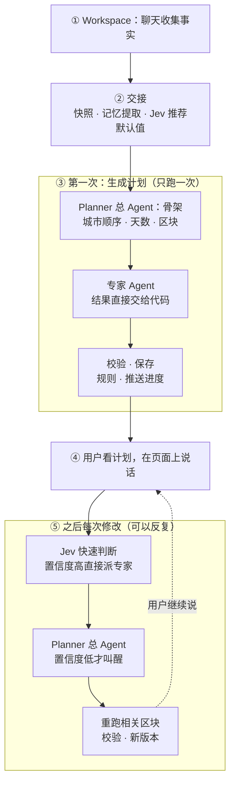

# Agent Planner 规划（进行中）

> 这是 Generate plan 背后 Planner Agent 的**规划工作区**，边讨论边增删改。每节标明状态：
> **已定**（讨论过、你确认了）、**草案**（我提的，还没确认）、**待讨论**（还没聊到）。
> 已经实现的部分以 [src/agents/README.md](../../src/agents/README.md) 为准；这里定下来、做出来以后，再写进那份文档。
> 讲过的 Agent 概念整理在 [agent-lessons.md](agent-lessons.md)。

## 进度

| 次 | 主题 | 顺带讲的概念 | 状态 |
| --- | --- | --- | --- |
| 1 | 业务：计划是什么，信息不全怎么办，记忆 | Agent 是什么、生成者 + 验证者、MCP、记忆、交接、工具就是函数 | 已定 |
| 2 | 页面：区块、空块引导、生成中、过期 | 分区块与依赖、真实进度（流式事件） | 进行中，大部分已定 |
| 3 | 运行：从点按钮到出结果、失败、重启；模块划分（总管 + 专家） | 工作流里放 Agent、可恢复与预算、多 Agent | 进行中 |
| 4 | 工具：需要哪些、返回什么、数据拿不拿得到 | 工具设计、追踪、评估 | 文档已查，待实测 |

全部讨论完、文档定稿以后才写代码。页面那次讨论后，你可能会生成一张效果图，我们对着图再调整。

## 1. 背景（已定）

**为什么做：** Meri 是面向 AI 工程岗位（Tesla、Microsoft）的作品集，Generate plan 直接按 Agent 架构做，不先做固定流程版。框架用 Mastra，Agent 放在 `src/agents/`；以后做 Agent 评估。不做 LangGraph 版本（2026-10-05 决定）。

**用户怎么旅行（你自己的习惯）：**

```text
出发前：怎么到那里（机票 / 高铁）
每天：  住在哪 → 明天去哪些景点 → 怎么排顺序、路上多久
        → 核实：几点开门、几点去最好、会不会下雨、要不要预约、电话多少、评价是不是真的
        → 一边玩一边用高德导航
```

所以计划的核心是**每一天一张卡**：住哪、去哪、顺序、路程、核实结果。

**你的八条思考，以及它们对设计的影响：**

| 思考 | 对 Meri 的影响 |
| --- | --- |
| 用户更在乎"行不行得通"，需要规则验证层 | 每天一个可行性检查，由代码按规则判断（第 2 节） |
| 修改能力比生成更重要，私人约束最后才说 | 计划页可以对话修改；对话中的约束由 Planner 记进记忆（第 3 节） |
| 旅行规划是对话，不是一次性生成 | 计划页旁边有对话入口 |
| 未来按约束而不是按目的地出发 | 远期方向（第 8 节），推荐卡已部分是这个思路 |
| 先给思路，不执着于一次就对 | 分层给计划，空块引导（第 2 节） |
| 用户画像可以被生成、修改、否定 | 记忆清单：自动记下，看得见，能删能改（第 3 节） |
| 高频需求是目的地内部景点之间的路线 | 路线工具的重点是景点 → 景点、酒店 → 景点 |
| 订票付款的越权风险 | Meri 不订不付；下单类工具不给 Agent |

## 2. 业务（已定）

### 2.1 信息不全时：先给能给的，缺什么锁什么

（2026-10-05 改：原来是"生成前先问天数"，改为解锁方式。）

- 只有目的地也能生成：给一个**示范的第一天**。
- 缺的信息不挡住生成。对应的区块显示为锁住的空块，空块里直接告诉用户补什么能解锁，并带行内输入框（"告诉我你玩几天，我把剩下的几天排出来"）。
- 哪个区块需要什么信息，由代码判断（见 4.2），不由模型判断。

### 2.2 v1 计划包含什么

每天：
- 住哪一带，以及附近的酒店（有价格就给价格，标明查询时间）
- 去哪些景点、什么顺序、开放时间、什么时候去最好
- 段与段之间的路程和时长（来自路线工具）
- 天气（几天内用预报，更远的只描述季节特点，不给数字）
- 要不要预约、电话
- 可行性检查：路上总时长、开放时间对不对得上、徒步能不能在天黑前走完、会不会下雨。由代码判断，不由模型判断

"怎么到那里"：机票、酒店用 OTA 的 MCP 给真实价格并标明查询时间；高铁能从 MCP 拿到什么就给什么，拿不到就给方向和链接。

拿不到的信息放进"不知道"列表，并告诉用户去哪里查，不猜。

### 2.3 修改

- 计划页可以对话修改，比如"第二天太赶了""换个酒店"。
- 用户说什么就按什么改，不给偏好排优先级、不算权重。
- 每次修改生成新版本。

### 2.4 边界

- **Meri 永远不订、不付**，只给信息、电话和链接。
- 接入的 OTA MCP 里有下单类工具，这些工具**不交给 Agent**。Agent 能用哪些工具由代码里的白名单决定。

## 3. 记忆（已定；存储为草案）

### 3.1 问题

Planner 的输入是 TripState 快照，不读聊天记录，为的是防止删掉的地点从历史里回来。但这样一来，用户在聊天里说的"我不吃辣""一天最多走 15 公里"就到不了 Planner。

### 3.2 形式：一条条记住的事，而不是一段摘要（已定）

```text
Meri 记得：
  · 不吃辣                    — 来自 10月3日「我不吃辣哈」          [×]
  · 一天最多走 15 公里         — 来自 10月3日「我一天最多走15公里」    [×]
  · 带父母，父亲膝盖不好        — 来自 10月4日「这次带爸妈…」           [×]
```

每一条记忆有：内容、用户原话、出自哪条消息、时间、状态（有效 / 被取代 / 用户删除）。

规则：
1. **防编造**：每条必须引用用户原话，代码检查这句原话真的出现在某条用户消息里，对不上就不保存。
2. **看得见、改得了**：清单显示在计划页，每条能删能改。
3. **矛盾**：新的话取代旧的话（"其实微辣可以"取代"不吃辣"），旧的一条标为已取代，不揉在一起。
4. **自动保存，不用确认**：偏好记错了代价小、看得见、一点就删。地点不同，地点仍然要确认。
5. **地点不进记忆**：地点只以 TripState 为准。

### 3.3 在哪里产生、谁来维护：交接（已定）

Workspace 是收集事实的阶段，计划页是规划阶段。点 Generate plan 时做一次**交接**：

```text
Workspace（固定流程，Vercel AI SDK）          计划页（Mastra Planner）
  聊天记录 + TripState
        │  点 Generate plan
        ▼
  交接包：① TripState 快照（事实）          → Planner 的输入
          ② 一次提取：聊天 → 记忆清单        → 显示在计划页，用户可删改
             （每条带原话，代码校验原话）
          ③ 今天日期、语言
                                              之后：计划页的对话由 Planner 处理，
                                              记忆由 Planner 通过工具维护
```

- **不在每一轮聊天里提取**：不改调好的中文聊天提示词，快照锁不动。
- **之后由 Planner 维护**：用户在计划页说"其实微辣可以"，Planner 调用记忆工具更新清单。

### 3.4 存储（草案）

- 记忆存在 **Meri 自己的表**里，Planner 通过自己的工具（例如 `remember`、`forget`）读写；写入前代码校验原话。
- 不用 Mastra 自带的 working memory：它由 Agent 直接改写，没法在中间插入校验；而且记忆是用户看得见、能改的产品数据，存在 Meri 自己的表里，Workspace 之外的页面和以后的评估都能直接读。

### 3.5 单向流程（已定）

过了 Workspace 就不回去：Workspace 收集事实，点 Generate plan 进入计划页，之后都在计划页完成。所以记忆只在交接时提取一次，之后由 Planner 维护，不需要增量提取。目的地在交接后固定，要换城市就新建旅程。

## 4. 页面（进行中 — 第 2 次）

### 4.1 已知前提

- 点 Generate plan 后进入一个新页面。
- 有对话入口，用来修改。
- 显示这次用了哪些记忆，每条能删能改。
- 单向流程，不回 Workspace（3.5）。缺的事实在计划页的空块里**点选**补上：天数点 3 / 5 / 7 / 自定义，交通方式点选，出发地用输入加建议。点选由代码处理，不调用模型、不花 token。
- 示范的第一天：用户在 Workspace 选的城市，一一对应；选了多个城市时用排第一的。它是 Planner 的一次**小范围运行**（区块任务，例如 `{ block: "day", city: "丽江", day: 1 }`，预算更小），不是单次模型调用，因为要调工具查景点、开放时间和路程。
- 以后要做大量动态效果，参考 [visual-media-direction.md](../product/visual-media-direction.md)。

### 4.2 区块和解锁（草案）

```text
┌ 怎么到那里 ───────────────────────────┐
│ 🔒 告诉我你从哪出发，我帮你查机票和高铁  │  ← 行内输入框，填完这块就解锁
└──────────────────────────────────────┘
┌ 第 1 天 · 丽江（示范） ─────────────────┐
│ 玉龙雪山 → 蓝月谷 → 丽江古城…           │  ← 只有目的地也能给
└──────────────────────────────────────┘
┌ 第 2 天、第 3 天… ─────────────────────┐
│ 🔒 告诉我你玩几天，我把剩下的几天排出来   │
└──────────────────────────────────────┘
┌ 天气、酒店价格 ───────────────────────┐
│ 🔒 告诉我哪天出发                       │
└──────────────────────────────────────┘
```

| 区块 | 需要什么才解锁 |
| --- | --- |
| 示范一天 | 目的地 |
| 其余几天 | 天数 |
| 机票 / 高铁 | 出发地，且交通方式不是自驾 |
| 自驾路线 | 出发地，且交通方式是自驾 |
| 天气、酒店价格 | 出发日期 |

用户补了一项信息，**只重算依赖它的区块**（依赖图上的增量重算），不用整个计划重来。

### 4.3 点选后能否修改（已定）

确认后收起成结果（例如"5 天 ✓"），旁边留一个小的"修改"。改了只重算依赖它的区块，例如改天数只重排每天，不重查机票。

### 4.4 打开计划页先看到什么（已定）

两者都要：
- **顶部一句话总览**：例如"云南 5 天：丽江 → 大理"，以及有几个区块还锁着。
- **地图显示当天的路线**：选中哪一天，地图就画那一天的景点和段与段的路线。

地图用**高德 JS 地图**（已定）：坐标和我们的数据都是高德的 GCJ-02 坐标，直接对得上；中国的地图数据最全；可交互。需要另申请一个 Web 端 JS key 和安全密钥。
没选的：高德静态地图图片（不能交互）；Leaflet + OpenStreetMap（中国数据少，坐标体系 WGS-84 不转换会偏几百米）。

### 4.5 生成中：游戏感的过渡和真实进度条（已定）

点 Generate plan 后有一个 hero 式的过渡，带游戏感和进度条；以后首页打开时也做 hero 效果，两者用同一套视觉语言。

原则：**进度条由真实的运行事件推动，不用假进度**。每完成一步（核实丽江、查路线、查开放时间、排好第一天），服务器推送一个事件，进度往前走一格。

形式：小熊沿着一条山路走，路上的每个营地就是一个真实步骤，到了就点亮。2D 像素风，和首页的像素山景、小熊统一；不做 3D（3D 仍放在 Generate plan 之后）。系统设置"减少动态效果"时，只显示简单的进度条和步骤文字。

素材缺口：现有小熊精灵图只有坐在小桌后的动作，**没有走路**。两种做法等效果图出来再定：一跳一跳前进（现有素材够用），或新做 6–8 帧侧面走路（更生动，需要参考图）。

### 4.6 待讨论

- 页面描述已写好：[page-mockup-brief.md](page-mockup-brief.md)（三张图的内容和英文生成提示）→ 你生成效果图 → 对着图调整。
- 区块过期的提示方式（事实改了，依赖它的区块要重算）。

## 5.0 模块划分：一个总 Agent + 专家（已定结构，细节草案）

结构（2026-10-06 定）：

```text
工作流（代码）── 管顺序、保存、失败、进度
   └ Planner（总 Agent，Kimi）── 只在需要判断时被叫醒
        ├ 每日行程专家（Agent）
        ├ 交通专家（Agent）
        └ 住宿专家（Agent）
   Jev：在 Planner 前面和专家里面做快速判断
   工具 / 代码：天气、地点、路线、搜索、记忆、可行性检查
```

Planner 在两个时刻被叫醒：
- **生成时**：看全部信息，输出结构化的骨架（城市顺序、每城几天、要生成哪些区块），代码照着骨架派给专家。
- **修改时**：Jev 拿不准的请求交给它，它拆任务并排先后、反问不清楚的话、调用记忆工具、判断只是提问就直接回答、最后告诉用户改了什么。

顺序、保存、进度这些不需要思考的事由代码负责，不经过 Planner：更快、更便宜、更稳定，也才能设检查点。

**专家的结果不经过 Planner 转述**：专家返回结构化 JSON，直接交给代码校验和保存。Planner 只派活，最后用一句话告诉用户改了什么。（社区总结的总管模式常见问题之一是转述失真："无法核实 X"被转述成"X 没确认"，意思在每次交接中漂移。）

**业界对照**（2026-10-06 查证）：外层流程 + Agent 判断对应 Anthropic《Building effective agents》的建议；Planner + 专家对应 orchestrator-workers 模式（Anthropic 的 Research 系统就是主 Agent 加并行子 Agent）；Jev 关口对应 routing 模式（小模型分类、按置信度回退大模型，RouteLLM 报告成本降 85% 以上、保持 95% 质量）。Jev 本身才发布几周，面试时讲的是这个模式，Jev 是具体实现，要有自己的实测数据。

| 模块 | 是不是 Agent | 做什么 | 工具 |
| --- | --- | --- | --- |
| Planner（总 Agent） | Agent（Kimi），前面有 Jev 快速关口 | 生成时输出骨架；修改时理解意图、拆任务、派给专家、更新记忆 | 各专家（作为工具）、天气、城市间路线、`remember`、`forget` |
| 每日行程（Day planner） | Agent | 从候选池挑当天的景点、排顺序（按半天天气安排室内/户外）、开放时间、路程、饭点 | 地点核实、地点详情、周边搜索、路线、天气、网页搜索 |
| 交通（Transport） | Agent | 怎么到目的地：机票、高铁、自驾 | 机票 MCP、高铁（看 MCP 能给什么）、驾车路线 |
| 住宿（Stay） | Agent | 每晚住哪一带、附近酒店和价格 | 酒店 MCP、周边搜索 |
| 天气 | 不是 Agent，是工具 | 城市 + 日期查预报；超出预报范围只给季节说明。用天气做决定（先去哪个省、下雨排室内）是 Planner 和每日行程的事 | 天气服务（高德只有白天/夜间；分上午下午需要逐小时预报，例如和风天气，待实测） |
| 可行性检查 | 不是 Agent | 按规则判断一天行不行得通 | 纯代码 |
| 记忆提取（交接时） | 不是 Agent | 从聊天提取记忆清单 | 一次模型调用 + 代码校验原话 |

整体流程（草案，按时间顺序：①–③ 只发生一次，④⑤ 可以反复）：



讨论顺序：每日行程 → Planner 总 Agent（生成时的骨架） → 可行性检查 → 交通 → 住宿 → 天气工具 → 记忆 → Planner 在修改时的工作。

**Mastra workflow 和手写流程的区别**：概念一样（按顺序执行步骤）；Mastra 另外自带可恢复（检查点）、暂停等用户（suspend / resume）、每步追踪、并行/分支/重试、进度事件。只有 Planner 用 Mastra workflow；现有的推荐、聊天流程是几秒的一问一答，不需要这些能力，**暂不改造**（以后为统一追踪可选）。

**Jev（TypeSafe AI，2026-09-15 发布）用作快速决策（草案，待实测）**：Jev 不写文字，只返回三种类型化的决定——Choice（选中的选项、每个选项的概率、置信度）、Score（得分等级、每个等级的概率、置信度）、是/否（为"是"的概率）；字段名以 SDK 为准；号称 70–500 毫秒，输入 $0.042/百万 token，输出免费；有 TypeScript SDK；不能调用工具。用在（流程图只画到 Agent 一层，Jev 多数在 Agent 里面）：

| 在哪一步 | Jev 做什么 | 类型 |
| --- | --- | --- |
| ② 交接 | 每句用户的话是不是偏好或约束，是才交给提取 | 是/否 |
| ② 交接 | 给锁住的区块算推荐默认值：建议天数（看城市数量和记忆，如带父母放慢节奏）、建议交通方式；预先选中"推荐"按钮，用户点一下才算数；置信度低就不标推荐 | Choice |
| ② 交接、⑤ 修改 | 新的一条是否取代已有的某一条（"微辣可以"取代"不吃辣"） | Choice |
| ③ 每日行程 Agent 里 | 候选池打分：每个景点适不适合这位用户和这天的天气 | Score |
| ③ 每日行程 Agent 里 | 多个候选时选一个（"苍山"），置信度低就把替换标签显示得更醒目 | Choice |
| ③ 校验 | 软性检查：规则管不到的，比如"父亲膝盖不好"对上陡峭山路，这天会不会太累；置信度低就在卡片上提醒 | Score |
| ⑤ 修改 | 是不是在改计划、派给哪个专家 | 是/否 + Choice |

接入顺序（中文实测通过后）：候选池打分 → 修改路由 → 推荐默认值 → 软性检查 → 其余三处。每多一处都要实测和评估，不硬塞。

**例子：交接时 Jev 算推荐默认值**（概率数字为示意，实际以中文实测为准）

用户在 Workspace 定了"丽江、大理"，没说天数，也没说怎么去。交接时代码把当前状态整理成文字交给 Jev：

```text
目的地：云南省 · 丽江市、大理白族自治州
出发地：上海
天数：没填
交通方式：没填
记忆：带父母 · 父亲膝盖不好 · 不想太赶
```

代码问 Jev 两个 Choice 问题，选项由代码事先定好：

```text
问题 1：适合玩几天？ 选项：3、4、5、6、7、8 天
  选中：6 天   置信度：高
  概率：3天 2% · 4天 8% · 5天 30% · 6天 41% · 7天 15% · 8天 4%
  （两个城市，带父母、膝盖不好、不想太赶 → 多留一天，节奏放慢）

问题 2：怎么去比较合适？ 选项：自驾 / 高铁 / 飞机
  选中：飞机   置信度：高
  （上海到丽江远，丽江有机场）
```

页面上显示：

```text
┌ 第 2–6 天 ──────────────────────────────────────────┐
│ 🔒 告诉我你玩几天                                       │
│   [ 4 天 ]  [ 5 天 ]  [ 6 天 · 推荐 ✓ ]  [ 7 天 ]  [ 自定义 ] │
└────────────────────────────────────────────────────┘
┌ 怎么到那里 ─────────────────────────────────────────┐
│ 🔒 怎么去？                                            │
│   [ 自驾 ]  [ 高铁 ]  [ 飞机 · 推荐 ✓ ]                  │
└────────────────────────────────────────────────────┘
```

- "推荐"按钮预先选中，但区块仍然锁着；用户点"确认"才解锁，也可以改选别的。天数和交通方式是事实，必须由用户决定，Jev 只是把"想一想再填"变成"点一下"。
- **置信度低时不标推荐**。例如只选了"海南"、没有记忆：Jev 选 5 天，但概率是 3天 22% · 4天 24% · 5天 26% · 6天 18% · 7天 10%，几个选项差不多。这时几个按钮平等显示，硬标一个推荐反而误导用户。
- 为什么用 Jev 不用 Kimi：这是从固定选项里选一个的问题，Jev 几十毫秒、几乎不花钱，而且置信度是校准过的，能直接决定"标不标推荐"；Kimi 更慢更贵，它说"很确定"不一定真的确定。

不用 Jev 的地方：
- **Workspace**：每轮都要 Kimi 写回复，理解意图和写回复是同一次调用，加 Jev 省不了调用；中文提示词已锁定。Jev 从交接开始用。
- **生成时派给哪些专家**：由事实推出（有出发地且不是自驾 → 交通专家要跑），代码 100% 准确、零成本。原则：事实能推出的用代码，需要判断的才用 Jev 或 Agent。

**只有一个总 Agent（Planner）**，在生成和修改两个时刻被叫醒（见 5.0）。

原则是按置信度分流：高置信度直接执行，低置信度交给 Kimi 或用户。代码里把"做一个类型化决定"抽成接口，Jev 和 Kimi 各一个实现，Jev 不可用时回退 Kimi。

风险，在工具模块实测：中文输入支持没有写明；服务在美国西海岸（用户消息会发到美国，要在文档写明数据流向）；刚发布，接口和注册方式可能变化。每个模块讨论输入、输出、工具、规则、失败处理、预算、页面显示。

### 模块 2：Planner 生成时出骨架（讨论中）

输入：TripState 快照、记忆、今天日期（和交接时 Jev 算的推荐默认值）。输出：骨架——城市顺序、每城几天、要生成哪些区块、每个决定的理由。

待你回答（括号里是我的倾向）：
1. 示范第一天：坚持用户选的第一个城市 / 用 Planner 排序后的第一天（坚持用户选的）。
2. 只有省没有市：Planner 挑一个城市并说明理由，给可点的替换标签 / 锁住请用户先选（前者）。
3. 城市顺序：Planner 综合地理、天气、用户顺序判断并写理由，不算权重；代码只检查没漏城市、天数对得上（同意吗）。
4. 城市之间转场：作为某天的一段路程 / 单独的转场日（作为一段路程）。
5. 顶部总览：代码按模板拼 / Planner 写一句（代码拼，不花 token、中英稳定）。
6. 改天数后：重跑 Planner 出新骨架，只重跑天数有变化的那几天（同意吗）。

### 模块 1：每日行程（已定）

1. **候选池**：先把这个城市的知名景点全部搜出来（用户在 Workspace 选的、Agent 提出并经高德核实的、高德周边景点搜索的），存成缓存。每天的排程从池子里挑；用户可以点按钮隐藏或加入景点，Agent 从缓存里重排当天，不重复调工具。每天几个景点由 Agent 按记忆决定（例如带父母、膝盖不好就少排），默认 3–4 个。
2. **时间**：给大约时间，并标明"时间仅供参考，请自己把握"；开放时间写查到的精确时刻。
3. **景点来源**：用户选的景点必须排进去；其余来自 Agent 提候选（每个都用高德核实，核实不了就丢）和高德周边搜索。
4. **吃饭**：每天中午推荐一家附近的饭店（高德，带电话），照顾记忆里的忌口；细节以后再议。
5. **多城市分天**：由 Planner 总 Agent 在生成骨架时决定，代码校验每个城市至少 1 天、总天数对得上。
6. **景点名有多个候选**：选最可能的一个，卡片上写"我选了 X"，旁边列出其他候选作为可点的小标签，点一下就换。不打断生成，但让用户参与。

## 5. 运行（进行中 — 第 3 次，草案）

### 5.1 结构：工作流里放 Agent

外层是固定的工作流，管顺序、保存和失败处理；Agent 只是其中一步，负责研究。

```text
外层工作流（代码写死）
  ① 准备：TripState 快照、一次记忆提取、算出哪些区块能解锁
  ② 对每个能解锁的区块：
       ├ Agent 研究（自己调工具，有预算）
       ├ 整理成 JSON（单独一次调用）
       ├ 代码校验，不过就把问题告诉 Agent 改，最多 2 次
       └ 保存这个区块，推送事件给页面
  ③ 收尾：写总览、更新状态
```

### 5.2 从点按钮到出结果

1. 在 Workspace 点 Generate plan：服务器做交接，创建计划记录，在服务器后台启动工作流，浏览器跳到计划页。
2. 计划页连上进度流，小熊过渡页按真实事件前进。
3. 示范第一天优先跑；其他能解锁的区块随后跑（高德每秒约 3 次，并行实际上也是排队）。
4. 用户关掉页面，运行不中断；状态在数据库里，回来能看到进度或结果。
5. 用户点选补信息：代码直接更新 TripState，不调模型；只对依赖它的区块启动一次小运行。
6. 计划页对话修改：Planner 处理这条消息，可能调 `remember` 记下偏好，然后重跑受影响的区块。

### 5.3 失败处理

| 情况 | 处理 |
| --- | --- |
| 某个工具或服务失败 | 该区块显示"暂时查不到"加重试按钮，其他区块不受影响 |
| 模型调用失败 | 自动重试 1 次，还失败按上一条处理 |
| 碰到预算上限 | 保存已有结果，标"未完成" |
| 代码校验 2 次都没通过 | 不保存这个区块，显示失败原因和重试 |
| 服务器重启 | 从最后一个检查点接着跑，已完成的区块不重做 |

### 5.4 预算初始值

每个区块最多 10 步、15 次工具调用、60 秒；整次运行最多 3 分钟。先这样设，跑起来按实测调整。

### 5.5 待定（会并进各模块的讨论里，问得更具体）

1. 部分成功（一块失败、其他照常）是否可以。
2. 暂停问用户放在哪里（见模块 1 第 6 问）。
3. 对话修改是直接改，还是先说明再改（到"总管"模块讨论）。
4. 示范第一天先跑、其他随后，是否可以。

### 5.6 1.0300 试验已经确定的约束（已定）
- 工具加结构化输出必须分两步：先让 Agent 跑完工具循环，再单独一次调用整理成 JSON。放在同一次调用里，Kimi 会跳过工具，还会用大量空行填充 JSON。
- 哪些内容核实过，由代码根据工具结果判断，不信模型的说法。
- 必须告诉 Agent 今天的日期。
- 每次运行有预算上限：步数、工具调用次数、时间、token。
- 用可恢复工作流：服务器重启后能接着跑，以后能暂停问用户。

## 6. 工具（进行中 — 文档已查，待实测）

### 6.1 官方文档核对结果（2026-10-06）

| 想知道的 | 文档怎么说 | 对设计的影响 | 还要实测什么 |
| --- | --- | --- | --- |
| 开放时间、电话、评分 | 高德 v5 地点搜索和详情的 `show_fields=business` 返回 `opentime_today`（今日营业时间）、`opentime_week`（营业时间描述）、`tel`、`rating`（餐饮、酒店、景点、影院才有）、`cost`（人均消费） | 每日行程能写开放时间和电话；我们已有的高德调用加一个字段即可 | 景点上这些字段实际有没有值 |
| 天气 | 高德天气只有 **3 天**预报，只分白天/夜间，**没有上午下午** | 半天粒度（下雨排室内）用不了高德 | — |
| 逐小时天气 | 和风天气逐小时预报 **1–240 小时（10 天）**，1 公里分辨率，含降水概率；**每月前 5 万次免费**；同一套餐含天文（日出日落） | 天气工具改用和风天气：10 天内可按小时排室内/户外；日出日落也有了（可行性检查的"天黑前走完"） | 申请 key，确认免费额度内的范围 |
| 景点之间的路线 | 高德路线（驾车、步行、公交） | 已知可用 | — |
| 机票 | RollingGo 机票 MCP：`searchAirports`、`searchFlights`（日期、航线、人数、舱位），500+ 航司，免费、无调用上限，个人可申请 | 交通专家的机票来源 | `searchAirports` 按英文城市名查，中文城市要实测 |
| 酒店 | RollingGo 酒店 MCP（API key 版）：`searchHotels`、`getHotelDetail`、`getHotelSearchTags`，streamable-http，免费、无上限。下单工具只在 OAuth 版里 | 住宿专家的来源；用 API key 版，**本身就没有下单工具**，符合"不订不付" | 价格是否实时、返回字段 |
| 高铁 | 途牛火车票 MCP：车次搜索、座位余票和价格，需在途牛开放平台申请 `TUNIU_API_KEY`（官方文档页本次连不上，细节待查）；飞猪 FlyAI 有 `search-train`，可不用 key，但只有 CLI 和 Agent skill，文档没写服务器可用的接口和使用条款 | 高铁优先用途牛；飞猪作为备选，先确认能否在服务器调用、条款是否允许 | 申请途牛 key；看真实返回 |
| Jev | JS SDK `@typesafe-ai/sdk`，在 console.typesafe.ai 取 key；文档**没写中文支持**；明确写了弱项：不会可靠地数数、算数、比较日期先后或两个数值是否接近 | 数字和日期都由代码算好再交给 Jev（例如可行性软检查只给它"路上 4.5 小时、坡度大"这种已算好的描述）；推荐天数的选项是固定标签，可以 | 注册是否开放；中文判断准确率 |
| 网页搜索 | AnySearch：可匿名使用（限流更低），注册后更高；`search`、`batch_search`、`extract`（抓整页）；文档**没写中文内容覆盖**（有中文 README） | 先和 Bocha 对比再决定首选 | 同一批中文旅游问题对比结果 |
| 小红书 | 暂不接入 | — | — |

### 6.2 工具选型和要准备的 key（2026-10-06）

| 用途 | 选型 | key | 去哪申请 | 环境变量名（建议） |
| --- | --- | --- | --- | --- |
| 地点核实、开放时间、电话、周边搜索、路线 | 高德（已在用） | 已有 | — | `AMAP_API_KEY` |
| 计划页地图 | 高德 JS 地图 | 另申请 Web 端（JS API）key + 安全密钥 | lbs.amap.com 控制台 | `AMAP_JS_KEY`、`AMAP_JS_SECURITY_CODE`（见下方说明） |
| 天气（逐小时、日出日落） | 和风天气 QWeather | 要 | dev.qweather.com 控制台 | `QWEATHER_API_KEY`、`QWEATHER_API_HOST`（控制台分配给你的专属域名） |
| 机票 + 酒店 | RollingGo（道旅），一个平台两个 MCP | 要 | rollinggo.store（个人可申请，自动审核） | `ROLLINGGO_API_KEY` |
| 高铁 | 途牛开放平台 | 要 | open.tuniu.com | `TUNIU_API_KEY` |
| 快速判断 | Jev（TypeSafe） | 要 | console.typesafe.ai/keys | `TYPESAFE_API_KEY` |
| 网页搜索（首选候选） | AnySearch | 可选 | anysearch.com | `ANYSEARCH_API_KEY` |
| 网页搜索（备选） | Bocha（已在用） | 已有 | — | `BOCHA_API_KEY` |
| 大模型 | Kimi（已在用） | 已有 | — | `MOONSHOT_API_KEY` |

不选：Amadeus（个人版已关闭）；飞猪 FlyAI（只有命令行工具，服务器调用和使用条款不清楚，观望）；小红书（调研中）。

**12306 社区 MCP**（如 drfccv/mcp-server-12306，不用 key，数据来自 12306）：不作为正式依赖。它们调用 12306 网页的公开查询，不是官方接口，网页一改就可能失效；12306 有反爬限制，部署到日本 VPS 后更容易被限制；有的版本靠更换 UA 绕过封禁，这类做法我们不用。可以在本地试着看数据。

key 只放在本地 `.env.local`，不提交、不发到对话里；`.env.example` 只加变量名。（1.0306 已加：`.env.example` 末尾一组，根 README 写明只有验证脚本读取。）

**高德 JS key 为什么不叫 `NEXT_PUBLIC_…`**（1.0306）：根 README 有一条规则——所有变量只在服务端，不用 `NEXT_PUBLIC_` 前缀，因为带这个前缀的值会在构建时打进浏览器代码。高德 JS key 本身就是要给浏览器用的（地图在浏览器里加载），它的保护靠控制台里的域名白名单和安全密钥，所以它公开不算泄密；**安全密钥**不能公开，要走服务端代理。现在没有页面用它，先按服务端变量命名，规则不破；做计划页地图时再决定：由服务端把 key 交给页面，或者把这一个 key 列为规则的例外。

### 6.3 下一步实测（只写验证脚本，不写产品代码）

和 1.0300 的试验一样，每个服务一个脚本，用真实问题跑几次：
- 高德：丽江、大理几个景点的营业时间和电话；
- 和风天气：丽江未来 48 小时的逐小时预报；
- RollingGo：上海到丽江的航班、丽江古城附近的酒店；
- 途牛：昆明到大理的车次和余票；
- Jev：用中文的修改语句测路由、用记忆测推荐天数；
- AnySearch 对比 Bocha：雨崩封路、玉龙雪山预约等 5 个问题。

**2026-10-22：申请 key 暂停。** 要准备的 key 见 6.2：和风天气（key + 专属 API Host）、RollingGo（机票和酒店如果是两个 key 就拆成两个变量）、途牛（可能要人工审核）、TypeSafe、AnySearch（可选）、高德 JS 地图（验证脚本用不到，放最后）。建议的申请顺序：和风天气 → RollingGo → TypeSafe，途牛同时提交，最后 AnySearch 和高德 JS。先解决下面这件事。

**待解决：高德商用授权。** 2026-10-22，自称高德官方的人员联系你，要 5 万元，很可能是收商用授权费。先核实对方身份和收费依据，再决定高德还能不能作为地点、路线和地图的来源；这件事也影响"计划页地图用高德 JS 地图"这个决定。

查到的官方规则（2026-10-22）：
- 2025-05-20 起的新定价：非商业用途的个人认证开发者，享有**自认证之日起 1 年**的免费月配额；1 年后要付费（[服务升级页](https://lbs.amap.com/upgrade)）。
- 个人免费配额很小，计费说明里关键字搜索、周边搜索是**每月 5000 次**（[计费说明](https://lbs.amap.com/pages/base_service_price)）；FAQ 写的却是每日 5000 次，两处口径不同（[认证 FAQ](https://lbs.amap.com/faq/account/certification/39670)）。
- 服务协议：平台可以不定期调整配额；非个人学习研究用途要走工单办理付费许可（[服务协议](https://lbs.amap.com/pages/terms/)）。
- 对方说"自用也不行，最少 5000 元可以继续用一段时间"，和"认证满 1 年后付费"对得上；具体价格没有在公开页面上找到。

**长期评估（2026-10-22，草案，等你定）：要换就在做 Generate plan 之前换。**

| | 高德 | 腾讯位置服务 | 百度地图 | 天地图 |
| --- | --- | --- | --- | --- |
| 个人免费额度 | 认证起 1 年；搜索约每月 5000 次 | 地点搜索每日 200 次（2025-04 调低） | 2022-07 调低，2025 年没查到新公告 | 免费申请 key，有每日配额，具体数字没查到官方的 |
| 商用授权 | 约 5 万元/年 | 5 万元/年，有效期 1 年 | 约 5 万元/年（第三方说有 3000 元/年的入门档，未核实） | 国家平台，接口免费；商用条款没找到 |
| 按量付费 | 有：流量包 1 年有效；基础服务（路线、地理编码）30 元/万次起，搜索类价格更低，阶梯递减 | 有流量包（372 天有效） | 未查到 | — |
| 营业时间、电话、评分 | 有（v5 `business` 字段） | 有部分 | 有部分 | 没有 |
| 景点数据 | 好 | 好 | 好 | 弱，更新慢 |
| Meri 已接入 | 是（地点核实、输入提示、照片），都在 `src/platform` 的提供方接口后面 | 否 | 否 | 否 |

结论：三家商业地图的规则几乎一样（个人免费额度小、商用 5 万一年），**换到腾讯或百度躲不开这个问题**，只是换一家收费；天地图免费，但没有营业时间和电话，景点数据弱，撑不起每日行程。

**我的建议：长期继续用高德，按量付费，不买 5 万的授权。** 估算一次计划约 150 次调用（候选池搜索、详情、每天的路线）；按 30 元/万次算，约 0.45 元一次；每月 100 次计划约 45 元。前提是要向高德书面确认：个人账号买流量包用于个人非商业作品集是否允许；他们说的 5000 元买的是什么、多久、多少次。Meri 以后真的商业化（收费、公司运营），再买商用授权。另外，高德已经在提供方接口后面，Generate plan 新加的路线、详情、地图也照这个方式接，以后要换只换提供方，不动 Agent。

来源：[高德服务升级](https://lbs.amap.com/upgrade)、[高德计费说明](https://lbs.amap.com/pages/base_service_price)、[腾讯配额调整公告](https://lbs.qq.com/news/lbs/DeveloperInterfaceQuotaUpdated)、[腾讯商业授权 FAQ](https://lbs.qq.com/FAQ/authorization_faq.html)、[百度免费额度调整公告](https://developer.baidu.com/article/detail.html?id=295339)、[天地图授权说明](http://lbs.tianditu.gov.cn/authorization/authorization.html)。

**2026-10-22：你买了 20 元高德流量包**（1 年有效；按基础服务 30 元/万次算约 6600 次，搜索类更便宜会更多）。高德暂时继续用；天地图照样实测，作为混合方案或备选。

**作为作品集，高德还要不要用（2026-10-22，草案，等你定）：要用，数据层用高德。** 理由：中国景点的营业时间、电话、照片只有国内商业地图有，Google 等海外地图在中国的数据很弱；高德从美国 IP 调用已经验证可用（Vercel iad1），天地图从海外反而有被拦截的风险；作品集的调用量小，流量包够用；"核实了营业时间"本身就是最能展示的部分。天地图降为备选，不急着测。

**改：先实测天地图（2026-10-22，你担心高德不讲道理）。** 天地图没有景点图片；没找到充值或购买配额的入口，提额走单位注册（审核后每天约 300 万次，福建平台的说法）。测之前先定通过标准，过了就换：
1. 在你的网络和美国 VPS 上都能稳定访问（连续请求不出现 418 拦截）；
2. 15 个测试地点（丽江、大理、香格里拉、迪庆的城市和景点，含玉龙雪山、苍山、雨崩村、洱海这类）至少 13 个搜得到，省、市对得上；
3. 有步行路线，景点之间驾车、步行的距离和时长合理；
4. 中文和英文都能查（英文地名能不能搜到，例如 Lijiang Old Town）。
**实测结果（2026-10-22，`scripts/verify-tianditu.ts`，跑了 3 轮，后 2 轮结果完全一样）：**

| 标准 | 结果 | 过没过 |
| --- | --- | --- |
| 1 能访问 | 这台电脑上：请求间隔 300 毫秒时 20 次全部成功，中位 72 毫秒；第一轮不间隔连续请求，后 11 次搜索拿不到结果。美国 VPS 没测 | 部分（VPS 待测） |
| 2 查得到 | 云南行政区内搜索 14/15；全国搜索第一条在云南的只有 12/15（苍山→广西，虎跳峡→深圳野生动物园，石林风景区→福建）。**错的那个恰好是苍山**：区内搜索也给了保山腾冲的"苍山"，不是大理苍山。第一条常常是管理机构（管委会、镇政府、管理局）而不是景点本身。电话只有 4/15 有 | 数字过了，质量勉强 |
| 3 有路线 | 驾车有：大理古城→双廊 51 km、66 分钟，合理；丽江古城→玉龙雪山 97 km、3.2 小时，因为搜到的"玉龙雪山"坐标在山北面的大具乡，不是游客去的甘海子一侧。**没有步行**：`style=3` 时速约 29 km/h，是驾车 | 没过 |
| 4 英文 | 4 个英文名全部搜不到；"Shangri-La" 搜到一家酒店 | 没过 |

另外：搜索结果没有省、市字段，要再调一次逆地理编码才知道在哪个省市；驾车接口返回 XML。

**同一组问题问高德（`scripts/verify-amap-baseline.ts`，跑 1 轮约 40 次调用，省流量包）：**

| | 天地图 | 高德 |
| --- | --- | --- |
| 云南省内搜索，省市对得上 | 14/15（苍山选成保山腾冲的） | **15/15**（苍山→大理苍山世界地质公园） |
| 全国搜索第一条在云南 | 12/15 | 14/15（泸沽湖排到四川一侧，也算对） |
| 第一条是不是景点本身 | 常常是管委会、镇政府、管理局 | 都是景区本身（雨崩村→雨崩景区） |
| 电话 / 营业时间 / 评分 / 照片 | 4/15 / 无 / 无 / 无 | 13/15 / **15/15** / 15/15 / 15/15 |
| 丽江古城→玉龙雪山驾车 | 97 km、3.2 小时（坐标在山北面） | 31 km、58 分钟 |
| 大理古城→双廊驾车 | 51 km、66 分钟 | 52 km、64 分钟 |
| 步行 | 没有（`style=3` 时速 29 km） | 有，时速 4.5 km（大理古城→三塔 3.2 km、43 分钟） |
| 英文名 | 4 个全部搜不到，"Shangri-La" 搜到一家酒店 | 都有结果，但多是名字里带英文的客栈、酒店；"Shangri-La" 返回上海的香格里拉酒店——两家都不能直接用英文查，要先翻译成中文（Meri 已经这么做） |
| 延迟（中位） | 约 72 毫秒 | 约 160 毫秒 |

营业时间的价值在例子里很清楚：普达措写了"最晚进入 16:00，悠幽步道 14:00 后关闭"，玉龙雪山写了"根据客流量不定期调整"——这正是每日行程要核实的东西。

**按完整文档重测（2026-10-22，你给了地名搜索 V2.0 和地理编码文档）：** 第一次没用 `show: "2"`，这个参数会返回省、市、县和它们的代码、类别 `typeCode` / `typeName`、英文名 `ename`。重测发现：
- 速度：每次 1 次调用、约 350 毫秒，和高德接近（第一次"慢 8 倍"是因为每条结果都补了一次逆地理编码，作废）。
- 类别有了：1804xx 风景名胜、1602xx 博物馆、2602xx 山和峡谷、2603xx 河流湖泊、2608xx 海岛；饭店 11xxxx、政府 19xxxx。
- `queryType 7`（地名搜索）和 `1` 结果一样；普通搜索里 `dataTypes` 不起作用（加不加、写名称还是编码，总数都一样）。
- **排序是根本问题**：取前 30 条再按类别筛，重庆的洪崖洞民俗风貌区排第 21，稻城亚丁景区第 20，北京的长城第 17，云南的虎跳峡只有"虎跳峡漂流"（第 24）；大理苍山在全国前 30 里没有，限定云南再加 `dataTypes` 也只有自然村和苍山西镇政府。没有评分或热度字段，代码没法重排。

**只看 Workspace（不看英文、不看 Generate plan、照片另想办法），天地图能不能用？**（2026-10-22，`scripts/verify-tianditu-workspace.ts`）

Workspace 的地点核实把用户说的话变成省 / 市 / 景点，靠的不只是搜索：要全国搜索（用户只说"西湖"，没给省）、每条结果带省市区、有类别代码分辨景点和售票处停车场、要输入提示。脚本里写了一个天地图试验适配器（每条结果再调一次逆地理编码补省市区；天地图没有类别，`kind` 留空），两家的结果都过 Meri 真实的判定规则，24 个说法：

| | 结果 |
| --- | --- |
| 两家一样 | 10/24：云南、广西、丽江、三亚、西湖、泰山、故宫、松赞林寺、雨崩、玉龙雪山 |
| 天地图更好 | 2：海南（高德 unresolved，见下）、朝阳（天地图还列出了北京朝阳区） |
| 差不多 | 2：大理、香格里拉（天地图少了自治州这一级，适配器可补） |
| 高德更好 | 10：峨眉山、黄山、张家界（天地图直接返回同名的市，用户想去的景区不在候选里）、洪崖洞、长城、九寨沟、鼓浪屿、苍山（同名的饭店、别省的地点排在前面）、稻城亚丁（找不到）、潮汕（天地图给了佛山、珠海的同名店） |
| 耗时 | 高德约 250 毫秒；天地图景点约 350 毫秒、1 次调用，城市要多 1 次逆地理编码（约 700 毫秒） |

（按完整文档重写适配器后跑了 2 轮，结果一样。）

天地图做得好的：省和市（"云南""丽江"直接返回行政区，带边界）、有建议词接口（`queryType 4`，带行政区代码，可替代输入提示）。做不好的：景点——全国搜索排序不按知名度，又没有类别代码，Meri 的规则分不出景点和同名的饭店、管理机构。推荐卡片里的景点用的是同一套核实，结论一样。

**你的想法：排序交给 LLM 或既定代码（2026-10-22 实测）。** 做法：Kimi 本来就知道"苍山在大理、洪崖洞在重庆"，让它给出所在城市，代码在这个城市里搜（`queryType 12`，`specify` 可以直接写行政区名称），只留景点类别，再让 LLM 或代码从候选里挑。手写提示（模拟 Kimi 给的城市）测 12 个：
- 好（6）：洪崖洞（民俗风貌区排第 11，前面是"洪崖洞巴渝古道"，要靠 LLM 挑）、鼓浪屿、故宫、峨眉山、九寨沟、稻城亚丁（只有几个观景台，没有景区本身）。
- 差（6）：苍山（大理州里只有"苍山兰峰""苍山踏雪"，没有苍山景区）、虎跳峡（迪庆只有"虎跳峡漂流"）、长城（北京给了丰台区的一个点，不是八达岭）、张家界（桑植县的一个自然地物，没有国家森林公园）、黄山（黄山市里没有景点类别——黄山风景区在天地图里归为"区县级地名"）、石林（昆明市里没有景点类别）。

结论：LLM 能**从候选里挑**，但**变不出不在结果里的景点**，也改不了归错的类别。这招能救一半，救不了数据本身。另外要改 Workspace 的中文提示词（多输出一个"所在城市"），提示词现在是锁定的。

**第二轮：增加数量、改写名称、建议词（2026-10-22）：**
- 增加数量（在 LLM 给的城市里取前 100 条）：没救回来。苍山只有"苍山兰峰""苍山第一峰"和索道，虎跳峡只有漂流、雕塑、游客中心；黄山市、昆明市里按类别一个景点都没有。
- **改写成正式名称（最有效）**：八达岭长城→八达岭长城景区 ✓、张家界国家森林公园 ✓、黄山风景区 ✓、虎跳峡景区→丽江虎跳峡景区（第 2 条）✓、苍山世界地质公园 ✓（类别是"公园"，景点类别要加上它）、洪崖洞民俗风貌区 ✓。不行的：苍山风景名胜区、石林（只有"石林风景区北门"和管委会）、稻城亚丁（景区本身叫"甘孜州稻城亚丁景区"，要非常准的名字）。做法：LLM 给 2–3 个正式名称 + 所在城市，代码依次在城市内搜、按类别过滤，约 10/12 能对。
- `queryType 4` 是**建议词搜索**（输入提示），按行政区列同名地点，排序同样不按知名度（苍山前 8 条全是外省的）。

**同一个词"苍山"，所有搜索方式各试一次（2026-10-22）：** 高德第一条就是"大理苍山世界地质公园"（类别里带"国家级景点"）。天地图：行政区内（官方示例那种，大理州）→ 苍山西镇政府、镇委、镇人大；全国 level 12 和 18 → 广西、四川、黑龙江的"苍山"；level 4 → 只给统计；地名搜索 `queryType 7`、视野内（大理）、周边（大理古城 10 公里）、加 `specify` 云南省、行政区内加 `dataTypes` → 都没有苍山景区。**只有分类搜索 `queryType 13` 的 `dataTypes` 真正起作用**：大理州"风景名胜"共 1395 条（崇圣寺三塔排第一），但它不带关键词。
原因不在参数：高德是消费级地图，有大量用户的搜索和导航记录，排序用热度，还人工标了"国家级景点"；天地图是测绘平台，数据来自测绘和地名登记，排序只看文字匹配，没有热度。
由此想到的另一条路：用 `queryType 13` 按城市把全部风景名胜（加"公园"等类别）一次拉下来（每次最多 300 条，大理约 5 次），存成城市景点表，用户说的名字在本地匹配，同名多个再用 Wikidata 知名度挑——和每日行程的"候选池按城市缓存"是同一个思路。风险：地理信息是监管敏感的数据，把整座城市、整个省的地点批量存下来，就是在积累地理数据集；缓存只存用户真正用到的地点，按供应商条款的保存期限，不做全城、全省的数据集。

**其他方案（2026-10-22 调研）：**
- 腾讯位置服务：官方 FAQ 把个人开发者定义为"个人学习、非企业或组织使用"；商业授权针对企业和非公益组织。个人公开上线、不盈利是否算商用，官方没写明，要提工单问。个人地点搜索每天 200 次。
- 百度：官方只有基础版 5 万/年、尊享版 10 万/年，都面向企业；"3000 元入门档"没有官方出处，作废。
- 华为 Site Kit：按量付费（关键字搜索约 168.7 元/千次，搜索建议 15 元/千次），每月约 2398 元代金券；是否适用国内开发者、国内数据质量没确认。
- Google Places：没找到中国大陆覆盖和营业时间准确度的资料，Google 在中国的数据普遍认为较旧。
- **Wikidata（我的提议）**：免费、无 key、全球可访问，有中英文名、坐标、图片（Wikimedia Commons，开放许可），sitelinks 数量可当知名度。实测"苍山"第一条就是大理苍山（Q844493，13 个语言条目，有坐标和图片），外省同名的只有 1–3 个条目——正好补天地图的排序。这台电脑访问 Wikidata 不稳定（第一个请求成功，后面超时），其余没测完。

**坐标合规（2026-10-22，资料整理，不是法律意见）：** 中国境内公开的地图要用加密坐标（GCJ-02），公开展示的地图要有审图号；把 GCJ-02 反算回 WGS-84 对外输出、逆向加密算法，资料普遍认为有违法风险。Meri 现在的做法是安全的那种：坐标来自持证供应商（高德，GCJ-02），存在 TripState 和消息里、交给页面，**不做任何转换**。规则：① 坐标从哪家来，就在哪家的地图上显示（高德坐标配高德 JS 地图；天地图坐标是 CGCS2000，配天地图底图）；② 不把高德坐标转成 WGS-84，不叠到 OpenStreetMap、Google 等国外底图上；③ 不批量导出、公开发布坐标数据集；④ 换供应商时，坐标随供应商一起换，不混用。

**Apple MapKit（2026-10-22 调研，未实测）：** Apple Maps Server API（搜索、地理编码、逆地理编码、ETA）和 MapKit JS 共用每个开发团队每天 2.5 万次免费调用，超出返回 429，可申请提额；需要 Apple 开发者计划（99 美元/年）。中国大陆的数据据说来自高德；有开发者反映在大陆网络里 MapKit JS 初始化报 401，Apple 工程师说从日本访问可以——非官方说法。没有营业时间之外的中国 POI 质量资料，要实测。

**二级供应商和"绕一绕"（2026-10-22 调研，都还没实测）：**
- 滴滴地图（滴图）开放平台：有 Web API、JS API，第三方说 9000 万+ POI；个人能不能注册说法不一（2025-11 的评测说只对企业开放）；注册后有永久测试 key；商用年费第三方说 3.5 万元，没有官方页面。
- 美团地图开放平台（lbs.meituan.com）："全新上线"，有关键字、周边、多边形搜索的 Web API；配额、收费、个人能不能用都没查到。美团有大众点评的数据，景点和饭店的评价可能是亮点，值得注册看控制台。
- 四维图新（lbs.navinfo.com）：面向车企和政企，人工报价。
- 阿里云百炼上的高德 MCP：官方帮助中心写着"限时免费"，用百炼自己的 API key 鉴权，不用高德 key；数据就是高德的（详情能拿营业时间、电话）。问题：限时、MCP 调用是否另计费说法矛盾、部署后的使用条款没查到。
- **你的要求（2026-10-22）：不是不花钱，是不要年费——要即用即付，余额用完就停；而且怕不卖钱的公开部署被高德当成商用。** 符合"按量付费 + 条款允许公开部署"的候选：
  - 百炼上的高德 MCP **（2026-10-22 看了详情页：不是按量付费，是高德的限时试用；可用作免费、可替换的提供方，待实测）**：详情页写着"该服务限时试用体验，商业化用途请联系商务"，百炼"预置了公共试用版 API-KEY"（大家共用一个高德试用 key，活跃调用方 1.7 万），服务协议是高德服务条款，说明页 https://lbs.amap.com/api/mcp-server/summary；换成自己的高德 key 就回到个人 key 的问题。没写禁止个人非商业使用。风险是试用随时结束、共用额度可能限流、返回的是给大模型读的文本（字段可能比直接 API 少）——所以只放在提供方接口后面，断了就换天地图组合或付费。下面这段是看详情页之前的推测，作废：现在限时免费；百炼文档把 MCP 广场服务归为"API key 直接调用、按量后付费"，从阿里云账户余额扣，余额不足会停；高德 MCP 恢复收费后的单价没查到（同平台的联网搜索 MCP 是 2000 次免费、之后 29 元/千次，仅作参考）。买的是阿里云的云服务，按阿里云条款计费，不是高德个人 key 的"个人学习"条款——商用是否允许要看服务详情页。
  - 华为 Site Kit：按量付费（关键字搜索约 168.7 元/千次、搜索建议 15 元/千次），每月约 2398 元代金券，作品集的量大概率在代金券内；国内数据质量和国内开发者是否适用要实测。
  - 天地图：免费、国家平台，公开展示地图要标审图号；作为省市和底图。
  - **百炼高德 MCP 第一次实测（2026-10-22 北京时间 21:09，`scripts/verify-amap-mcp.ts`）**：连接和工具列表正常（168 毫秒，15 个工具，参数和页面一致）；天气、地理编码、步行路线都能用，返回 JSON 文本；**关键字搜索 15 次全部 `USER_DAILY_QUERY_OVER_LIMIT`**——大家共用的试用 key 当天的搜索额度已经被用完。这正是"共用额度"的风险，而且坏在最需要的接口上。北京时间零点后重跑，看早上的额度能撑多久。
  - **华为项目套餐页（2026-10-22，你贴的）**：项目默认在"Petal Maps Platform - **免费档**"，位置服务每项配额都是 **0 次/月**，等于现在一次也调不了；页面写"内含奖励金，**升级到付费档后即可使用**，只有用量超过奖励金后，您才需要为超额使用的部分付费"。所以"用完就停"的免费档没有额度，要用就得升级付费档，奖励金（价格页说每月 2398 元）抵扣，超出部分收费。官方单价确认：关键字搜索、周边搜索 168.7 元/千次，地点详情 90 元/千次，搜索建议、自动补全 15 元/千次，逆地理编码 26.2 元/千次。同一个套餐里还有**天气服务**（5×5 公里逐小时预报 3.29 元/万次），可以和和风天气比较。升级前要确认：升级后奖励金显示多少；有没有预算上限或费用提醒；余额为 0 时超额是停服还是欠费。另一道保险放在我们自己的代码里：华为提供方每天最多调用 N 次，到了就停，不依赖供应商的设置。
  - **华为付费服务规则（2026-10-22 查）**：订付费档前要"完善发票信息并开通付费服务"。《AppGallery Connect 付费服务协议》：按需付费从付费服务账户**余额**扣；余额不足会发邮件提醒，**继续使用的部分记欠费，充值后补扣**，欠费 48 小时后华为才"有权"暂停服务——所以余额为 0 也可能欠一小笔钱，不是立刻停。信用卡只在部分国家、邀请制开放；也有微信 / 支付宝付款方式。**代金券的对象两处说法不一**：一个官方价格页写"每位**企业**开发者"，另一个写"每位开发者"——个人账号可能拿不到 2398 元。
  - **华为位置服务产品页（2026-10-22）**：支持 Android 和 **Web**；能力有自动补齐、周边搜索、地点详情（"酒店、餐饮、景点"的营业时间、评分等）、逆地理编码、时区查询；号称 2.6 亿全球 POI、覆盖 200+ 国家和地区、支持 13 种语言。多语言正合 Meri 的中英双语方向；中国大陆的景点数据和坐标系要实测（`scripts/verify-huawei-site.ts` 已写好，等 key）。
  - **华为价格页（你贴的，2026-10-22）**：每月为**每位开发者**提供 2398 元代金券，用于定位、地图、位置服务，当月有效；超出免费限额后**可以选择**开通超额付费，不开通就停——正是"用完就停、不被意外扣费"。地图页价格：JS 地图加载 37.5 元/千次、驾车 / 步行 / 骑行路线 26.2 元/千次、静态地图 11.2 元/千次。地点搜索在"位置服务计费说明"里，这页没列；之前查到的是关键字搜索约 168.7 元/千次、详情约 90 元/千次、搜索建议约 15 元/千次（可能过时）。按作品集估算一个月：Workspace 地点搜索约 5000 次（约 843 元）、搜索建议约 2000 次（约 30 元）、地图加载约 2000 次（约 75 元）、100 次生成计划（每次约 50 次搜索详情 + 100 次路线，约 9 元，共约 900 元）——合计约 1850 元，在 2398 元代金券内。注意单次搜索比高德贵很多（约 0.17 元对 0.003 元），代金券不适用的话就不便宜。还要实测：国内个人开发者能否用代金券、Site Kit 网页 API 的中国景点数据、营业时间 / 电话 / 照片、坐标系。
  - **怎么接（草案，2026-10-22；百炼排除后仍适用于以后的任何 MCP 提供方）**：MCP 是协议，不要求有 Agent。Workspace 不改成 Mastra workflow（维持 2026-10-06 的决定），只多一个 `LocationProvider` 实现：代码用 MCP 客户端直接调固定的工具（例如关键字搜索），不让模型挑工具，判定规则不变。Generate plan 照原计划用 Mastra workflow，专家 Agent 通过白名单拿到需要的高德 MCP 工具。两边共用同一个 MCP 连接配置。
- 对比下来，高德 5000 元/年在商业方案里反而最便宜（腾讯、百度 5 万，滴图第三方说 3.5 万）。

**Wikidata 补天地图（2026-10-22，`scripts/verify-wikidata.ts`）：** 24 个说法，在"中国境内、有坐标"的条目里按语言版本数挑最有名的：
- 挑对 17 个：洪崖洞、虎跳峡、长城（照片就是八达岭）、黄山、九寨沟、鼓浪屿、峨眉山、故宫、泰山、玉龙雪山、松赞林寺、普达措、双廊、崇圣寺三塔、泸沽湖、洱海、梅里雪山。
- 挑错 3 个：**苍山→兰陵县**（兰陵县旧名苍山县，18 个语言版本，比大理苍山多）、张家界→张家界市（有歧义）、稻城亚丁→稻城亚丁机场。
- 没有条目 3 个：石林、雨崩村、独克宗古城；西湖这次被限流，没测到。
- 英文名 20/20、照片 20/20；条目挑对时照片都对，挑错时照片也错（兰陵县给了一张火车站照片）。
结论：只看"最有名"不够，还要按条目类型过滤（Wikidata 的 P31：山、湖、景区、寺庙优先，县、机场排后），这和天地图的类别过滤是同一招；小景点（雨崩村这类）Wikidata 没有，要回到天地图 + LLM。英文名和照片：条目对了就基本可靠。照片的另两个来源 Unsplash、Pexels 是关键词搜图，可能配错地方，只作后备，并且要检查照片描述里有这个地名。另外：从荷兰的代理出口访问天地图，返回的是拦截页（一个海外访问的数据点，你说海外访问你来测）。

**高德的答复（2026-10-22）：没有按量付费的搜索服务，部署就算商用，必须买年费，最低 5000 元/年，基础接口都能用。**

**结论：Workspace 也不换天地图。** 换了以后省和市基本没问题，但用户最常说的景点会大量变成"选错 / 让用户在一堆同名地点里挑 / 找不到"，速度不是问题，排序才是。

**顺带发现的现有问题：** 高德把"海南"判成 unresolved——第一页全是"海南省三亚市人民检察院"这类机构，现有的重试只会再搜"海南市"。和换不换地图无关，另外修。

**结论：不全换天地图。** 标准 3、4 没过，苍山这种重名景点会选错，坐标落在管理机构上会让路线时长错得很离谱（3.2 小时对 50 分钟）。天地图可以留作备选：地图底图、逆地理编码（省市县很全）、驾车路线。

即使全部通过，营业时间、评分、照片天地图也给不了。能选的只有两种：混合（这三样还用高德，调用量很小），或者全换，接受推荐卡没有照片、营业时间靠网页搜索并标明来源。还没定的是**地图显示**：面试官多半看英文，高德 JS 地图的英文标注要实测，放到页面模块讨论。（2026-10-22 撤回"不行再换别的底图、自己处理 GCJ-02 偏移"：把 GCJ-02 转回 WGS-84 再叠到国外底图上，是坐标合规里最容易出问题的做法，见下面"坐标合规"。）

**天地图调研（2026-10-22，草案）：** 你想过要是合适就换天地图。官方文档页从这台电脑的网络打不开（出口代理拒绝连接，接口返回防火墙拦截页），下面来自搜索到的官方文档片段和开发者文章，**都要用 key 实测确认**。

| Meri 需要的 | 天地图能不能做 | 说明 |
| --- | --- | --- |
| 地点核实（存在、在哪个省市） | 能 | 地名搜索 V2.0（关键字、周边、行政区内搜索）+ 地理编码 / 逆地理编码 |
| Workspace 输入提示 | 勉强 | 没有专门的输入提示接口，要用关键字搜索代替，占配额 |
| 营业时间、评分、人均 | **不能** | 返回字段只有名称、坐标、地址、电话，地址和电话"不一定返回" |
| 景点照片 | **不能** | 现在推荐卡的照片来自高德 |
| 驾车路线 | 能 | `drive` 接口，可加途经点；返回 XML |
| 步行路线 | 待确认 | 第三方说是驾车接口 `style=3`，官方文档没找到 |
| 市内公交 / 地铁 | 能 | `transit` 接口；城际高铁本来就用途牛 |
| 地图显示 | 能 | JS API 4.0；公开展示要标注审图号 |
| 坐标 | 好处 | CGCS2000，基本等于 WGS-84，没有高德 GCJ-02 的几百米偏移问题 |
| 费用和额度 | 好处 | 免费；个人每个服务每天约 1 万次（多处说法，未见国家平台官方数字），个人最多 5 个 key |
| 商用 | 不清楚 | 国家平台的条款没找到；省级平台的条款限制商业宣传，商用要走官方渠道 |
| 景点数据质量 | 弱 | 开发者普遍说数据更新慢、精度不如商业地图；雨崩村、苍山这类景点覆盖要实测 |
| 海外服务器访问 | **风险高** | 常见 418"疑似攻击"拦截；有境外 IP 被拦的经验帖，官方没写；美国 VPS 要实测 |

结论（草案）：天地图**单独撑不起** Meri。它能做地图、路线、基本核实，而且免费、额度大；但营业时间、评分、照片拿不到，而"核实几点开门"是每日行程的核心。可选：
- A：继续用高德，按量付费（上面的建议）。
- B：混合——天地图做地图、路线、地理编码（调用量最大的部分），高德只做地点详情（营业时间、电话、照片），高德调用量大约降到原来的三分之一。
- C：全换天地图，营业时间靠网页搜索补，标明来源和日期——准确性明显下降，不建议。

要实测才能定：申请天地图个人 key（免费、不用审核），在能连上的网络里跑一个验证脚本，测丽江、大理的景点能不能搜到、步行路线、从美国 VPS 能不能访问。

来源：[地名搜索 V2.0](http://lbs.tianditu.gov.cn/server/search2.html)、[福建自然资源厅：天地图使用篇](https://zrzyt.fujian.gov.cn/zwgk/xwdt/zrzyyw/202610/t20261009_7222216.htm)、[天地图 418 问题](https://ask.supermap.com/82921)、[北京天地图标准地图](https://beijing.tianditu.gov.cn/bzdt/)、[天地图山东服务条款](https://www.sdmap.gov.cn/policy/%E6%9C%8D%E5%8A%A1%E6%9D%A1%E6%AC%BE.html)。

工具来源会有两种：自己写的（包装 `src/platform` 的接口），和通过 MCP 接入的（RollingGo、途牛）。MCP 接入的工具也要过白名单，返回结果要缩减和校验。

## 7. 数据（草案，等业务定了再改）

第 1 次讨论前我提过一个草案，业务没定，暂不采用：
- `domain/plan`：Plan（每天、地点、路程、天气、不知道的、来源），`validatePlan`，`isPlanStale`。
- `trip_plans` 表：每生成一次一行，存生成时的 TripState 快照、计划 JSON、状态、用量和追踪 ID。
- Mastra 自己的表放进单独的 Postgres schema `mastra`。

讨论完页面和运行后，按最终业务重新设计，还要加上记忆的存储。

## 8. 远期方向（不在 v1）

- **按约束出发**：用户只说"两大一小、十月、暖和、预算 1000 美元"，没有目的地，Meri 从约束推出目的地。
- **小红书**真实评价，等你调研完再定。
- **Agent 评估**：成本、延迟、质量报告。
- 出发前几天按最新预报自动重排（属于后台监控）。
- 分享链接、PDF 导出、3D 营地（见 [visual-media-direction.md](../product/visual-media-direction.md)）。

## 9. 决策记录

| 日期 | 决定 |
| --- | --- |
| 2026-10-05 | 先完整规划（业务、页面、运行、工具），再写代码，不边写边想 |
| 2026-10-05 | 信息不全：先给能给的（示范一天），缺什么锁什么，空块里补信息解锁（取代同日"先问天数"） |
| 2026-10-05 | v1 计划内容见 2.2；机票酒店用 OTA MCP 给真实价格；高铁能拿到什么给什么 |
| 2026-10-05 | 计划页可对话修改，用户说什么就按什么改，不算权重 |
| 2026-10-05 | 记忆做成带原话的清单，代码校验原话，自动保存、可删改、可取代；不含地点 |
| 2026-10-05 | 记忆在点 Generate plan 时一次性交接给 Planner，之后由 Planner 维护；不在每轮聊天里提取（改自同日"每轮提取"的方案） |
| 2026-10-05 | 小红书暂不接入 |
| 2026-10-05 | Meri 永远不订、不付；下单类工具不给 Agent |
| 2026-10-05 | 记忆工具（remember / forget）自己写，存在 Meri 的 Postgres，不需要外部依赖 |
| 2026-10-05 | 单向流程：过了 Workspace 不回去；缺的事实在计划页点选补上，点选不调用模型；目的地交接后固定 |
| 2026-10-05 | 示范第一天 = 用户选的城市（多个时取第一个），由 Planner 的一次小范围区块任务生成 |
| 2026-10-05 | 不做 LangGraph 版本 |
| 2026-10-05 | 点选确认后收起，留"修改"，只重算依赖的区块 |
| 2026-10-05 | 计划页顶部一句话总览，加当天路线地图 |
| 2026-10-05 | 生成时 hero 式游戏感过渡，进度条由真实运行事件推动 |
| 2026-10-05 | 地图用高德 JS 地图 |
| 2026-10-05 | 生成过渡：小熊沿山路走，营地 = 真实步骤；2D 像素风，不做 3D |
| 2026-10-06 | 多 Agent：总管 + 专家；生成时代码路由，对话修改时总管路由 |
| 2026-10-06 | 天气是工具不是 Agent；用天气做决定（城市顺序、室内/户外）由行程骨架和每日行程两个 Agent 负责 |
| 2026-10-06 | 每日行程：候选池缓存、大约时间、用户选的景点优先、中午一家饭店、多候选时"我选了 X"加可点替换 |
| 2026-10-06 | 现有推荐、聊天流程暂不改造为 Mastra workflow |
| 2026-10-06 | 快速决策用 Jev（路由、候选打分、多候选选择），按置信度分流，Kimi 后备；草案，待中文实测 |
| 2026-10-06 | Workspace 不用 Jev；Jev 从交接开始，交接时给锁住的区块算推荐默认值（天数、交通方式），用户点击确认 |
| 2026-10-06 | 行程骨架 Agent 就是生成时的总管；生成时派活由代码按骨架和事实决定 |
| 2026-10-06 | 结构定为：工作流（代码）→ Planner 总 Agent → 每日行程 / 交通 / 住宿三个专家；Jev 在 Planner 前面和专家里面做快速判断；行程骨架和修改总管合并进 Planner |
| 2026-10-06 | 天气工具改用和风天气（逐小时 10 天、每月 5 万次免费、含日出日落）；高德天气只有 3 天、只分昼夜 |
| 2026-10-06 | 酒店用 RollingGo 的 API key 版（本身没有下单工具）；机票 RollingGo；高铁优先途牛 |
| 2026-10-06 | 交给 Jev 的数字和日期都由代码先算好（Jev 文档写明不擅长数数、算数、比较日期） |
| 2026-10-06 | 工具选型定稿（6.2）；高铁用途牛，12306 社区 MCP 不作为正式依赖 |
